# 📑 이형규 포트폴리오
## INTRODUCTION

### 타협하지 않고 집요하게.

---

### 🎮 게임플레이 — "머릿속 아이디어가 코드를 통해 실제로 플레이가 될 때 가장 재밌습니다"
- 기획서의 아이디어가 플레이어에게 어떻게 느껴질지를 먼저 고민하고, 직접 플레이하며 의도대로 전달되는지 확인합니다.
  - [포탈 없는 단일 필드 — 7가지 활성화 방식을 실측 비교해 거리 기반으로 전환, 가장 느린 1% 프레임 ▼47%](#optimization-trouble)
  - [최단 경로보다 자연스러운 이동 — Funnel + Bezier 스무딩으로 코너 끼임 93쌍 → 0](#navmesh-smoothing)

---

### 🏗️ 아키텍처 — "하나를 고칠 때 다른 곳을 건드리지 않아도 되는 구조"
- 기능 하나를 수정했을 때 연쇄적으로 손봐야 할 곳이 최소화되는 설계를 우선합니다.
- 직접 만든 구조에서 한계가 보이면, 동작하더라도 고칩니다.
  - [흐름까지 부품으로 만든 AbilitySystem의 한계를 겪고 흐름(Timeline) · 행동(Event)을 나눈 SkillSystem으로 재설계](#ability-trouble)
  - [FSM 상태 폭증의 유지보수 한계를 겪고 Behavior Tree로 구조 개선](#fsm-to-bt)

---

### 🚀 도전 — "재밌을 것 같으면 일단 뛰어드는 사람"
- 낯선 기술이나 어려운 문제도 "배울 수 있는 기회"로 보고 즐겁게 도전합니다.
- 개발 중 마주하는 벽도 끝까지 파고들어 해결합니다.
  - [GDI+의 한계를 느끼고 하드웨어 가속(Direct2D) 시스템으로 전면 교체](#direct2d-optimization)
  - [Addressables 수동 해제의 한계를 겪고 익숙지 않았던 Scope 기반 수명 관리 구조에 도전](#resource-lifetime-trouble)

---

 

## 목차

<table>
  <thead>
    <tr>
      <th>🎮 블루아카이브 팬메이드 &nbsp;&nbsp;&nbsp;&nbsp;&nbsp;&nbsp;&nbsp;&nbsp;&nbsp;&nbsp;&nbsp;&nbsp;&nbsp;&nbsp;&nbsp;&nbsp;&nbsp;&nbsp;&nbsp;</th>
      <th>🎮 이터널 리턴 모작 &nbsp;&nbsp;&nbsp;&nbsp;&nbsp;&nbsp;&nbsp;&nbsp;&nbsp;&nbsp;&nbsp;&nbsp;&nbsp;&nbsp;&nbsp;&nbsp;&nbsp;&nbsp;&nbsp;</th>
      <th>🎮 Brotato 모작&nbsp;&nbsp;&nbsp;&nbsp;&nbsp;&nbsp;&nbsp;&nbsp;&nbsp;&nbsp;&nbsp;&nbsp;&nbsp;&nbsp;&nbsp;&nbsp;&nbsp;&nbsp;&nbsp;</th>
    </tr>
  </thead>
  <tbody>
    <tr>
      <td valign="top">
         
        <b><a href="#bluearchive-main">🎮 프로젝트 메인</a></b> 
        <b><a href="#overview-bluearchive">📖 게임 개요</a></b> 
        <b><a href="#goals-bluearchive">📌 학습 목표 및 달성</a></b> 
        <b><a href="#features-bluearchive">🔨 주요 개발</a></b> 
        <b><a href="#troubleshooting-bluearchive">🛠️ 문제 해결</a></b> 
        &nbsp;&nbsp; └ <a href="#optimization-trouble">필드 몬스터 관리 (거리 · 갱신 LOD)</a> 
        &nbsp;&nbsp; └ <a href="#ability-trouble">전투 행동 설계 (SkillSystem)</a> 
        &nbsp;&nbsp; └ <a href="#resource-lifetime-trouble">리소스 수명 스코프</a>
      </td>
      <td valign="top">
         
        <b><a href="#eternal-return-main">🎮 프로젝트 메인</a></b> 
        <b><a href="#overview-eternal">📖 게임 개요</a></b> 
        <b><a href="#goals-eternal">📌 학습 목표 및 달성</a></b> 
        <b><a href="#features-eternal">🔨 주요 개발</a></b> 
        <b><a href="#troubleshooting-eternal-return">🛠️ 문제 해결</a></b> 
        &nbsp;&nbsp; └ <a href="#deferred-rendering-trouble">Hybrid 렌더링</a> 
        &nbsp;&nbsp; └ <a href="#navmesh-smoothing">NavMesh 경로 스무딩</a> 
        &nbsp;&nbsp; └ <a href="#quadtree-optimization">Picking · 충돌 처리 최적화</a> 
        &nbsp;&nbsp; └ <a href="#navmesh-optimization">NavMesh 검색 최적화</a> 
        &nbsp;&nbsp; └ <a href="#fsm-to-bt">FSM → BT 리팩토링</a>
      </td>
      <td valign="top">
         
        <b><a href="#brotato-main">🎮 프로젝트 메인</a></b> 
        <b><a href="#overview-brotato">📖 게임 개요</a></b> 
        <b><a href="#goals-brotato">📌 학습 목표 및 달성</a></b> 
        <b><a href="#features-brotato">🔨 주요 개발</a></b> 
        <b><a href="#troubleshooting-brotato">🛠️ 문제 해결</a></b> 
        &nbsp;&nbsp; └ <a href="#direct2d-optimization">Direct2D 전환</a> 
        &nbsp;&nbsp; └ <a href="#tilemap-optimization">타일맵 렌더링 최적화</a> 
        &nbsp;&nbsp; └ <a href="#event-queue-system">이벤트 큐 시스템</a>
      </td>
    </tr>
  </tbody>
</table>

 
 

---

# 🎮 블루아카이브 팬 메이드 OperationKivotos

### 📌 프로젝트 정보

| 항목 | 내용 |
|:---:|:---:|
| 🎯 **장르** | 수집형 액션 RPG, 서브컬처 |
| ⏱️ **개발 기간** | 2026.01 ~ 진행 중 |
| 👥 **개발 인원** | 1인 (개인 프로젝트) |
| 🛠️ **개발 환경** | Unity, C#, `Addressables`, `UniTask`, `NPOI`, Claude |
| 📝 **개발 블로그** | [Velog 바로가기](https://velog.io/@vfly1189/series/Unity-%EB%B8%94%EB%A3%A8%EC%95%84%EC%B9%B4%EC%9D%B4%EB%B8%8C-%EC%B0%BD%EC%9E%91-%ED%94%84%EB%A1%9C%EC%A0%9D%ED%8A%B8) |
| 💾 **GitHub** | [소스코드](https://github.com/vfly1189/OperationKivotos-Code) |

### 🎬 개발 과정 영상 (총 4편)

| 초기 빌드 | 던전 & 스킬 | 아이템 & 필드 | 최신 버전 |
|:---:|:---:|:---:|:---:|
|  |  |  |  |
| [▶ YouTube](https://youtu.be/ZPzTefOje7Y) | [▶ YouTube](https://youtu.be/StobiSiFDl4) | [▶ YouTube](https://youtu.be/T_7pYuZHefc) | [▶ YouTube](https://youtu.be/yPBj7T_f7ds) |

## 📑 프로젝트 목차

**1. 📖 [게임 개요](#overview-bluearchive)**

**2. 📌 [학습 목표 및 달성](#goals-bluearchive)**

**3. 🔨 [주요 개발 기능](#features-bluearchive)**  
&nbsp;&nbsp; └ [필드 몬스터 관리 : 거리 기반 활성화와 갱신 LOD](#optimization-bluearchive) 
&nbsp;&nbsp; └ [전투 행동 설계 : 흐름과 행동을 분리한 SkillSystem](#ability-bluearchive) 
&nbsp;&nbsp; └ [리소스 수명 관리 : 수명 스코프와 레지스트리](#resource-lifetime-bluearchive) 
&nbsp;&nbsp; └ [데이터 주도 설계(Data-Driven) 및 에셋 베이킹 자동화](#data-driven-bluearchive) 
&nbsp;&nbsp; └ [다형성 계층형 몬스터 AI (Behavior Tree + SkillSystem)](#behavior-tree-ai) 
&nbsp;&nbsp; └ [UI 렌더링 최적화 및 이벤트 분리](#ui-optimization-bluearchive)

**4. 🛠️ [문제 해결 (Troubleshooting)](#troubleshooting-bluearchive)**  
&nbsp;&nbsp; └ **[필드 몬스터 관리 : 거리 기반 활성화와 갱신 LOD 도입](#optimization-trouble)**  
&nbsp;&nbsp;&nbsp;&nbsp;&nbsp;&nbsp; - 가까운 몬스터만 켜고, 화면 밖은 덜 갱신 → **가장 느린 1% 프레임 ▼47% (4.68 → 2.50ms)**

&nbsp;&nbsp; └ **[전투 행동 설계 : 흐름과 행동 분리를 통한 확장](#ability-trouble)**  
&nbsp;&nbsp;&nbsp;&nbsp;&nbsp;&nbsp; - 흐름은 Timeline, 행동은 조합 → **일반몹 · 보스가 같은 SkillSystem 구조**

&nbsp;&nbsp; └ **[리소스 수명 관리 : 2버킷 구조의 한계와 수명 스코프 도입](#resource-lifetime-trouble)**  
&nbsp;&nbsp;&nbsp;&nbsp;&nbsp;&nbsp; - Addressables 리소스를 수명 스코프 단위로 관리 → **Global 상주 메모리 ▼60% (513 → 205MB)**

  <a href="#table-of-contents">⬆️ 전체 목차로 돌아가기</a>

## 📖 게임 개요

**장르** : 쿼터뷰 액션 RPG (4인 태그)

OperationKivotos(가제)는 4명의 캐릭터를 태그하며 전투하는 액션 RPG입니다. 5,000개 이상의 게임 데이터를 효율적으로 관리하고, 맵 규모와 몬스터 수가 늘어도 런타임 성능을 지킬 수 있는 구조를 만드는 데 집중한 프로젝트입니다.

**🔄 핵심 루프 (Core Loop)**
1. **탐험 & 전투** : 포탈 없이 이어진 필드를 탐험하며 적을 처치
2. **재화 획득** : 처치 보상과 드롭 아이템 수집
3. **장비 / 스탯 강화** : 캐릭터 스탯과 무작위 옵션 장비를 강화
4. **상위 던전 공략** : 고유 패턴을 가진 보스를 공략하여 상위 난이도로 진입

**🎯 중점 목표**

| 목표 | 내용 | 결과 |
|:---:|:---|:---:|
| **1. 필드 몬스터 관리** | 거리 기반 활성화 · 화면 밖 갱신 LOD | 가장 느린 1% 프레임 **▼47%** |
| **2. 몬스터 · 보스 행동 설계** | 흐름(Timeline) / 행동(Event) 분리 · 일반몹과 보스가 같은 SkillSystem | 일반몹 · 보스 **같은 구조** |
| **3. 리소스 수명 관리** | Addressables Release 일원화 · 수명 스코프 → 자동 해제 | Global 상주 메모리 **▼60%** |

**🧩 그 외 구현**
- **SYSTEM & DATA** : Addressables 캐싱 · UniTask 비동기 파이프라인 / NPOI 엑셀 → ScriptableObject 데이터 주도 설계 / Action · Delegate 구독으로 데이터 · UI 분리
- **GAMEPLAY & AI** : 다형성 계층형 Behavior Tree · Timeline 보스 스킬 / 파티 4인 태그 · 무작위 옵션 장비

  <a href="#toc-bluearchive">⬆️ 프로젝트 목차로 돌아가기</a>

 

 

## 📌 학습 목표 및 달성

> **"이전 프로젝트들을 회고하며 느낀 구조적 아쉬움을 개선하고, 확장성 높은 아키텍처를 연구 및 적용"**

과거 프로젝트(이터널 리턴 모작, Brotato 모작)에서 겪었던 로딩 병목, 데이터 하드코딩 등 구조적 문제를 식별하고 이를 객체지향 패턴으로 리팩토링하는 과정을 학습했습니다.

### 1️⃣ 리소스 로드 방식의 현대화 (UniTask)
- **과거의 한계** : 소규모 시연 목적의 개발로 인해 프로그램 시작 시 모든 리소스를 동기식으로 일괄 로딩함. 데이터 규모가 커질 경우 발생하는 초기 로딩 지연과 메모리 점유 문제를 해결할 필요성 인지
- **달성 성과** : `Addressables`와 `UniTask`를 결합하여 필요한 시점에 필요한 에셋만 로드하는 비동기 점진적 로딩 구조 구축.

### 2️⃣ 하드코딩 탈피와 데이터 주도 설계 (JSON & Excel)
- **과거의 한계** : 10~15개 내외의 데이터를 코드 내에 직접 선언하여 관리. 데이터 수정 시마다 재컴파일이 필요하며, 기획 데이터가 늘어날수록 유지보수가 불가능해지는 구조적 취약점 확인
- **달성 성과** : 모든 수치 데이터를 외부 포맷(Excel/JSON)으로 완전히 분리. 특히 무거운 파싱 로직을 에디터 타임으로 이전하는 SO 베이킹 자동화 툴을 개발하여, 코드 수정 없이 데이터만으로 게임의 밸런스를 제어하는 환경 구축

### 3️⃣ 결합도 감소를 통한 연쇄 수정 방지 (Decoupling)
- **과거의 한계** : 객체 간 강한 참조로 인해 기능 하나를 수정하면 수십 개의 파일을 동시에 수정해야 하는 현상 발생. 설계의 부재가 개발 속도를 저해하는 악순환 경험
- **달성 성과** : **인터페이스(Interface)** 와 이벤트(Observer) 패턴을 적극 도입하여 시스템 간 의존성 최소화. 기능을 수정하거나 추가해도 다른 모듈에 영향을 주지 않는 독립적이고 확장성 있는 아키텍처 설계 역량 확보

  <a href="#toc-bluearchive">⬆️ 프로젝트 목차로 돌아가기</a>

---

 

## 🔨 주요 개발

<h3>🗺️ 필드 몬스터 관리 : 거리 기반 활성화와 갱신 LOD</h3>

 

**구현 목적**
- 포탈 없이 하나로 이어진 필드에 약 400마리 규모의 몬스터를 배치하면서, **플레이어 근처 몬스터만 켜고(존재 판정)** · **화면 밖 몬스터는 덜 돌려(갱신 LOD)** AI · 렌더링 비용을 줄이기 위해 도입

**주요 구현 내용**
- **누구를 켤 것인가 — 거리 기반 활성화 (`DistanceActivation`)**
  - 구역(Sector) 대신 **스포너 중심과 플레이어의 바닥(x · z) 거리**로 판정. 켜기 20m / 끄기 25m로 반경을 나눠, 경계를 오갈 때 켜졌다 꺼졌다 하는 깜빡임을 제거
  - 판정 방식을 `ActivationPolicy`로 추상화하여 **7가지 방식을 같은 빌드 · 같은 경로에서 교체하며 측정**한 뒤 채택
  - 모든 방식에 공통 규칙 : **교전 중인 몬스터는 범위를 벗어나도 유지**하고, 너무 멀어지면 스폰 지점으로 귀환(리쉬)

- **얼마나 돌릴 것인가 — 갱신 LOD**
  - 대상은 **화면 밖이면서 교전 중이 아닌 몬스터**만 (살아 있는 몬스터의 87%가 화면 밖)
  - HP바 끔 · Behavior Tree **8프레임에 1번** (몬스터마다 실행 프레임을 엇갈리게) · Animator 끔
  - 교전 중인 몬스터는 줄이지 않음 — 화면 밖에서 쏘는 몬스터의 공격 타이밍이 늦어지면 안 되므로

- **결과 (자동 주행 5분 × 3회 실측)**
  - 가장 느린 1% 프레임(p99) **4.68 → 2.50ms (▼47%)**, 60fps 미만 프레임 **14 → 0번**
  - 한 번에 생기는 몬스터 **119 → 17마리**, 경계 왕복 깜빡임 **136 → 0번**
  - 갱신 LOD : 몬스터 밀도 ×8에서 보통 프레임 **4.12 → 3.43ms (▼17%)**

**관련 코드**
- [[📄DistanceActivation.cs (거리 판정)]](https://github.com/vfly1189/OperationKivotos-Code/blob/main/Assets/Scripts/Managers/Activation/DistanceActivation.cs)
- [[📄ActivationPolicy.cs (판정 방식 추상화)]](https://github.com/vfly1189/OperationKivotos-Code/blob/main/Assets/Scripts/Managers/Activation/ActivationPolicy.cs)
- [[📄SpawnerManager.cs (활성화 · 갱신 LOD 적용)]](https://github.com/vfly1189/OperationKivotos-Code/blob/main/Assets/Scripts/Managers/Core/Field/SpawnerManager.cs)

> **🚀 기술 도입 배경**:
> 처음 택한 Sector 방식이 경계에서 부딪힌 문제와, 7가지 방식을 비교해 거리 기반으로 바꾼 과정은
> 하단 **[🛠️ 문제 해결](#optimization-trouble)** 파트에서 다룹니다.

  <a href="#toc-bluearchive">⬆️ 프로젝트 목차로 돌아가기</a>

 

 

<h3>⚔️ 전투 행동 설계 : 흐름과 행동을 분리한 SkillSystem</h3>

 

**구현 목적**
- 기존 AbilitySystem은 공격을 부품(SO)으로 조립했지만, **흐름(순서 · 대기 · 분기)까지 부품으로 만들어** 분기 종류가 생길 때마다 새 부품 클래스가 필요했음
- **흐름과 행동을 분리**하여, 몬스터 · 보스의 패턴을 코드 추가 없이 조립과 값으로 늘릴 수 있는 구조가 목적

**주요 구현 내용**
- **흐름은 Timeline 위에, 행동은 그 순간에만**
  - 흐름 = 애니메이션 · Timeline + 태그 신호 (`TimelineAction`, `AnimationAction`)
  - 행동 = `PatternEvent` 하나 — 흐름을 품지 않음. 신호가 오면 태그와 조건이 맞는 `PatternTask`만 Event를 실행
  - `PatternMemo` : 고른 색 · 경고 위치처럼 **패턴이 도는 동안만 필요한 값**을 담는 칠판. 패턴이 시작될 때마다 비우고 재사용 (할당 0)

- **고르는 곳과 실행하는 곳을 분리**
  - 선택기 = 무엇을 쓸까 / `SkillSystem` = 써도 되나(쿨다운 · 태그) · 실행 / `PatternEnded` = 끝났다는 알림
  - 보스 선택기 : HP선을 넘으면 기믹(한 번), 평소에는 가중치 추첨 · 일반몹 선택기 : 탄이 있으면 공격(탄 −1), 없으면 재장전
  - **SkillSystem은 누가 부르는지 모른다** — 같은 코드를 보스와 일반몹이 함께 사용

- **행동 하나 = 무엇을 + 횟수 · 간격 + 어디에**
  - Event(내려치기 · 장판 · 발사 · 소환 …) + Emitter(몇 개씩 · 몇 초마다 · 몇 번) + Placement(한 점 · 원 · 무작위 · 지정 위치)를 따로 정해 조합
  - 예) 조여오는 번개 = 내려치기 + 12개씩 · 0.15초 + 원 · 반경 8 → 0

- **결과** : 일반몹(Tank)과 보스(Hieronymus)가 **같은 `Pattern → Action → Task → Event` 구조** 위에서 동작하고, 다른 것은 조립과 값뿐
  - 플레이어 캐릭터는 기존 AbilitySystem(`AbilityRunner`)을 유지하고, 몬스터 · 보스를 SkillSystem으로 이관

**관련 코드**
- [[📄SkillSystem.cs (사용 가능 판정 · 실행 창구)]](https://github.com/vfly1189/OperationKivotos-Code/blob/main/Assets/Scripts/SkillSystem/SkillSystem.cs)
- [[📄PatternRunner.cs (패턴 시작 → 끝 · 취소)]](https://github.com/vfly1189/OperationKivotos-Code/blob/main/Assets/Scripts/SkillSystem/PatternRunner.cs)
- [[📄PatternMemo.cs (패턴 동안의 칠판)]](https://github.com/vfly1189/OperationKivotos-Code/blob/main/Assets/Scripts/SkillSystem/PatternMemo.cs)
- [[📄BossMonsterPatternSelector.cs (보스 선택기)]](https://github.com/vfly1189/OperationKivotos-Code/blob/main/Assets/Scripts/SkillSystem/BossMonsterPatternSelector.cs) · [[📄AmmoPatternSelector.cs (일반몹 선택기)]](https://github.com/vfly1189/OperationKivotos-Code/blob/main/Assets/Scripts/SkillSystem/AmmoPatternSelector.cs)
- [[📄PointEmitter.cs (횟수 · 간격 · 어디에)]](https://github.com/vfly1189/OperationKivotos-Code/blob/main/Assets/Scripts/Pattern/Event/PointEmitter.cs)

> **🚀 기술 도입 배경**:
> 흐름까지 부품으로 만든 구조가 어디서 막혔는지와, 흐름 · 행동을 나눈 이유는
> 하단 **[🛠️ 문제 해결](#ability-trouble)** 파트에서 다룹니다.

  <a href="#toc-bluearchive">⬆️ 프로젝트 목차로 돌아가기</a>

 

 

<h3>🗂️ 리소스 수명 관리 : 수명 스코프와 레지스트리</h3>

 

**구현 목적**
- `Global` / `Scene` **2개 버킷만으로 리소스를 운영**하다 보니, 실제 수명은 그보다 다양해 **수명이 애매한 리소스가 전부 `Global`로 도피**하던 구조 해소
- **"누가 Release를 호출하는가"** 라는 책임을 호출부(46개 파일 · 130곳)에서 걷어내고, **수명을 코드가 아닌 구조로 표현**

**주요 구현 내용**
- **책임을 3층으로 분리**
  - `ResourceManager`(라우팅) ➔ `ResourceScope`(수명 티켓 · 키 집합) ➔ `ResourceRegistry`(핸들 · refCount) ➔ `Addressables`(실제 I/O)
  - 실제 로드는 레지스트리 한 곳에서 첫 요청 1번만 일어나고 재요청은 캐시에서 반환 — refCount는 요청 수가 아니라 **이 키를 쥔 스코프 수** (같은 스코프의 재요청은 +0)

- **수명 스코프 4종 — 수명 경계가 곧 해제 시점**
  - `Global`(종료까지) · `Scene`(씬 전환) · `Party`(씬 전환을 넘어 생존) · `Popup`(스택 0➔1 생성, 1➔0 Dispose)
  - 각 스코프는 **자기가 잡은 키만** `Dispose()` 시점에 `-1` 하므로 **호출부는 Release를 기억할 필요가 없음 (호출부에 추가한 Release 0줄)**
  - 세는 것은 Addressables가 하지만 **'언제 줄일지'는 사람이 직접 작성해야 한다** — 스코프 층이 "이제 필요 없다"는 도메인 신호를 refCount 감소로 번역

- **풀 · 아틀라스 캐시까지 수명 통합**
  - 풀이 원본 프리팹의 **refCount 티켓을 직접 획득**하여, 씬 전환 시 원본이 언로드되어 풀 인스턴스가 깨지는 창을 차단
  - 아틀라스에서 뽑은 클론 Sprite를 레지스트리의 `OnReleased`에 맞춰 함께 파기 — 캐시가 핸들을 붙잡아 회수가 무효화되는 것 방지

- **결과 (같은 경로 · 같은 체크포인트 Before / After)**
  - Global 상주 메모리 **513 → 205MB (▼60%)** · 전체 리소스 메모리 **617 → 363MB (▼41%)**
  - 던전 왕복 후 남는 메모리 **+18.7 → ≈0MB** — 씬을 오가도 다시 쌓이지 않음

**관련 코드**
- [[📄ResourceScope.cs (수명 티켓)]](https://github.com/vfly1189/OperationKivotos-Code/blob/main/Assets/Scripts/Managers/Core/Resource/ResourceScope.cs)
- [[📄ResourceRegistry.cs (핸들 · refCount)]](https://github.com/vfly1189/OperationKivotos-Code/blob/main/Assets/Scripts/Managers/Core/Resource/ResourceRegistry.cs)
- [[📄ResourceManager.cs (스코프 라우팅)]](https://github.com/vfly1189/OperationKivotos-Code/blob/main/Assets/Scripts/Managers/Core/Resource/ResourceManager.cs)

**관련 이미지**

**1️⃣ 리소스 로드 흐름** 

<em>첫 요청만 실제 로드가 일어나고, 재요청은 레지스트리 캐시에서 반환된다</em>

 

**2️⃣ refCount 정산** 

<em>수명 경계에서 스코프가 사라지면 소유자가 없어진 키만 Release된다</em>

> **🚀 기술 도입 배경**:
> 매니저 한 곳이 로드 · 핸들 · 수명을 전부 소유하던 2버킷 구조가 왜 한계에 부딪혔는지는
> 하단 **[🛠️ 문제 해결](#resource-lifetime-trouble)** 파트에서 다룹니다.

  <a href="#toc-bluearchive">⬆️ 프로젝트 목차로 돌아가기</a>

 

 

<h3>📊 데이터 주도 설계(Data-Driven) 및 에셋 베이킹 자동화</h3>

 

**구현 목적**
- **런타임 성능(조회 속도)** 과 **기획자의 작업 편의성(수식 연산)** 이라는 두 마리 토끼를 잡기 위해 데이터 포맷을 Excel과 JSON으로 이원화하고, 로딩 오버헤드를 에디터 타임으로 이전

**주요 구현 내용**
- **대규모 수치 데이터 베이킹 자동화 (Excel ➔ ScriptableObject)**
  - 캐릭터 스탯, 성장치 등 수식 연산이 필수적인 데이터는 기획 친화적인 **Excel**로 관리
  - 런타임 엑셀 파싱 시 발생하는 GC 할당을 막기 위해, 빌드 전 NPOI를 활용해 엑셀 데이터를 가벼운 **`ScriptableObject` 에셋으로 자동 변환(Baking)** 하는 에디터 툴 구축
  - 
  
- **계층적 구조 데이터 관리 (JSON)**
  - 구역별 스포너 위치 등 다단계 깊이(Depth)를 가지는 데이터는 Excel의 2차원 표로 관리하기 부적합하여 **JSON** 포맷 채택

- **DataManager를 통한 $O(1)$ 통합 조회 시스템**
  - 베이킹된 SO 에셋과 JSON 데이터를 `DataManager`가 메모리에 일괄 로드하여 캐싱
  - 인게임 로직에서는 원본 파일 형식에 구애받지 않고 **ID(Key) 기반 $O(1)$ 속도로 데이터를 즉시 조회**

**관련 코드**
- [[📄아이템 정보 엑셀파일 추출 코드]](https://github.com/vfly1189/OperationKivotos-Code/blob/main/Assets/Editor/ItemExcelImporter.cs)

  <a href="#toc-bluearchive">⬆️ 프로젝트 목차로 돌아가기</a>

 

 

<h3>🧱 다형성 계층형 몬스터 AI (Behavior Tree + SkillSystem)</h3>

 

**구현 목적**
- 몬스터 타입이 추가될 때마다 컨트롤러에 `if-else`가 누적되는 **God Class 안티패턴 방지**
- 공통 로직은 상위 클래스에 두고, **"언제 공격하는가"만 하위 클래스로, "무엇을 하는가"는 SkillSystem의 데이터로** 위임

**주요 구현 내용**
- **계층형 상속 구조 (`Base ➔ Normal ➔ Skill`, `Base ➔ Boss`)**
  - `BaseMonsterController` : 스탯 · HP · 사망 · 풀 재사용(`OnSpawn` / `OnDespawn`) · 갱신 LOD 같은 공통 생명주기
  - `NormalMonsterController` : 감지 · 추적 · 리쉬 귀환을 담은 Behavior Tree. 전투 노드만 **추상 메서드 `GetCombatNode()`** 로 열어 둠
  - `SkillMonsterController` : "사거리 안이면 선택기에 묻고 SkillSystem에 시도"만 구현 — 무기 · 탄 · 발사 방식은 전부 프리팹의 Pattern 에셋
  - `BossMonsterController` : 보스 선택기(HP선 기믹 · 가중치 추첨)로 패턴을 골라 같은 SkillSystem에 전달

- **AI 상태 판단의 캡슐화 (Behavior Tree)**
  - 일반몹 최상위 `Selector` : **리쉬 귀환 ➔ 행동 중 ➔ 전투 ➔ 추적 ➔ 대기** 순으로, 처음 `Running` / `Success`가 나온 곳에서 멈춤
  - 리쉬가 행동 중 노드보다 앞에 있어 **귀환이 진행 중인 패턴을 끊을 수 있고**, 행동 중이면 뒤의 노드는 평가조차 되지 않음

- **의사 결정(Logic)과 시각적 연출(Timeline)의 분리**
  - 보스 패턴의 흐름은 `TimelineAction`이 재생하고, 연출 도중 지정된 프레임의 **태그 신호**가 Task를 통해 Event를 실행
  - **보스는 '언제 터지는가'만 알고, '무엇이 터지는가'는 Pattern 에셋이 소유** — 자세한 구조는 [전투 행동 설계](#ability-bluearchive) 참고

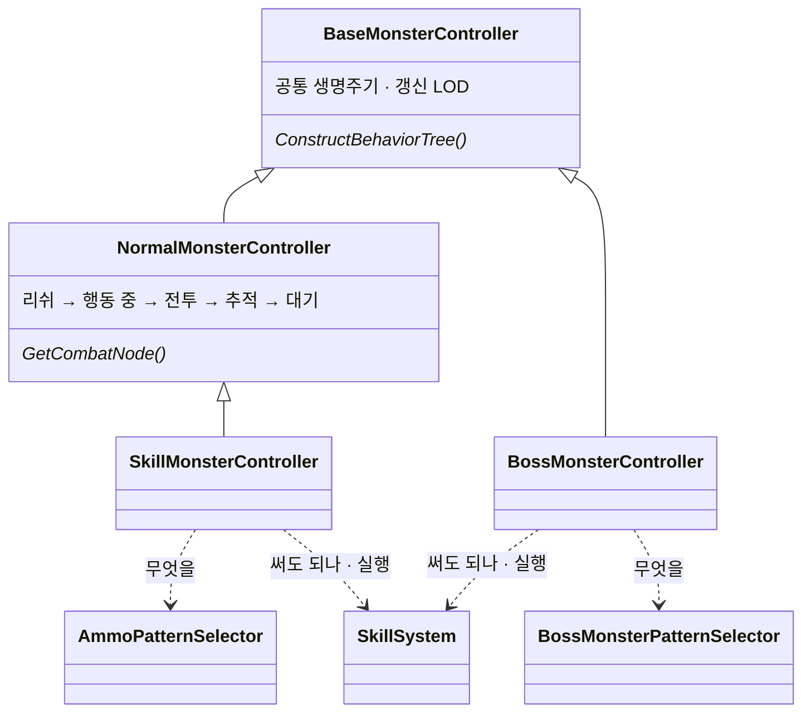

**관련 코드**
- [[📄BaseMonsterController.cs]](https://github.com/vfly1189/OperationKivotos-Code/blob/main/Assets/Scripts/Controllers/Monster/BaseMonsterController.cs)
- [[📄NormalMonster 행동 트리 구성 함수]](https://github.com/vfly1189/OperationKivotos-Code/blob/b64235f6042137cc6488aed291025114858b973c/Assets/Scripts/Controllers/Monster/NormalMonsterController.cs#L170-L197)
- [[📄SkillMonsterController.cs (일반몹 전투 노드)]](https://github.com/vfly1189/OperationKivotos-Code/blob/main/Assets/Scripts/Controllers/Monster/SkillMonsterController.cs)
- [[📄BossMonsterController.cs]](https://github.com/vfly1189/OperationKivotos-Code/blob/main/Assets/Scripts/Controllers/Monster/Boss/BossMonsterController.cs)

  <a href="#toc-bluearchive">⬆️ 프로젝트 목차로 돌아가기</a>

 

 

<h3>🖥️ UI 렌더링 최적화 및 이벤트 분리</h3>

 

**구현 목적**
- 매 프레임 UI를 강제 갱신하며 발생하는 CPU 오버헤드와 **Canvas 전체 Rebuild로 인한 Draw Call 문제** 해결

**주요 구현 내용**
- **옵저버(Observer) 패턴 기반 데이터-UI 분리**
  - C# `Action/Delegate`를 활용하여 체력 변화, 아이템 획득 등 **데이터 변동이 발생한 순간에만 이벤트를 브로드캐스트**
  - UI는 이벤트 수신 시에만 화면을 갱신하도록 설계하여 불필요한 `Update()` 연산 제거

- **목적별 Canvas 분할 최적화**
  - 모든 요소를 단일 캔버스에 넣지 않고, 갱신 빈도에 따라 **4개의 Canvas**(`Scene`, `System`, `World`, `Popup`)로 격리
  - 체력바나 팝업 데미지(`World`)가 매 프레임 위치를 갱신하며 캔버스를 더럽히더라도, 정적인 기본 UI(`Scene`)는 **Rebuild 대상에서 제외되어 렌더링 부하 최소화 및 Draw Call 절약**
  

**관련 코드**
- [[📄UIManager.cs]](https://github.com/vfly1189/OperationKivotos-Code/blob/main/Assets/Scripts/Managers/Core/UIManager.cs)

  <a href="#toc-bluearchive">⬆️ 프로젝트 목차로 돌아가기</a>

 

 

---

 

## 🛠️ 문제 해결

### 1️⃣ 필드 몬스터 관리 : 거리 기반 활성화와 갱신 LOD 도입

> **🚨 문제 상황: 구역(Sector) 단위로 켜고 끄자, 경계에서 문제가 생겼다**
>
> - **처음 생각** : 포탈 없이 이어진 필드로 전환하며 맵을 구역(Sector)으로 나누고, 구역 Collider로 진입 · 탈출을 판정해 **플레이어가 들어간 구역의 스포너만 켰다.**
> - **따라오던 몬스터가 사라짐** : 구역 밖으로 나가면 싸우던 몬스터도 즉시 회수
> - **멀어도 같은 구역이면 켜짐** : 켜 둔 몬스터 중 대부분이 화면 밖에 존재
> - **경계를 넘는 순간 몰림** : 구역이 바뀌는 순간 **최대 119마리 동시 생성**
> - **맵마다 구역을 손으로 나눔** : 구역 분할 · 스포너 배정을 맵마다 다시 작업

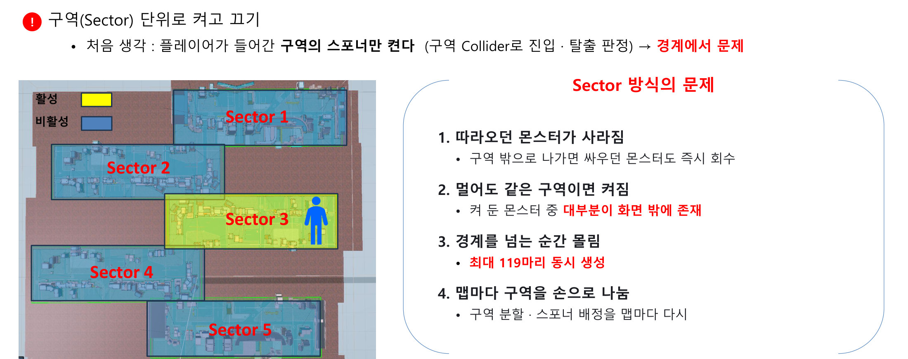

**🔍 원인 분석 : 보완해도 한쪽을 고치면 다른 쪽이 나빠졌다**
- **원인 1 · 회수 규칙** : 구역이 꺼지면 싸우던 몬스터도 바로 회수 → 모든 방식에 공통 규칙으로 **교전 유지 + 리쉬(귀환)** 를 추가
- **원인 2 · 판정 단위** : 모든 문제가 "구역 크기" 하나에 묶여 있음 — 구역을 키우면 활성 객체가 늘고, 줄이면 깜빡임이 늘어남 → **판정 단위 자체를 바꿔야 한다**

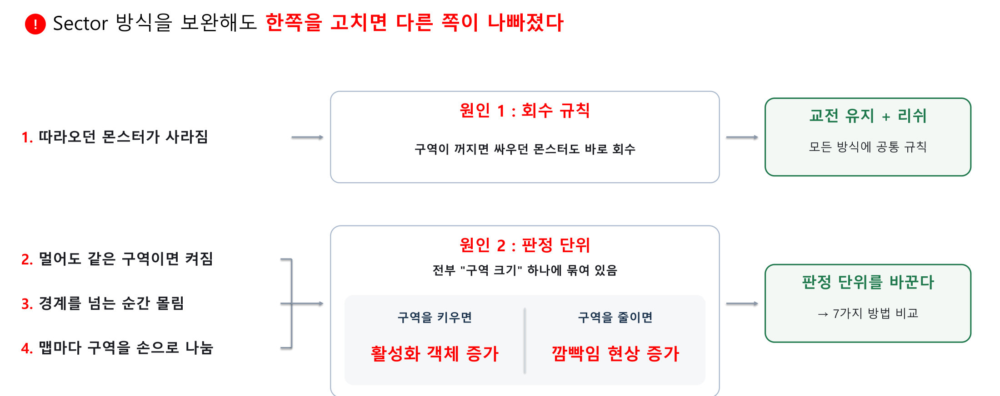

**💡 해결 과정**

1. **켜 둘 범위를 정하는 방법 7가지를 같은 조건에서 측정**
   - 판정 방식을 `ActivationPolicy`로 추상화하고, 같은 빌드 · 같은 자동 주행 5분 × 3회로 비교

   | 방식 | 살아 있는 몬스터 | 가장 느린 1% 프레임(p99) | 비고 | 판정 |
   |:---|:---:|:---:|:---|:---:|
   | ① Sector | 62마리 | 4.36ms | 깜빡임 136 · 등장 9 | 탈락 |
   | ② Sector + 인접 | 187마리 | 4.86ms | 깜빡임 114 · 풀 부족 | 탈락 |
   | ③ 격자 3×3 | 46마리 | 2.72ms | 깜빡임 77 | 탈락 |
   | ④ 격자 5×5 | 34마리 | 2.60ms | 깜빡임 19 | 탈락 |
   | **⑤ 거리** | **25마리** | **2.54ms** | **문제 없음** | **채택** |
   | ⑥ 격자 + 거리 | 25마리 | 2.54ms | 문제 없음 | 통과 |
   | ⑦ CullingGroup | 25마리 | 2.55ms | 문제 없음 | 통과 |

   - 통과한 ⑤ ⑥ ⑦은 켜는 스포너가 100% 동일(결과 · 비용 같음) → **가장 단순하고 카메라에 의존하지 않는 ⑤ 거리 채택** (켜기 20m / 끄기 25m)

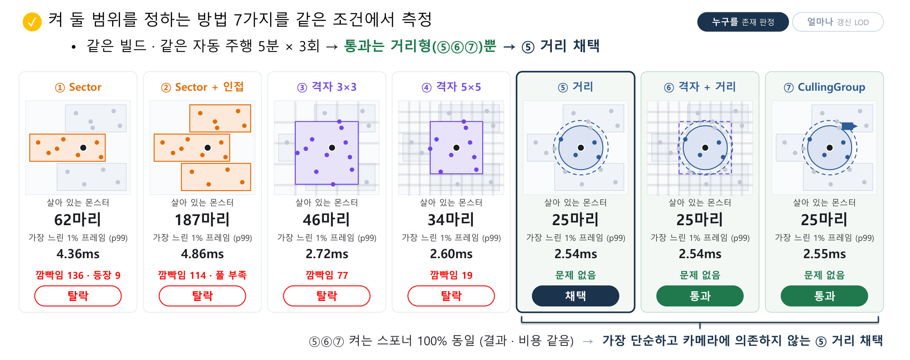

2. **갱신 LOD : 화면 밖에서 가만히 있는 몬스터는 덜 돌린다**
   - 살아 있는 몬스터의 **87%가 화면 밖** → 그중 **교전 중이 아닌 몬스터만** HP바 끔 · Behavior Tree 8프레임에 1번 · Animator 끔
   - 몬스터가 많을수록 효과가 커짐 — 밀도 ×4에서 −10%, ×8에서 −17%

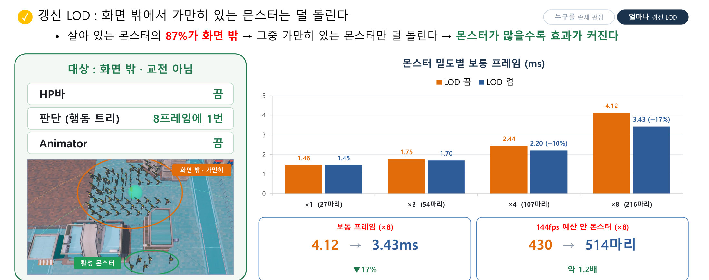

**✅ 결과 (최종 빌드 · 같은 경로 3회씩 재측정)**

| 항목 | Sector | 거리 | 변화 |
|---|:---:|:---:|:---:|
| 살아 있는 몬스터 (평균) | 62마리 | 25마리 | **▼60%** |
| 가장 느린 1% 프레임 (p99) | 4.68ms | 2.50ms | **▼47%** |
| 60fps 미만 횟수 (3회 합) | 14번 | 0번 | **없어짐** |
| 한 번에 생기는 몬스터 (최대) | 119마리 | 17마리 | **몰림 해소** |
| 경계 왕복 깜빡임 | 136번 | 0번 | **없어짐** |
| 보통 프레임 (밀도 ×8, 갱신 LOD) | 4.12ms | 3.43ms | **▼17%** |
| 144fps 예산 안 몬스터 수 (×8) | 430마리 | 514마리 | **약 1.2배** |

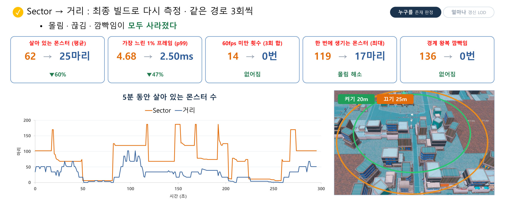

**관련 코드**
- [[📄DistanceActivation.cs (⑤ 거리 판정)]](https://github.com/vfly1189/OperationKivotos-Code/blob/main/Assets/Scripts/Managers/Activation/DistanceActivation.cs)
- [[📄ActivationPolicies.cs (7가지 방식 생성)]](https://github.com/vfly1189/OperationKivotos-Code/blob/main/Assets/Scripts/Managers/Activation/ActivationPolicies.cs)
- [[📄ActivationManager.cs (판정 실행 · 방식 간 결과 비교)]](https://github.com/vfly1189/OperationKivotos-Code/blob/main/Assets/Scripts/Managers/Activation/ActivationManager.cs)
- [[📄SpawnerManager.cs (활성화 · 갱신 LOD 적용)]](https://github.com/vfly1189/OperationKivotos-Code/blob/main/Assets/Scripts/Managers/Core/Field/SpawnerManager.cs)

  <a href="#toc-bluearchive">⬆️ 프로젝트 목차로 돌아가기</a>

 

 

### 2️⃣ 전투 행동 설계 : 흐름과 행동 분리를 통한 확장

> **🚨 문제 상황: 흐름까지 부품으로 만들어서, 분기가 생길 때마다 새 클래스가 필요했다**
>
> - **기존 AbilitySystem** : 캐스터마다 흩어져 있던 공격 발동을 `AbilityRunner` 한 곳으로 모으고, 공격을 부품(SO)으로 조립하는 구조. 다만 **흐름(순서 · 대기 · 분기)도 행동(발사 · 장판 · 소환)도 같은 부품**이었다.
> - **흐름과 행동은 다르다** : 행동은 한 순간에 끝나지만, 흐름은 시간과 상태를 가진다.
> - **흐름을 부품으로 만들면** : ① 블록 코딩이 되어 **분기 키워드마다 새 부품 클래스**가 필요하고, ② 분기 결과(고른 색 등)를 저장할 곳이 없어 **부품 밖 컨트롤러**에 두게 된다.
> - 예) 보스의 유물 포격 — 트리를 펼쳐 보면 `if (색 == 빨강) for (안쪽 8발) … else for (바깥 70발) …` 과 같은, **트리가 곧 코드**인 상태

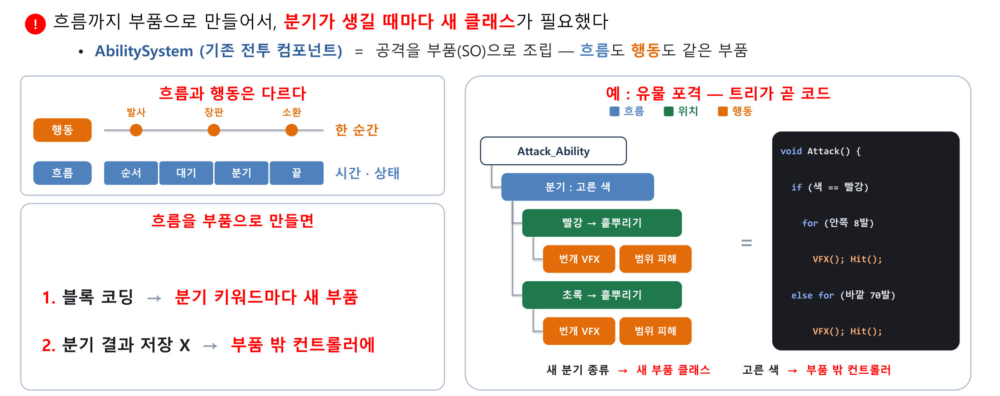

**💡 해결 과정**

1. **흐름은 Timeline 위에, 행동은 그 순간에만**
   - 흐름 = 애니메이션 · Timeline + 태그 신호, 행동 = Event 하나 — **행동은 흐름을 품지 않는다**
   - `Runner`(수명 : 패턴의 시작 → 끝 · 사망 / 회수 시 취소) ➔ `Action`(흐름 : Timeline) ➔ `Task`(신호 : 태그 · 조건이 맞을 때만) ➔ `Event`(행동)
   - 분기 결과는 `PatternMemo`(칠판)에 — 고른 색 · 경고 위치를 패턴 동안 기억하고, 패턴마다 비움

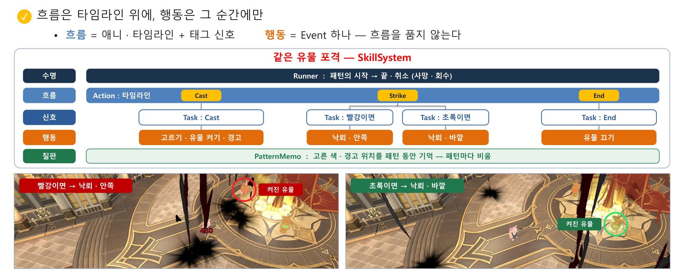

2. **고르는 곳과 실행하는 곳을 나눴다**
   - 선택기 = 무엇을 쓸까 → `SkillSystem` = 쓸 수 있나? → 시작 → `Runner` 실행 → `PatternEnded` = 끝났다 → 다음 패턴
   - 보스 선택기(HP선을 넘으면 기믹 한 번 · 평소 가중치 추첨)와 일반몹 선택기(탄 있으면 공격 · 없으면 재장전)만 다르고, **SkillSystem은 같은 코드**

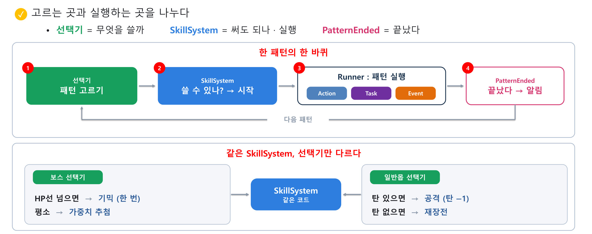

3. **행동 하나 = 무엇을 + 횟수 · 간격 + 어디에**
   - 세 가지를 따로 정해서 조합 — **하나를 바꿔도 나머지는 그대로**
   - 예1) 조여오는 번개 = 내려치기 + 12개씩 · 0.15초 + 원 · 반경 8 → 0
   - 예2) 몬스터 소환 = 소환 + 1마리씩 · 0.3초 + 지정 위치 4곳

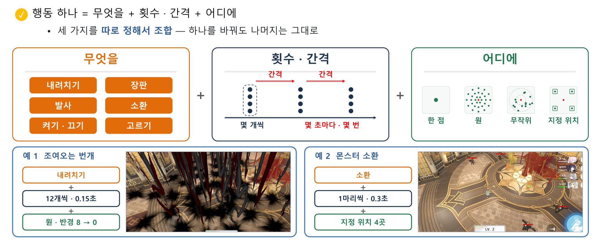

**✅ 결과 — 일반몹과 보스가 같은 구조 위에서 돈다**
- 일반몹(Tank)과 보스(Hieronymus) 모두 `Pattern → Action → Task → Event` — **다른 것은 조립과 값뿐**
- 새 분기 종류가 생겨도 부품 클래스가 아니라 **Timeline의 신호와 Task 조건**으로 표현

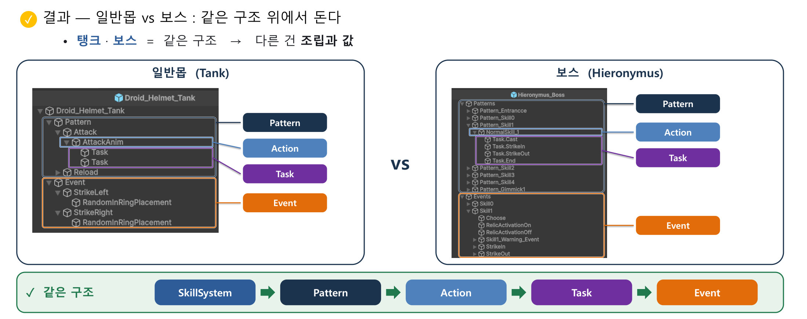

**관련 코드**
- [[📄SkillSystem.cs]](https://github.com/vfly1189/OperationKivotos-Code/blob/main/Assets/Scripts/SkillSystem/SkillSystem.cs)
- [[📄PatternRunner.cs (Action 진행 · 신호 → Task)]](https://github.com/vfly1189/OperationKivotos-Code/blob/main/Assets/Scripts/SkillSystem/PatternRunner.cs)
- [[📄TimelineAction.cs (흐름 = Timeline)]](https://github.com/vfly1189/OperationKivotos-Code/blob/main/Assets/Scripts/SkillSystem/TimelineAction.cs)
- [[📄PatternMemo.cs (칠판)]](https://github.com/vfly1189/OperationKivotos-Code/blob/main/Assets/Scripts/SkillSystem/PatternMemo.cs)
- [[📄StrikeEvent.cs (행동 예 : 내려치기)]](https://github.com/vfly1189/OperationKivotos-Code/blob/main/Assets/Scripts/Pattern/Event/StrikeEvent.cs)

  <a href="#toc-bluearchive">⬆️ 프로젝트 목차로 돌아가기</a>

 

 

### 3️⃣ 리소스 수명 관리 : 2버킷 구조의 한계와 수명 스코프 도입

> **🚨 문제 상황: 버킷이 2개뿐이라, 수명이 애매한 리소스는 전부 Global에 쌓인다**
>
> - 매니저 한 곳이 로드 · 핸들 · 수명을 전부 소유하는 구조에서, 재로딩을 없애려 핸들을 캐싱해 보관하기 시작.
> - 담는 통이 `Global` · `Scene` 2개뿐이라, 파티 · 팝업 · 던전처럼 수명이 애매한 리소스가 전부 안전한 쪽인 `Global`로 도피 — **Global은 해제 경로가 없어 세션 내내 상주**.
> - Addressables는 자체 refCount를 갖지만 증감의 짝맞춤 책임을 호출자에게 위임한다 — 실제 호출부는 46개 파일 · 130곳이라, "누가 언제 Release를 부르는가"가 정해지지 않으면 그대로 새는 구조.

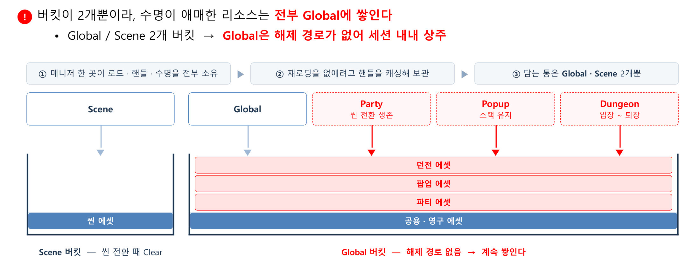

**💡 해결 과정**

1. **책임을 3층으로 분리 (Manager / Scope / Registry)**
   - `ResourceManager`(라우팅) → `ResourceScope`(수명 티켓 · 키 집합) → `ResourceRegistry`(핸들 · refCount) → `Addressables`(실제 I/O).
   - 실제 로드는 레지스트리 한 곳에서 첫 요청 1번만 일어나고, 같은 키의 재요청은 캐시에서 반환 — 요청이 늘어도 늘어나는 것은 로드가 아니라 refCount.

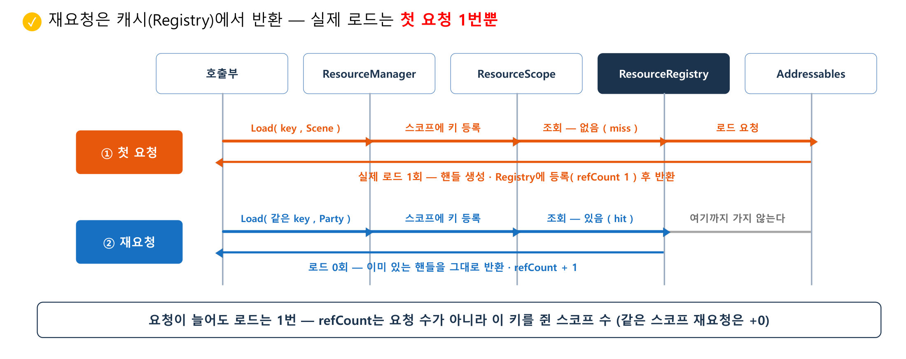

2. **수명 스코프를 2종 → 4종으로 확장**
   - `Global`(종료까지) · `Scene`(씬 전환) · `Party`(씬 전환을 넘어 생존) · `Popup`(스택 0→1 생성, 1→0 Dispose).
   - 각 스코프는 자기가 잡은 키만 `Dispose()` 시점에 -1 — 팝업을 모두 닫으면 `Popup Scope`가 소멸하며 자신이 가진 키만 정산되고, 다른 스코프가 같은 키를 아직 쥐고 있으면 메모리가 유지된다.

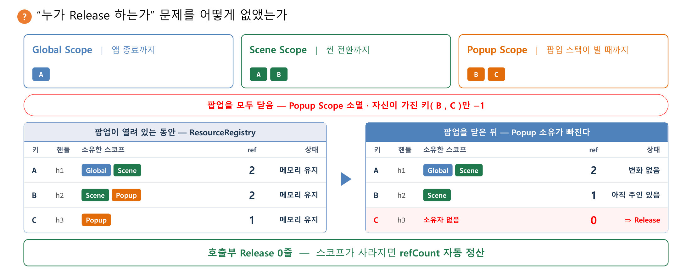

3. **"Addressables가 이미 세는데 왜 카운트를 하나 더 뒀는가"**
   - 세는 것은 Addressables가 하지만, **언제 줄일지는 사람이 직접 작성해야 한다.** 스코프 층은 "이제 필요 없다"는 도메인 신호를 refCount 감소로 번역하는 역할.
   - 결과적으로 해제 짝맞춤 지점이 **호출부 130곳 → 수명 경계(씬 전환 · 팝업 스택 0 · 파티 해체) 개수**로 압축됨.

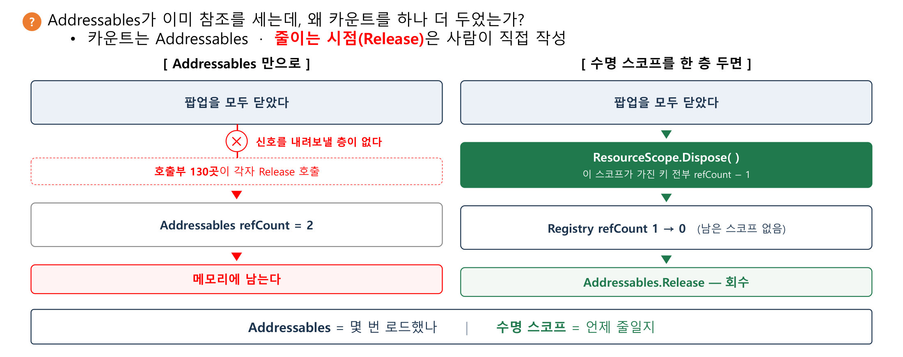

4. **오브젝트 풀 · 아틀라스 캐시까지 수명 통합**
   - 풀이 원본 프리팹의 refCount 티켓을 직접 획득(`AcquirePoolRef`)하여, 씬 전환 시 원본이 언로드되어 풀 인스턴스가 깨지는 창을 구조적으로 차단.
   - 아틀라스에서 뽑은 클론 Sprite 캐시를 레지스트리의 `OnReleased` 이벤트에 맞춰 함께 파기 — 캐시가 핸들을 붙잡아 회수가 무효화되는 것 방지.

**✅ 결과 (같은 경로 · 같은 체크포인트 Before / After, 호출부에 추가한 Release 0줄)**

| 항목 | Before | After | 변화 |
|---|:---:|:---:|:---:|
| Global 상주 메모리 (진입 직후) | 513MB | 205MB | **▼60%** |
| 전체 리소스 메모리 (진입 직후) | 617MB | 363MB | **▼41%** |
| 던전 왕복 후 남는 메모리 | +18.7MB | ≈0MB | **쌓이지 않음** |
| 대가 : 팝업 첫 오픈 | — | +14 ~ 20ms | 다시 열 때는 그대로 |

- 개발 빌드 텍스처 메모리 : 팝업 5종 첫 오픈 **+28.1MB** → 던전 왕복 후 **−26.7MB 반납** → 다시 열고 다시 오가도 **증가 0MB**
- 해제 짝맞춤 지점 : 호출부 **130곳 → 수명 경계 개수**로 압축.

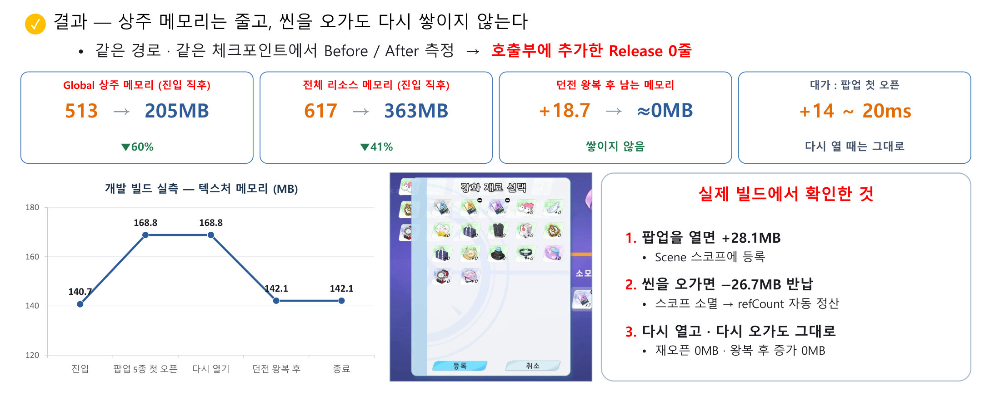

**관련 코드**
- [[📄ResourceScope.cs (수명 티켓)]](https://github.com/vfly1189/OperationKivotos-Code/blob/main/Assets/Scripts/Managers/Core/Resource/ResourceScope.cs)
- [[📄ResourceRegistry.cs (핸들 · refCount)]](https://github.com/vfly1189/OperationKivotos-Code/blob/main/Assets/Scripts/Managers/Core/Resource/ResourceRegistry.cs)
- [[📄ResourceManager.cs (스코프 라우팅)]](https://github.com/vfly1189/OperationKivotos-Code/blob/main/Assets/Scripts/Managers/Core/Resource/ResourceManager.cs)

  <a href="#toc-bluearchive">⬆️ 프로젝트 목차로 돌아가기</a>

 

 

---

 

# 🎮 이터널 리턴 모작

### 📌 프로젝트 정보

| 항목 | 내용 |
|:---:|:---:|
| 🎯 **장르** | 쿼터뷰, 배틀로얄, MOBA |
| ⏱️ **개발 기간** | 2025.07 ~ 2025.09 (2개월) |
| 👥 **개발 인원** | 2인 (프로그래머로 참여) |
| 🛠️ **개발 환경** | C++, DirectX11, HLSL |
| 🎬 **시연 영상** | [YouTube 바로가기](https://youtu.be/b6XVkd0xc-E?si=XHB1nkE6C2-JarC8) |
| 📝 **개발 블로그** | [상세 개발 과정](https://tobrother.tistory.com/category/DirectX11/Eternal%20Return%20%EB%AA%A8%EC%9E%91) |
| 💾 **GitHub** | [소스코드](https://github.com/HyangRim/DirectX11-Engine-Client) |

## 📑 프로젝트 목차

**1. 📖 [게임 개요](#overview-eternal)**

**2. 📌 [학습 목표 및 달성](#goals-eternal)**

**3. 🔨 [주요 개발 기능](#features-eternal)**  
&nbsp;&nbsp; └ [Deferred Rendering (Hybrid)](#deferred-rendering) 
&nbsp;&nbsp; └ [GPU Instancing](#gpu-instancing) 
&nbsp;&nbsp; └ [Quad Tree 공간 분할](#quad-tree) 
&nbsp;&nbsp; └ [NavMesh 길찾기](#navmesh) 
&nbsp;&nbsp; └ [몬스터 AI 시스템](#fsm-to-bt-feature)

**4. 🛠️ [문제 해결 (Troubleshooting)](#troubleshooting-eternal-return)**  
&nbsp;&nbsp; └ **[Hybrid 렌더링 (Forward → Deferred 전환)](#deferred-rendering-trouble)** 
&nbsp;&nbsp;&nbsp;&nbsp;&nbsp;&nbsp;  다중 광원 처리와 반투명 객체를 혼합한 **Hybrid 파이프라인 구축**

&nbsp;&nbsp; └ **[NavMesh 경로 스무딩](#navmesh-smoothing)** 
&nbsp;&nbsp;&nbsp;&nbsp;&nbsp;&nbsp;  Funnel + Bezier로 **코너 끼임 93쌍 → 0, 최대 회전 78.6° → 15.8°**

&nbsp;&nbsp; └ **[마우스 Picking + 충돌 처리 최적화 (Quad Tree)](#quadtree-optimization)** 
&nbsp;&nbsp;&nbsp;&nbsp;&nbsp;&nbsp;  검사할 후보만 남겨 충돌 처리 **135.8배 단축 (53,922μs → 397μs)**

&nbsp;&nbsp; └ **[NavMesh 검색 최적화](#navmesh-optimization)** 
&nbsp;&nbsp;&nbsp;&nbsp;&nbsp;&nbsp;  Spatial Grid 도입으로 탐색 속도 **21.5배 가속 (301μs → 14μs)**

&nbsp;&nbsp; └ **[AI 구조 개선 (FSM → BT)](#fsm-to-bt)** 
&nbsp;&nbsp;&nbsp;&nbsp;&nbsp;&nbsp;  Behavior Tree 도입으로 **복잡한 AI 로직의 유지보수성 확보**

  <a href="#table-of-contents">⬆️ 전체 목차로 돌아가기</a>

 

 

## 📖 게임 개요

**장르**: 쿼터뷰 배틀로얄 / MOBA (Multiplayer Online Battle Arena)

이터널 리턴은 전략적인 쿼터뷰 시점의 생존 게임입니다. 플레이어는 루미아 섬에서 재료 파밍하고 장비를 제작하여 캐릭터를 성장시키며, 최후의 1인이 될 때까지 생존해야 합니다.

**🔄 핵심 루프 (Core Loop)**
1. **파밍 및 제작**: 맵 곳곳의 재료 수집
2. **장비 강화**: 상위 등급 장비 제작으로 전투력 상승
3. **생존 경쟁**: 금지 구역 회피 및 다른 생존자와의 전투
4. **승리**: 최후의 1인 생존

**🎯 개발 초점**
- DirectX 11을 이용한 **3D 렌더링 파이프라인 구축**
- **엔진 레벨의 성능 최적화** 및 아키텍처 설계

  <a href="#toc-eternal">⬆️ 프로젝트 목차로 돌아가기</a>

 

 

## 📌 학습 목표 및 달성

> **"게임 엔진 레벨의 고급 렌더링 최적화 기법 습득"**

이 프로젝트의 핵심 목표는 상용 엔진 없이 DirectX 11 API로 3D 게임 엔진을 직접 구현하며, 대규모 리소스를 효율적으로 처리하는 최적화 기술을 체화하는 것이었습니다.

### 1️⃣ 고급 렌더링 파이프라인 구축
- **Deferred Rendering 도입**: 다수의 동적 광원(Point Light 등) 처리를 위해 Forward 방식 대신 Deferred 방식을 적용하여 연산 효율성 확보
- **G-Buffer 및 MRT 활용**: Albedo, Normal, Position 등 지오메트리 정보를 MRT(Multi Render Target)에 저장하여 라이팅 연산 최적화

### 2️⃣ 대규모 오브젝트 처리 최적화
- **GPU Instancing**: 동일한 메시를 사용하는 수천 개의 오브젝트(풀, 나무 등) 렌더링 시 발생하는 DrawCall 병목 현상 해결
- **Quad Tree 공간 분할**: 마우스 Picking과 충돌 검사의 후보를 줄여 **충돌 검사 135.8배 단축**

### 3️⃣ 3D 게임 엔진 기술 심화
- **NavMesh 길찾기**: 네비게이션 메쉬 위 A* 길찾기와 **Funnel + Bezier 경로 스무딩**으로 **코너 끼임 93쌍 → 0**
- **Skeletal Animation**: GPU Skinning 기반 캐릭터 애니메이션

**🧩 그 외 구현**
- **GRAPHICS & RENDERING** : Hybrid 렌더링(Forward / Deferred 혼합) · GPU Skinning
- **GAME LOGIC & ARCHITECTURE** : 몬스터 AI(FSM → Behavior Tree 리팩토링) · NavMesh 검색(Spatial Grid) · FSM 기반 스킬 · 쿨타임 매니저
 

  <a href="#toc-eternal">⬆️ 프로젝트 목차로 돌아가기</a>

 
 

---

 

## 🔨 주요 개발

<h3>🎨 Deferred Rendering 파이프라인 (Hybrid)</h3>

 

**렌더링 파이프라인 구조**
- **Hybrid 구조 설계**: 불투명 객체(Deferred)와 투명 객체(Forward)를 분리하여 처리하는 혼합 파이프라인 구축
- **MRT(Multiple Render Targets)**: 4개의 G-Buffer(Albedo, Normal, Position, Material)에 지오메트리 정보를 동시 출력하도록 셰이더 및 RTV 설정
- **Lighting Pass**: G-Buffer 텍스처를 입력받아 화면 전체에 조명 연산 수행
- | **Deferred Render** | **Hybrid ( Forward + Deferred )** |
  | :---: | :---: |
  |  |  |

**G-Buffer 구성 (MRT)**
- G-Buffer 4개 구성 (Albedo, Normal, Position, Material)
- 멀티 렌더 타겟(MRT)을 활용한 지오메트리 정보 저장
- 풀스크린 쿼드를 통한 라이팅 패스 구현
- | **Albedo** | **Normal** |
  | :---: | :---: |
  |  | |
  | **Position (World Space)** | **Material** |
  |  |  |

**렌더링 파이프라인 구조**
- Geometry Pass (Deferred): 불투명 객체의 지오메트리 정보를 G-Buffer에 저장 [[📄G-Buffer 셰이더]](https://github.com/HyangRim/DirectX11-Engine-Client/blob/master/Shaders/00.%20GBuffer.fx)
- Lighting Pass (Deferred): G-Buffer 데이터를 기반으로 조명 계산  [[📄Lighting 셰이더]](https://github.com/HyangRim/DirectX11-Engine-Client/blob/d0b9114a5d95640c568cfa5f0bffa8fb9e8c036b/Shaders/00.%20DeferredLighting.fx#L121-L169)
- Forward Pass (Transparent/UI): 투명/반투명 객체(알파 블렌딩, UI 등)를 Forward로 렌더링하여 최종 합성 [[📄UI 객체 셰이더]](https://github.com/HyangRim/DirectX11-Engine-Client/blob/master/Shaders/ImageShader.fx)

> **🚀 기술 도입 배경**: 다중 광원 처리를 위한 포워드 렌더링의 한계와 해결 과정은 하단 **[🛠️ 문제 해결](#deferred-rendering-trouble)** 파트에서 다룹니다.

  <a href="#toc-eternal">⬆️ 프로젝트 목차로 돌아가기</a>

 

 

<h3>🧬 인스턴싱 기반 렌더링 (GPU Instancing)</h3>

 

**구현 배경 및 목표**
- 넓은 필드에 배치된 수천 개의 나무, 풀, 환경 오브젝트로 인한 **DrawCall 병목 현상(CPU Overhead) 해결**
- 개별 DrawCall 발생을 억제하고, 동일한 메쉬를 사용하는 객체들을 한 번의 API 호출로 처리

**🛠️ 기술적 구현**
- **인스턴스 버퍼(Instance Buffer)**: `World Matrix` 및 색상 정보를 담은 버퍼를 별도로 생성하여 VS(Vertex Shader)에 전달
- **배칭(Batching) 시스템**: 매 프레임 렌더링 큐에 등록된 객체 중, 동일한 키(Mesh + Material)를 가진 객체를 자동으로 묶어서 처리
- **다양한 렌더러 지원**: 정적 메쉬뿐만 아니라 애니메이션이 포함된 객체도 인스턴싱 지원
  - [[📄MeshRenderer (정적 객체)]](https://github.com/HyangRim/DirectX11-Engine-Client/blob/d0b9114a5d95640c568cfa5f0bffa8fb9e8c036b/Engine/RenderManager.cpp#L311-L348)
  - [[📄AnimRenderer (애니메이션 객체)]](https://github.com/HyangRim/DirectX11-Engine-Client/blob/d0b9114a5d95640c568cfa5f0bffa8fb9e8c036b/Engine/RenderManager.cpp#L388-L435)

**📊 최적화 로직 비교**
| 구분 | 기존 방식 (Individual) | 개선 방식 (Instancing) | 효과 |
| :---: | :---: | :---: | :---: |
| **API 호출** | 객체 수(N)만큼 호출 | **1회 호출** (Batch 단위) | **CPU 오버헤드 최소화** |
| **데이터 전달** | 매번 상수 버퍼(CB) 갱신 | **인스턴스 버퍼**로 일괄 전달 | **버스 대역폭 효율화** |
| **확장성** | 오브젝트 증가 시 성능 급락 | 수천 개가 늘어도 **비용 일정** | **대규모 씬 처리 가능** |

  <a href="#toc-eternal">⬆️ 프로젝트 목차로 돌아가기</a>

 

 

<h3>🧱 쿼드 트리 (공간 분할 자료구조)</h3>

 

**자료구조 설계**
- **재귀적 노드 시스템**: `QuadTreeNode` 클래스가 4개의 자식 노드 포인터와 자신의 영역(BoundingBox) 정보를 가지는 트리 구조
- **동적 객체 관리**: 오브젝트의 위치가 변경될 때마다 트리의 노드를 갱신(Update)하거나 재삽입(Re-insert)하는 로직 구현

**핵심 기능**
- **공간 쿼리(Spatial Query)**: 특정 영역(절두체, 마우스 피킹 Ray)과 겹치는 노드만 빠르게 선별하는 인터페이스 제공
- **충돌 그룹 관리**: 노드 단위로 객체 리스트를 관리하여 인접한 객체끼리만 상호작용하도록 설계

**관련 이미지**
| **마우스 Picking 최적화** | **충돌 처리 최적화 (Collision)** |
| :---: | :---: |
|  |  |
| Ray와 교차하는 노드(Leaf Node)만 선별하여 정밀 검사 | 빨간색 영역의 객체는 초록색 영역에서만 검사 |

**관련 코드**
- [[📄QuadTree.h (헤더 설계)]](https://github.com/HyangRim/DirectX11-Engine-Client/blob/master/Engine/QuadTree.h)
- [[📄Node Insert (객체 삽입 로직)]](https://github.com/HyangRim/DirectX11-Engine-Client/blob/d0b9114a5d95640c568cfa5f0bffa8fb9e8c036b/Engine/QuadTree.cpp#L218-L257)

> **🚀 성능 최적화 사례**: 쿼드트리를 활용한 획기적인 충돌 처리 성능 개선(135배) 결과는 하단 **[🛠️ 문제 해결](#quadtree-optimization)** 파트에서 상세히 다룹니다.

  <a href="#toc-eternal">⬆️ 프로젝트 목차로 돌아가기</a>

 

 

<h3>🧭 NavMesh 길찾기 시스템</h3>

 

**시스템 아키텍처**
- **NavMesh 데이터**: 맵 데이터를 삼각형(Triangle) 그래프 형태로 변환하여 이동 가능 영역 정의
- **경로 탐색(Pathfinding)**: 시작점과 도착점이 포함된 삼각형을 찾고, A* 알고리즘으로 연결된 삼각형들의 최단 경로 리스트 산출

**경로 스무딩 (Funnel + Bezier)**
- **Funnel**: A* 통로의 벽 쪽 끝을 R(= 몸 반경 × 1.5)만큼 줄인 뒤, 경로가 꺾이는 **벽 꼭짓점(코너)** 을 직접 찾음
- **Bezier**: 코너 꼭짓점을 기준으로 진입 · 진출 방향의 곡선을 만들어, **벽에서 몸 반경만큼 띄운 채 코너를 가깝고 둥글게 돎**
- 초기 버전은 삼각형 중심을 잇는 경로를 `Line-of-Sight` 검사로 펴는 방식이었으나, 코너 끼임이 발생해 교체 [[📄초기 LOS 스무딩]](https://github.com/HyangRim/DirectX11-Engine-Client/blob/d0b9114a5d95640c568cfa5f0bffa8fb9e8c036b/Engine/NavMesh.cpp#L307-L360)
- **Agent FSM**: AI 캐릭터의 이동 상태(Idle, Move)를 관리하고 NavMesh 위로 위치를 투영(Projection)하는 에이전트 클래스 구현

**관련 이미지 (초기 LOS 스무딩)**
| **A* 원본 경로** | **LOS 스무딩 적용** |
| :---: | :---: |
|  |  |

> **🚀 경로 스무딩 개선**: LOS 스무딩이 코너 끼임을 만든 원인과 Funnel + Bezier로 바꾼 과정은 하단 **[🛠️ 문제 해결](#navmesh-smoothing)**,
> 경로 탐색 병목을 해결한 'Spatial Grid' 기법은 **[🛠️ 문제 해결](#navmesh-optimization)** 파트에서 다룹니다.

  <a href="#toc-eternal">⬆️ 프로젝트 목차로 돌아가기</a>

 

 

<h3>🤖 몬스터 AI 시스템 (Behavior Tree)</h3>

 

**시스템 개요**
- **Behavior Tree (BT) 아키텍처**: 몬스터의 행동을 계층적 트리 구조로 설계하여 복잡한 의사결정 로직을 체계화
- **노드 구성**:
    - **Composite**: `Selector`(우선순위 선택), `Sequence`(순차 실행)
    - **Decorator**: 조건 검사 (`CheckHP`, `CheckRange` 등)
    - **Leaf**: 실제 행동 수행 (`Move`, `Attack`, `Die` 등)

**AI 행동 패턴 (우선순위)**
- **Selector 노드**를 통해 왼쪽부터 실행 가능성을 판단하여 가장 높은 우선순위 행동을 수행하도록 설계
1.  **생존 본능 (최우선)**: HP가 0 이하일 경우 즉시 `Die` 상태로 전이
2.  **전투 (Combat)**: 공격 사거리 내에 타겟이 있으면 `Attack` 수행
3.  **추적 (Trace)**: 타겟이 감지 범위 내에 있으면 NavMesh 경로를 따라 이동
4.  **대기 (Idle)**: 위 조건이 모두 해당하지 않을 경우 대기 상태 유지

**관련 이미지**
| **AI 행동 트리 구조 (시각화)** | **인게임 AI 동작 (추적 → 공격 → 사망)** |
| :---: | :---: |
|  |  |

**관련 코드**
- [[📄BehaviorTree.h (트리 노드 설계)]](https://github.com/HyangRim/DirectX11-Engine-Client/blob/master/Engine/BehaviorTree.h)
- [[📄WolfAI.cpp (몬스터 트리 구성)]](https://github.com/HyangRim/DirectX11-Engine-Client/blob/5d9aa0d9b421b32bf8004703d286ba5dbfd8bac5/Client/Wolf.cpp#L281-L319)

> **🚀 아키텍처 개선 사례**: 기존 FSM 구조의 한계(유지보수성 저하)를 극복하기 위해 Behavior Tree로 전환한 과정과 기술적 의사결정 내용은 하단 **[🛠️ 문제 해결](#fsm-to-bt)** 파트에서 상세히 다룹니다.

  <a href="#toc-eternal">⬆️ 프로젝트 목차로 돌아가기</a>

---

 

## 🛠️ 문제 해결

### 1️⃣ Forward에서 Deferred Rendering으로 전환 (Hybrid)

> **🚨 문제 상황: Forward Rendering의 구조적 한계**
> 
> **성능 병목** : 다수의 동적 광원(Skill Effects, Lights)이 배치되자 $O(\text{객체 수} \times \text{광원 수})$의 연산량으로 인해 프레임이 급격히 저하됨
> 
> **픽셀 오버드로우** : 화면에 보이지 않는 픽셀까지 불필요하게 셰이딩 연산을 수행하여 GPU 자원을 낭비함

**💡 해결 과정**

1.  **Deferred Rendering (지연 렌더링) 구현**
    *   **G-Buffer (MRT) 구축** : 4개의 Render Target에 물체의 정보를 동시에 기록하도록 셰이더 및 RTV 설정
        *   `Albedo`(색상), `Normal`(법선), `Position`(좌표), `Material`(재질)
        *   | **G-Buffer 실시간 구성 (MRT Debug View)** | 
            | :---: |
            |  |
    *   **Lighting Pass** : G-Buffer 데이터를 샘플링하여 화면 전체(Screen Space)에 조명 연산 수행. 연산량을 **$O(\text{화면 해상도} \times \text{광원 수})$** 로 고정하여 객체 수 증가에 따른 성능 저하 방지

2.  **Hybrid Rendering으로 파이프라인 완성**
    *   **문제** : Deferred 방식의 구조적 한계로 인해 투명/반투명 객체(Alpha Blending) 처리가 불가능
    *   **해결 (Hybrid)** : 렌더링 파이프라인을 이원화하여 각 패스의 장점 결합
        *   **불투명 객체 (Opaque)** : Deferred Pass로 처리하여 다중 광원 연산 최적화
        *   **반투명/UI 객체 (Transparent)** : Lighting Pass 이후 Forward Pass로 렌더링하여 알파 블렌딩 정상 처리
    * | **Deferred Only (반투명/UI 미적용)** | **Hybrid (Deferred + Forward)** |
      | :---: | :---: |
      |  |  |

**✅ 결과**
*   **표현력 향상**: Deferred의 이점(많은 광원)과 Forward의 이점(반투명 처리)을 모두 확보하여 화려한 게임 씬 구성 가능
*   **G-Buffer 시각화**: 각 Render Target이 정상적으로 출력됨을 디버깅 모드로 확인
  

  <a href="#toc-eternal">⬆️ 프로젝트 목차로 돌아가기</a>

 

 

### 2️⃣ NavMesh 경로 스무딩 : 지그재그 A* 경로를 어떻게 펼 것인가

> **🚨 문제 상황: 코너에서 캐릭터가 멈춘다 (1,000쌍 중 93쌍)**
>
> - **구조** : A* 경로는 삼각형 중심점을 잇는 지그재그라, `Line-of-Sight`(시야 판정)로 "통과하는 가장 먼 점"까지 건너뛰어 경로를 폈다.
> - **원인** : 코너를 끼고 돌도록 판정을 **후하게(허용 오차 띠)** 잡았더니, 띠 안이라는 이유로 통과 판정이 나 **경로가 벽 안을 지나감** → NavMesh 밖으로 나간 캐릭터가 코너에서 끼임
> - 무작위 시작 · 도착 1,000쌍 중 **93쌍**에서 발생

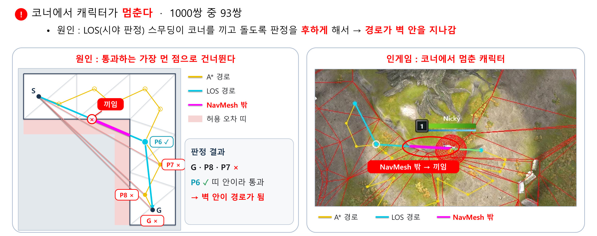

**💡 해결 과정**

1. **시도 : 같은 규칙 그대로, 판정만 엄격하게 하면?**
   - 직선이 A* 통로 삼각형 안에만 있어야 통과하도록 판정을 바꿨다 → **끼임은 0이 됐지만** 중심점에서 꺾여 최대 회전이 **86°** 로 부자연스러운 이동

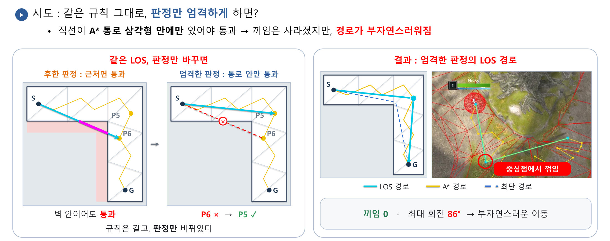

2. **왜 Funnel + Bezier로 갔는가**
   - 판정을 바꿔도 후보는 여전히 **삼각형 중심점** — 중심점에 얽매여 있었다
   - 목표는 최단 경로가 아니라 **자연스러운 이동** → 코너를 가깝게 돌아야 하는데, **중심점에는 코너 정보가 없다** → 코너를 직접 찾아야 한다

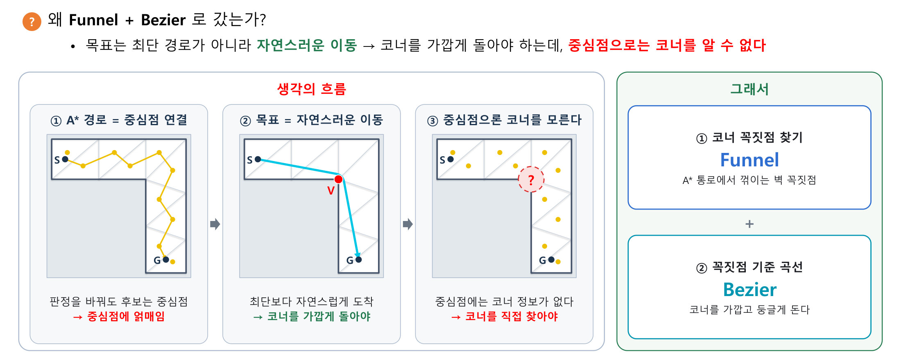

3. **코너 꼭짓점 V를 기준으로 Bezier 곡선을 만든다**
   - **Funnel** : 벽 쪽 통로 끝을 R(= 몸 반경 r × 1.5)만큼 줄여, 경로가 코너 꼭짓점 V에서 R 떨어진 곳에서 꺾이게 한다
   - **새 점 A** : Funnel이 낸 꺾인 점은 버리고, 진입 · 진출 방향으로 새 점 A를 정한다
   - **곡선** : A 앞뒤 직선 위 d 지점을 곡선의 시작 · 끝으로 잡고, 곡선의 한가운데가 V에서 r(몸 반경)만큼 떨어지도록 d를 정한다 — A는 곡선을 당기기만 하고 지나지 않는다

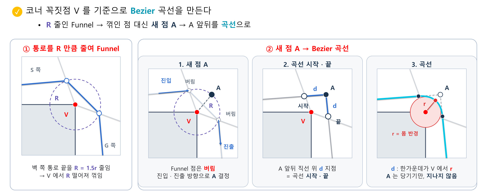

**✅ 결과 — 끼임 0, 꺾임은 가장 작고 벽 여유는 가장 크다 (몬스터 이동에도 그대로 적용)**

| 방식 | 끼임 | 최대 회전 | 벽 여유 ↑ | 스무딩 1회 |
|:---|:---:|:---:|:---:|:---:|
| LOS (후한 판정) | 93쌍 | 78.6° | 0.000 | 16.4ms |
| LOS (엄격한 판정) | 0 | 86.1° | 0.194 | 11μs |
| Funnel | 0 | 37.7° | 0.136 | 13μs |
| **Funnel + Bezier** | **0** | **15.8°** | **0.296** | **45μs** |

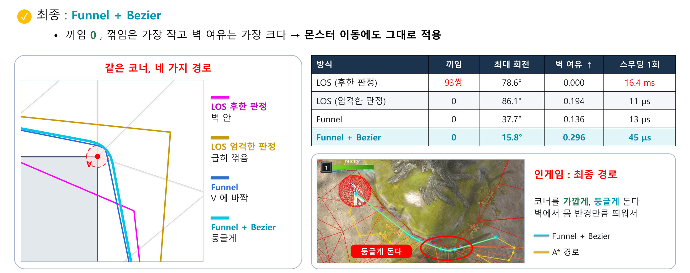

  <a href="#toc-eternal">⬆️ 프로젝트 목차로 돌아가기</a>

 

 

### 3️⃣ Quad Tree 기반 공간 분할 : 마우스 Picking + 충돌 처리 최적화

> **🚨 문제 상황: 객체 1,000개 이상을 매 프레임 전부 검사**
> 
> *   **비용 구조** : 마우스 Picking은 클릭마다 $O(N)$, 충돌 검사는 매 프레임 $O(N^2)$ — 객체가 10배 늘면 충돌 검사는 100배로 늘어난다
> *   **비효율적 연산** : N = 1,000 이상이면 충돌 검사만으로 프레임마다 약 50만 쌍을 검사하는데, 대부분은 화면 밖 · 멀리 떨어진 객체
> *   **목표** : Picking과 충돌 처리를 **한 구조로** 함께 빠르게 — 검사할 후보를 줄이는 공간 분할

**💡 해결 과정**

1.  **쿼드 트리(Quad Tree) 도입 이유 (Why?)**
    *   **2D 기반 최적화** : 게임 시점이 **쿼터뷰(Quarter View)** 고정형이므로, 높이(Y축)에 대한 복잡한 분할(Octree) 대신 평면 분할만으로 충분
    *   **게임 기획 특성** : 근접 전투 중심이며 원거리 투사체 · 맵 전체 스킬이 없어, 화면 내 로직 처리에 집중하는 것이 효율적
    *   **개발 자원** : 난이도 · 일정 대비 충분한 효과

2.  **기능 구현 및 최적화 전략**
    *   **공간 분할**: 맵 전체를 4분면으로 재귀적으로 분할하여 객체를 노드(Node) 단위로 관리
    *   **계층적 충돌 검사 (Hierarchical Collision Check)**:
        *   **내부 검사 (Internal)**: 동일한 Leaf Node에 속한 객체끼리만 검사.
        *   **경계 검사 (Boundary)**: 노드의 경계선에 걸쳐있는 객체(Parent Node 소속)는 하위 노드(Child Node)의 객체들과 교차 검사 수행.
        *   [[📄QuadTree 충돌 로직]](https://github.com/HyangRim/DirectX11-Engine-Client/blob/d0b9114a5d95640c568cfa5f0bffa8fb9e8c036b/Engine/QuadTree.cpp#L945-L1113)
        *   [[📄QuadTree 쿼리]](https://github.com/HyangRim/DirectX11-Engine-Client/blob/d0b9114a5d95640c568cfa5f0bffa8fb9e8c036b/Engine/QuadTree.cpp#L259-L278)
    
    *   | **충돌 검사 시각화 (빨간색 객체는 초록색 영역만 검사)** |
        | :---: |
        |  |

**✅ 결과**
*   **마우스 Picking** : 전체 검사 대비 **4.6배** 속도 향상 (656μs → **142μs**)
*   **충돌 처리** : $O(N^2)$ 비용을 줄여 **135.8배** 속도 향상 (53,922μs → **397μs**, 객체 1,118개)
*   | **Picking 최적화 (Ray-Node 검사)** | **결과** |
    | :---: | :---: |
    |  | |
*   | **충돌 처리 최적화 (Node 내부 검사)** | **결과** |
    | :---: | :---: |
    |  |  |

**🤔 남은 한계 → 개선 방향**
- **빌드 비용 역전** : 객체가 많을수록 트리 빌드 비용이 탐색 비용을 넘어서고, 잦은 할당 / 해제가 발생 → **정적 / 동적 트리 분리**, **메모리 풀링으로 재할당 제거**
- **화면 밖 충돌 누락** : 화면 밖 로직을 정지하면 그쪽 충돌도 무시됨 → **Frustum 영역만 렌더링 검색**, **활성 청크 기반 시뮬레이션**

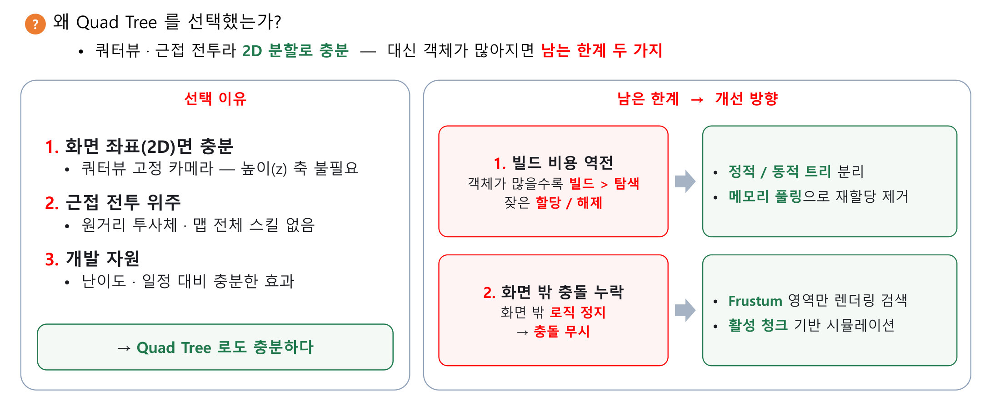

  <a href="#toc-eternal">⬆️ 프로젝트 목차로 돌아가기</a>

 

 

### 4️⃣ NavMesh 검색 속도 최적화 (Spatial Grid)

> **🚨 문제 상황: 선형 탐색(Linear Search)으로 인한 병목**
> 
> *   **구조적 문제** : 캐릭터가 이동할 때마다 현재 위치를 NavMesh 위의 유효한 지점으로 보정하기 위해 `GetNearestPointOnNavMesh`를 호출.
> *   **성능 저하** : 별도의 공간 분할 없이 구현된 초기 로직은 맵 전체의 삼각형(20,000개+)을 순차적으로 검사하는 $O(N)$ 비용 발생
> *   **코드 병목** : `GetNearestPointOnNavMesh` 내부에서 모든 삼각형과의 거리를 계산하는 반복문이 매 프레임 실행됨. [[📄GetNearestPointOnNavMesh()]](https://github.com/HyangRim/DirectX11-Engine-Client/blob/d0b9114a5d95640c568cfa5f0bffa8fb9e8c036b/Engine/NavMesh.cpp#L93-L129)

**💡 해결 과정**

1.  **공간 분할(Spatial Partitioning) 도입**
    *   맵 전체를 일정 크기의 **그리드(Grid)** 형태로 분할하고, 각 셀에 포함된 삼각형을 `unordered_map`에 저장
    *   [[📄NavMesh.h :: SpatialGrid]](https://github.com/HyangRim/DirectX11-Engine-Client/blob/d0b9114a5d95640c568cfa5f0bffa8fb9e8c036b/Engine/NavMesh.h#L31-L81)

2.  **검색 알고리즘 최적화 ( $O(N) \rightarrow O(k)$, $k \ll N$ )**
    *   **해시맵(`unordered_map`) 활용** : 입력된 월드 좌표를 키(Key)로 변환하여 셀에 즉시 접근하고, 해당 셀에 등록된 소수의 삼각형(k개, $k \ll N$)만 검사하도록 로직 변경
    *   **탐색 범위 축소** : 전체 삼각형을 순회하는 대신, 해당 셀에 등록된 **소수의 삼각형만 검사** 하도록 로직 변경
      *   | **Grid** |
          | :---: |
          |  |
    *   [[📄NavMesh.cpp :: FindTriangleContaining]](https://github.com/HyangRim/DirectX11-Engine-Client/blob/d0b9114a5d95640c568cfa5f0bffa8fb9e8c036b/Engine/NavMesh.cpp#L463-L500)

**✅ 결과**
*   **성능 검증** : 탐색 소요 시간 **301μs → 14μs** (약 **21.5배** 성능 향상)
*   **확장성 확보** : 맵 크기가 커지거나 삼각형이 늘어나도 탐색 비용이 일정하게 유지됨
*   | **Linear Search (최적화 전)** | **Spatial Grid (최적화 후)** |
    | :---: | :---: |
    |  |  |
*   | **Case 1** | **Case 2** |
    | :---: | :---: |
    |  |  |

  <a href="#toc-eternal">⬆️ 프로젝트 목차로 돌아가기</a>

 

 

### 5️⃣ 몬스터 AI 아키텍처 개선: FSM → Behavior Tree

> **🚨 문제 상황**
>
> **"FSM에서 상태/전이 조건이 증가하면서 유지보수성 급격히 악화"**
>
> - **파일 폭증** : Wolf 몬스터 1종에 상태 8개(Appear/Attack/Attack1/Death/Dying/Run/Trace/Wait)만 구현해도 **파일 16개** (.cpp + .h)가 생성됨
> - **전이 로직 분산** : 각 상태 클래스 내부에 "다음 상태로 언제 전환할 것인가"를 결정하는 조건이 흩어져 있어, 전체 흐름을 파악하기 어려움
> - **확장 비용 증가** : 새로운 행동(예: Skill) 추가 시, 기존의 여러 상태 클래스를 수정해야 하므로 사이드 이펙트 발생 위험 증가

**💡 해결 과정** [[📄BehaviorTree]](https://github.com/HyangRim/DirectX11-Engine-Client/blob/master/Engine/BehaviorTree.h)

**"계층적 우선순위 구조의 Behavior Tree 도입"**

- **Selector 기반 우선순위 판단** :
  - 루트 노드를 `Selector`로 설정하여 왼쪽(상위)에서 오른쪽(하위)으로 조건을 검사하며, 가장 먼저 성공하는 행동만 수행하도록 설계
  - 우선순위: **생존(사망 체크) > 전투(공격) > 추적(이동) > 대기(Idle)**

- **Sequence 노드로 조건-행동 묶음 구성** :
  - 각 행동을 `Sequence`로 구성하여 "조건 체크 → 행동 실행"을 하나의 논리 단위로 캡슐화
  - 예: `[HP <= 0 체크] → [Die()]` / `[사거리 내 체크] → [Attack()]`

- **상태 간 결합도 제거** :
  - 기존 FSM에서는 `TraceState` 내부에 "거리가 가까우면 AttackState로 전환" 코드가 있었으나, BT에서는 각 노드가 독립적으로 조건만 체크
  - 전환 로직은 부모 노드(Selector)가 자동으로 처리하므로, 노드 간 의존성 사라짐

**🤔 기술적 의사결정: 왜 Behavior Tree인가?**

**1. 우선순위의 구조화**
  - FSM에서는 "어떤 상태가 우선인가?"를 코드 곳곳에 숨겨진 `if`문으로 결정했으나, BT는 **트리 구조 자체**가 우선순위를 명시함
  - 면접관이나 후임 개발자가 코드를 보지 않고도 다이어그램만으로 AI 로직의 우선순위를 직관적으로 파악 가능

**2. 모듈화와 재사용성**
  - `CheckHP`, `CheckAttackRange` 같은 조건 노드는 다른 몬스터에도 재사용 가능
  - 새로운 행동(예: Skill) 추가 시, 기존 노드를 수정할 필요 없이 새로운 Sequence 노드를 트리의 적절한 위치에 삽입만 하면 됨

**3. 디버깅 용이성**
  - 각 노드가 `SUCCESS`, `FAILURE`, `RUNNING` 상태를 명확히 반환하므로, 런타임에 어느 노드에서 실패했는지 추적 가능
  - FSM의 "상태 A에서 상태 B로 전환이 안 됨" 같은 모호한 디버깅 상황 감소

**✅ 결과**

| 비교 항목 | 기존 (FSM) | 개선 (Behavior Tree) |
| :---: | :---: | :---: |
| **핵심 구조** | 상태 (State) + 전이 (Transition) | 행동 (Action) + 우선순위 (Selector) |
| **흐름 제어** | 각 상태가 다음 상태를 직접 결정 | 부모 노드가 자식의 실행 여부 결정 |
| **결합도** | 상태끼리 서로 참조 (강한 결합) | 노드끼리 서로 모름 (독립적) |
| **확장성** | 상태 추가 시 기존 코드 수정 필수 | 노드만 추가하면 됨 (수정 불필요) |
| **우선순위** | 코드 로직에 숨겨져 파악 힘듦 | 트리 구조(왼쪽→오른쪽)로 직관적 |

**📊 구조 비교**

| **FSM 구조 (상태 전이 다이어그램)** | **Behavior Tree 구조** |
| :---: | :---: |
|  |  |
| *복잡하게 얽힌 상태 간 화살표* | *계층적으로 정리된 우선순위 구조* |

  <a href="#toc-eternal">⬆️ 프로젝트 목차로 돌아가기</a>

 
 

---

 

# 🎮 Brotato 모작

  

### 📌 프로젝트 정보

| 항목 | 내용 |
|:---:|:---:|
| 🎯 **장르** | 탑다운 슈팅, 로그라이크 서바이벌 |
| ⏱️ **개발 기간** | 2025.02 ~ 2025.03 (3주) |
| 👥 **개발 인원** | 2인 (프로그래머로 참여) |
| 🛠️ **개발 환경** | C++, Direct2D, Win32 API |
| 🎬 **시연 영상** | [YouTube 바로가기](https://youtu.be/d-VZS1AdvtA?si=zvILKb3qGncavOqS) |
| 💾 **GitHub** | [소스코드](https://github.com/HyangRim/BrotatoClone) |

## 📑 프로젝트 목차

**1. 📖 [게임 개요](#overview-brotato)**

**2. 📌 [학습 목표 및 달성](#goals-brotato)**

**3. 🔨 [주요 개발 기능](#features-brotato)**  
&nbsp;&nbsp; └ [렌더링 시스템](#rendering-system-brotato) 
&nbsp;&nbsp; └ [엔진 아키텍처 (Manager-Scene-Object)](#engine-brotato) 
&nbsp;&nbsp; └ [컴포넌트 기반 객체 설계](#component-brotato) 

**4. 🛠️ [문제 해결 (Troubleshooting)](#troubleshooting-brotato)**  
&nbsp;&nbsp; └ **[GDI+ → Direct2D 전환](#direct2d-optimization)**  
&nbsp;&nbsp;&nbsp;&nbsp;&nbsp;&nbsp;  GPU 하드웨어 가속으로 **대규모 웨이브에서도 평균 150 ~ 250 FPS** (GDI+는 소수 객체에서도 20 ~ 40 FPS)

&nbsp;&nbsp; └ **[타일맵 렌더링 최적화](#tilemap-optimization)**  
&nbsp;&nbsp;&nbsp;&nbsp;&nbsp;&nbsp;  비트맵 베이킹(Baking) 기법으로 **Draw Call 99.9% 감소 (1,296회 → 1회)**

&nbsp;&nbsp; └ **[이벤트 시스템 자료구조 개선](#event-queue-system)**  
&nbsp;&nbsp;&nbsp;&nbsp;&nbsp;&nbsp;  `unordered_set` 도입으로 **삭제 중복 요청(Double Free)으로 인한 크래시 해결**

  <a href="#table-of-contents">⬆️ 전체 목차로 돌아가기</a>

 

## 📖 게임 개요

**장르** : 탑다운 슈팅 / 로그라이크 서바이벌

Brotato는 감자가 되어 외계 행성에서 밀려오는 수많은 외계인을 물리치는 탑다운 아레나 슈팅 게임입니다. 최대 6개의 무기를 동시에 사용하며, 다양한 아이템과 특성을 조합하여 자신만의 빌드를 구축하고 생존해야 합니다.

**🔄 핵심 루프 (Core Loop)**
1. **웨이브 생존** : 제한 시간 동안 몰려오는 적들로부터 생존
2. **재화 획득** : 적 처치 시 떨어지는 재료 수집
3. **상점/빌드 강화** : 웨이브 종료 후 상점에서 무기 및 아이템 구매
4. **다음 웨이브** : 더 강력해진 적들과 전투

**🎯 개발 초점**
- **수백 개의 몬스터와 투사체**가 난무하는 대규모 난전 상황 구현
- **프레임 방어 및 최적화**를 위한 렌더링 파이프라인 설계

  <a href="#toc-brotato">⬆️ 프로젝트 목차로 돌아가기</a>

 

 

## 📌 학습 목표 및 달성

> **"게임 엔진의 기본 아키텍처와 2D 렌더링 파이프라인 학습"**

이 프로젝트의 목표는 엔진 없이 Win32 API와 Direct2D를 활용하여 게임 엔진의 핵심 구조(Scene 관리, Object 관리)를 직접 설계하고, GDI+에서 Direct2D로의 마이그레이션을 통해 하드웨어 가속의 필요성과 원리를 체득하는 것이었습니다.

### 1️⃣ 계층적 엔진 아키텍처 설계
- **Manager - Scene - Object 구조** : 게임의 생명주기를 관리하는 `GameManager`, 씬 전환을 담당하는 `SceneManager`, 객체를 관리하는 `ObjectManager` 등 3계층 구조의 싱글톤 패턴 적용
- **확장성 있는 설계** : 상속과 다형성을 활용하여 유지보수가 용이한 객체 지향적 엔진 아키텍처 구축

### 2️⃣ 렌더링 시스템의 이해 및 고도화
- **GDI+ → Direct2D 전환** : 초기 GDI+로 구현 시 발생한 성능 저하를 해결하기 위해 Direct2D로 렌더링 파이프라인 전면 교체 (하드웨어 가속 적용)
- **더블 버퍼링 (Double Buffering)** : 화면 깜빡임(Flickering) 현상을 방지하기 위해 백 버퍼(Back Buffer)에 먼저 그리고 프론트 버퍼(Front Buffer)와 교체하는 기법 적용

### 3️⃣ 성능 중심의 개발 프로세스
- **병목 지점 식별** : 프로파일링을 통해 대량의 객체 렌더링 시 발생하는 CPU 오버헤드 식별
- **최적화 기법 적용** : 타일맵 오프스크린 베이킹으로 매 프레임 그리기 명령 1,296회 → 1회

**🧩 그 외 구현**
- **SYSTEM ARCHITECTURE** : 컴포넌트 기반 객체 · 레이어 기반 충돌 처리(AABB) · UI 컴포넌트 & 콜백 이벤트 시스템
- **GAMEPLAY & GRAPHICS** : Scale 기반 절차적(Procedural) 애니메이션 · 상점 & 캐릭터 선택

  <a href="#toc-brotato">⬆️ 프로젝트 목차로 돌아가기</a>

 
 

---

 

## 🔨 주요 개발

<h3>🎨 렌더링 시스템</h3>

 

**Direct2D 기반 렌더링 파이프라인**
- **하드웨어 가속** : GDI+의 CPU 렌더링 방식이 가진 성능 한계를 극복하기 위해, GPU 가속을 지원하는 Direct2D로 렌더링 파이프라인 교체
- **더블 버퍼링 (Double Buffering)** : 렌더 타겟(Back Buffer)에 모든 오브젝트를 먼저 그린 후, 화면(Front Buffer)과 교체(Present)하여 깜빡임(Flickering) 현상 차단
- [[📄Direct2D.h]](https://github.com/HyangRim/BrotatoClone/blob/master/Client/Direct2DMgr.h)

**대규모 리소스 관리 및 최적화**
- **리소스 매니저** : `unordered_map`을 활용한 텍스처(비트맵) 캐싱 시스템을 구축하여 중복 로딩 방지 및 빠른 리소스 접근 지원
- **타일맵 렌더링 최적화 (Batching)** : 
    - 32x32 타일 1,296개(36x36)를 매 프레임 개별 렌더링하던 방식을 개선
    - 1,296회의 개별 드로우 콜을 하나의 비트맵 렌더링으로 병합(Batching) **DrawCall을 1,296회 → 1회로 감소**
      - [[📄오프스크린 비트맵]](https://github.com/HyangRim/BrotatoClone/blob/7c887b61fc9d09e10d9a9f0866541d067a76d7e2/Client/CScene.cpp#L431-L547)

> **🚀 성능 개선 사례**:
> 1. 대규모 웨이브에서도 평균 150 ~ 250 FPS를 확보한 **[Direct2D 전환기]** 는 하단 **[🛠️ 문제 해결](#direct2d-optimization)**에서 다룹니다.
> 2. 타일맵 드로우 콜을 99.9% 줄인 **[타일맵 베이킹 기법]** 은 하단 **[🛠️ 문제 해결](#tilemap-optimization)**에서 상세히 설명합니다.

  <a href="#toc-brotato">⬆️ 프로젝트 목차로 돌아가기</a>

 

 

<h3>🏗️ 엔진 아키텍처 및 코어 시스템</h3>

 

**Manager-Scene-Object 3계층 구조**
- **싱글톤 매니저** : `CCore`를 중심으로 Time, Key, Camera, Scene 등 10여 개의 핵심 기능을 담당하는 Manager 클래스들을 싱글톤 패턴으로 초기화 및 관리
  - [[📄매니저 초기화]](https://github.com/HyangRim/BrotatoClone/blob/7c887b61fc9d09e10d9a9f0866541d067a76d7e2/Client/CCore.cpp#L88-L100)
- **프레임워크 흐름 제어** : 메인 루프에서 매 프레임 `Progress()`를 호출하여 `Update` → `Render` 순서로 게임 로직과 렌더링을 일괄 처리

**지연 처리(Delayed Processing) 이벤트 시스템**
- **이벤트 큐(Event Queue)** : 객체 생성/삭제, 씬 전환 등의 요청을 즉시 실행하지 않고 큐에 저장하여 프레임 동기화 유지
- **안전한 생명주기 관리** : 모든 로직 업데이트가 끝난 후 이벤트를 일괄 처리하여, 반복문 순회 중 객체 삭제로 인한 `Iterator Invalidated` 에러 방지
  - [[📄이벤트 처리 로직]](https://github.com/HyangRim/BrotatoClone/blob/7c887b61fc9d09e10d9a9f0866541d067a76d7e2/Client/CEventMgr.cpp#L44-L92)

> **🚀 구조적 문제 해결**: 반복문 순회 중 객체 삭제로 인한 런타임 에러를 해결한 **[이벤트 큐 시스템 도입]** 과정은 하단 **[🛠️ 문제 해결](#event-queue-system)**에서 자세히 다룹니다.

  <a href="#toc-brotato">⬆️ 프로젝트 목차로 돌아가기</a>

 

 

<h3>🧩 컴포넌트 기반 객체 시스템</h3>

 

**확장성 있는 오브젝트 설계**
- **CObject 추상 클래스** : 모든 게임 객체의 기본이 되는 클래스로, 컴포넌트 컨테이너 역할 수행
- **컴포넌트 패턴** : `Collider`(충돌), `Animator`(애니메이션), `Rigidbody`(물리) 등 기능 단위로 컴포넌트를 분리하여 조합형 객체 설계
  - [[📄Collider.h]](https://github.com/HyangRim/BrotatoClone/blob/master/Client/CCollider.h)
  - [[📄Animator.h]](https://github.com/HyangRim/BrotatoClone/blob/master/Client/CAnimator.h)

**계층적 UI 시스템**
- **UI 컴포넌트화** : `Panel`, `Button`, `Text` 등 UI 요소를 객체화하고, 부모-자식 관계(Parent-Child)를 통해 위치와 렌더링 순서를 계층적으로 관리
- **콜백(Callback) 이벤트** : 버튼 클릭 등의 상호작용을 함수 포인터 기반의 콜백으로 처리하여 로직 결합도 감소

  <a href="#toc-brotato">⬆️ 프로젝트 목차로 돌아가기</a>

 
 

---

 

## 🛠️ 문제 해결

### 1️⃣ GDI+에서 Direct2D 전환을 통한 렌더링 최적화

> **🚨 문제 상황: CPU 기반 렌더링의 한계**
> 
> *   **GDI/GDI+의 구조적 문제** : 픽셀 연산을 CPU가 전담하는 소프트웨어 렌더링이라 하드웨어 가속을 쓰지 못해, **소수 객체에서도 FPS 20~40**
> *   **화면 품질 저하** : 단일 버퍼 렌더링으로 인한 플리커링(Flickering)과 낮은 주사율로 시각적 품질 저하.

**💡 해결 과정** [[📄Direct2D 초기화]](https://github.com/HyangRim/BrotatoClone/blob/7c887b61fc9d09e10d9a9f0866541d067a76d7e2/Client/Direct2DMgr.cpp#L15-L59)
- **하드웨어 가속 파이프라인** : CPU 의존적인 GDI+를 버리고, GPU 가속을 활용하는 Direct2D(`ID2D1HwndRenderTarget`)로 엔진 코어 교체
- **렌더링 아키텍처 개선** : `CreateCompatibleRenderTarget()`을 이용한 **Back Buffer 기반의 더블 버퍼링 아키텍처**를 구축하여 프레임 안정성 확보.

**✅ 결과**
- **성능 향상** : 소수 객체에서도 20~40 FPS였던 GDI+와 달리, 수백 개 객체가 등장하는 **대규모 웨이브에서도 평균 150~250 FPS** 유지
- **안정적인 플레이** : 수백 개의 투사체와 몬스터가 난무하는 상황에서도 끊김 없는 부드러운 조작감 확보.

| **대규모 웨이브** | **FPS 변화** |
| :---: | :---: |
|  |  |

  <a href="#toc-brotato">⬆️ 프로젝트 목차로 돌아가기</a>

 

 

### 2️⃣ 타일맵 렌더링 최적화: Draw Call 병목 해결

> **🚨 문제 상황**
>
> **"매 프레임 1,296회의 그리기 명령으로 인한 CPU 오버헤드 발생"**
>
> - **상황** : 36x36 크기의 타일맵을 구현하기 위해 매 프레임 **1,296번의 `DrawBitmap`** 함수 호출.
> - **위험** : 초기에는 650 FPS로 문제가 없어 보였으나, 몬스터(100마리 이상)와 투사체가 급증하는 후반부 웨이브에서 프레임 드랍이 발생할 잠재적 위험 확인.
> - **기술적 원인 분석** :
>   - **드로우콜 제출 오버헤드 누적** : 1,296번의 렌더링 명령을 개별적으로 처리하면서 CPU가 GPU에 명령을 제출(Submit)하는 과정에 병목 발생.
>   - **GPU 유휴 상태(Idle)** : CPU가 명령을 보내느라 바빠서, 정작 GPU는 명령을 기다리는 대기 시간이 길어짐 (CPU 바운드 현상).

**💡 해결 과정** [[📄타일맵 생성 함수]](https://github.com/HyangRim/BrotatoClone/blob/7c887b61fc9d09e10d9a9f0866541d067a76d7e2/Client/CScene.cpp#L431-L547)

**"오프스크린 렌더링을 통한 베이킹 처리"**
- **오프스크린 타겟 생성** : `ID2D1BitmapRenderTarget`을 사용하여 메모리 상에 거대한 캔버스(1,152x1,152 픽셀)를 생성.
- **프리 렌더링 (Pre-rendering)** : 게임 로딩 시점에 36x36개의 타일(32px)을 순회하며 오프스크린 타겟에 **단 1장의 거대 비트맵** 으로 미리 합성.
  - *테두리 타일은 규칙적으로, 내부 타일은 랜덤하게 배치하여 자연스러운 맵 생성.*
- **런타임 최적화** : 매 프레임 1,296번의 루프를 도는 대신, 합성된 **단일 비트맵만 1회 렌더링** 하도록 변경.

**✅ 결과**
- 이 최적화를 통해 CPU의 명령 제출 비용을 획기적으로 줄여, 후반부 대규모 교전 로직(충돌 처리 등)을 위한 연산 자원을 확보했습니다.

- | 성능 지표 | 최적화 전 (Before) | 최적화 후 (After) | 개선율 |
  | :--- | :---: | :---: | :---: |
  |  **Draw Calls** | 1,296 회 | **1 회** | **99.9% 감소** |
  | **FPS (Avg)** | ~650 | **~1,400** | **약 2.15배 증가** |
  | **Frame Time** | 1.54 ms | **0.71 ms** | **약 0.8ms 단축** |
- | **Before (최적화 전)** | **After (최적화 후)** |
  | :---: | :---: |
  |  |  |
  | **DrawCall: 1,296회 / FPS: ~650** | **DrawCall: 1회 / FPS: ~1,400** |

  <a href="#toc-brotato">⬆️ 프로젝트 목차로 돌아가기</a>

 

 

### 3️⃣ 이벤트 처리 시 중복 삭제로 인한 메모리 오염 방지

> **🚨 문제 상황**
>
> **"동일 프레임 내 중복된 삭제 요청으로 인한 Double Free 크래시 발생"**
>
> - **상황** : 안전한 객체 관리를 위해 `DELETE_OBJECT` 이벤트를 즉시 처리하지 않고 `vector` 컨테이너에 담아 지연 처리(Deferred Deletion) 수행.
> - **문제** : 다수의 투사체가 동시에 하나의 몬스터를 타격하는 난전 상황에서, **동일한 몬스터 객체 주소에 대한 삭제 요청**이 큐에 여러 번 중복 등록됨.
> - **결과** : 메모리 해제 시, 이미 해제된 주소를 다시 해제하려는 **Double Free 오류** 및 댕글링 포인터 접근으로 인한 프로그램 강제 종료(Crash) 발생.

**💡 해결 과정** [[📄객체 삭제 이벤트 처리]](https://github.com/HyangRim/BrotatoClone/blob/7c887b61fc9d09e10d9a9f0866541d067a76d7e2/Client/CEventMgr.cpp#L61-L69)

**"이벤트 큐와 실제 삭제 컨테이너의 분리 및 `unordered_set` 도입"**

- **이벤트 처리 파이프라인 분리:**
  - 기존의 이벤트 큐(`vector`)는 순차적 이벤트 처리를 위해 그대로 유지하되, **실제 삭제할 객체를 모아두는 전용 저장소**를 별도로 분리했습니다.

- **중복 제거 로직 적용 (`unordered_set`):**
  - `Execute` 함수에서 삭제 이벤트를 처리할 때, 객체를 즉시 `delete`하지 않고 **삭제 스케줄러(`unordered_set`)**에 주소를 삽입합니다.
  - **자료구조 선택 이유:**
      - **유일성 보장** : `set`의 특성을 활용해 동일 주소가 여러 번 들어와도 자동으로 1개만 유지.
      - **성능 ( $O(1)$ )** : `std::set` 대신 해시 기반의 `std::unordered_set`을 사용하여 삽입/검색 성능을 $O(1)$ 로 최적화, 정렬 오버헤드 제거.
        
- **지연 삭제 (Lazy Deletion) 수행:** [[📄최종 삭제 로직]](https://github.com/HyangRim/BrotatoClone/blob/7c887b61fc9d09e10d9a9f0866541d067a76d7e2/Client/CEventMgr.cpp#L24-L30)
  - 모든 프레임 로직이 끝난 후, `unordered_set`에 모인 '유니크한' 객체 주소들만 순회하며 최종적으로 `delete`를 수행합니다.

 
**✅ 결과**
| 개선 항목 | 설명 |
| :---: | :---: |
| **안정성 확보** | 동일 프레임 내 수십 개의 삭제 요청이 들어와도 **메모리 해제는 단 1회만 수행됨**을 보장하여 크래시 차단. |
| **성능 유지** | 해시 기반 컨테이너(`unordered_set`) 사용으로 다수의 오브젝트가 상호작용하는 난전 상황에서도 오버헤드 없는 이벤트 처리 구현. |
| **구조 개선** | 삭제 요청(Logic)과 실제 메모리 해제 시점을 명확히 분리하여 코드의 유지보수성 향상. |

  <a href="#toc-brotato">⬆️ 프로젝트 목차로 돌아가기</a>

 
 

---
