# 📑 이형규 포트폴리오
## INTRODUCTION

### 타협하지 않고 집요하게.

---

### 🎮 게임플레이 — "머릿속 아이디어가 코드를 통해 실제로 플레이가 될 때 가장 재밌습니다"
- 플레이어가 느낄 경험을 먼저 고민 → 직접 플레이하며 의도대로 전달되는지 확인
  - [포탈 없는 단일 필드 — 7가지 활성화 방식을 실측 비교해 거리 기반으로 전환, 가장 느린 1% 프레임 ▼47%](#optimization-trouble)
  - [최단 경로보다 자연스러운 이동 — Funnel + Bezier 스무딩으로 코너 끼임 93쌍 → 0](#navmesh-smoothing)

---

### 🏗️ 아키텍처 — "하나를 고칠 때 다른 곳을 건드리지 않아도 되는 구조"
- 기능 하나를 고칠 때 연쇄 수정이 최소화되는 설계 우선
- 직접 만든 구조라도 한계가 보이면, 동작하더라도 개선
  - [흐름까지 부품으로 만든 AbilitySystem의 한계를 겪고 흐름(Timeline) · 행동(Event)을 나눈 SkillSystem으로 재설계](#ability-trouble)
  - [FSM 상태 폭증의 유지보수 한계를 겪고 Behavior Tree로 구조 개선](#fsm-to-bt)

---

### 🚀 도전 — "재밌을 것 같으면 일단 뛰어드는 사람"
- 낯선 기술 · 어려운 문제 = 배울 수 있는 기회
- 개발 중 마주한 벽은 끝까지 파고들어 해결
  - [GDI+의 한계를 느끼고 하드웨어 가속(Direct2D) 시스템으로 전면 교체](#direct2d-optimization)
  - [Addressables 수동 해제의 한계를 겪고 익숙지 않았던 Scope 기반 수명 관리 구조에 도전](#resource-lifetime-trouble)

---

 

## 목차

<table>
  <thead>
    <tr>
      <th>🎮 블루아카이브 팬메이드 &nbsp;&nbsp;&nbsp;&nbsp;&nbsp;&nbsp;&nbsp;&nbsp;&nbsp;&nbsp;&nbsp;&nbsp;&nbsp;&nbsp;&nbsp;&nbsp;&nbsp;&nbsp;&nbsp;</th>
      <th>🎮 이터널 리턴 모작 &nbsp;&nbsp;&nbsp;&nbsp;&nbsp;&nbsp;&nbsp;&nbsp;&nbsp;&nbsp;&nbsp;&nbsp;&nbsp;&nbsp;&nbsp;&nbsp;&nbsp;&nbsp;&nbsp;</th>
      <th>🎮 Brotato 모작&nbsp;&nbsp;&nbsp;&nbsp;&nbsp;&nbsp;&nbsp;&nbsp;&nbsp;&nbsp;&nbsp;&nbsp;&nbsp;&nbsp;&nbsp;&nbsp;&nbsp;&nbsp;&nbsp;</th>
    </tr>
  </thead>
  <tbody>
    <tr>
      <td valign="top">
         
        <b><a href="#bluearchive-main">🎮 프로젝트 메인</a></b> 
        <b><a href="#overview-bluearchive">📖 게임 개요</a></b> 
        <b><a href="#goals-bluearchive">📌 중점 목표 및 달성</a></b> 
        <b><a href="#features-bluearchive">🔨 주요 개발</a></b> 
        <b><a href="#troubleshooting-bluearchive">🛠️ 문제 해결</a></b> 
        &nbsp;&nbsp; └ <a href="#optimization-trouble">필드 몬스터 관리 (거리 · 갱신 LOD)</a> 
        &nbsp;&nbsp; └ <a href="#ability-trouble">전투 행동 설계 (SkillSystem)</a> 
        &nbsp;&nbsp; └ <a href="#resource-lifetime-trouble">리소스 수명 스코프</a>
      </td>
      <td valign="top">
         
        <b><a href="#eternal-return-main">🎮 프로젝트 메인</a></b> 
        <b><a href="#overview-eternal">📖 게임 개요</a></b> 
        <b><a href="#goals-eternal">📌 학습 목표 및 달성</a></b> 
        <b><a href="#features-eternal">🔨 주요 개발</a></b> 
        <b><a href="#troubleshooting-eternal-return">🛠️ 문제 해결</a></b> 
        &nbsp;&nbsp; └ <a href="#deferred-rendering-trouble">Hybrid 렌더링</a> 
        &nbsp;&nbsp; └ <a href="#navmesh-smoothing">NavMesh 경로 스무딩</a> 
        &nbsp;&nbsp; └ <a href="#quadtree-optimization">Picking · 충돌 처리 최적화</a>
      </td>
      <td valign="top">
         
        <b><a href="#brotato-main">🎮 프로젝트 메인</a></b> 
        <b><a href="#overview-brotato">📖 게임 개요</a></b> 
        <b><a href="#goals-brotato">📌 학습 목표 및 달성</a></b> 
        <b><a href="#features-brotato">🔨 주요 개발</a></b> 
        <b><a href="#troubleshooting-brotato">🛠️ 문제 해결</a></b> 
        &nbsp;&nbsp; └ <a href="#direct2d-optimization">Direct2D 하드웨어 가속 전환</a> 
        &nbsp;&nbsp; └ <a href="#tilemap-optimization">타일맵 렌더링 최적화</a> 
        &nbsp;&nbsp; └ <a href="#event-queue-system">이벤트 처리 안정성</a>
      </td>
    </tr>
  </tbody>
</table>

 
 

---

# 🎮 블루아카이브 팬메이드 OperationKivotos

### 📌 프로젝트 정보

| 항목 | 내용 |
|:---:|:---:|
| 🎯 **장르** | 쿼터뷰 액션 RPG (4인 태그) |
| ⏱️ **개발 기간** | 2026.01 ~ 진행 중 |
| 👥 **개발 인원** | 1인 (개인 프로젝트) |
| 🛠️ **개발 환경** | Unity, C#, `Addressables`, `UniTask`, `NPOI`, Claude |
| 📝 **개발 블로그** | [Velog 바로가기](https://velog.io/@vfly1189/series/Unity-%EB%B8%94%EB%A3%A8%EC%95%84%EC%B9%B4%EC%9D%B4%EB%B8%8C-%EC%B0%BD%EC%9E%91-%ED%94%84%EB%A1%9C%EC%A0%9D%ED%8A%B8) |
| 💾 **GitHub** | [소스코드](https://github.com/vfly1189/OperationKivotos-Code) |

### 🎬 개발 과정 영상 (총 4편)

| 초기 빌드 | 던전 & 스킬 | 아이템 & 필드 | 최신 버전 |
|:---:|:---:|:---:|:---:|
|  |  |  |  |
| [▶ YouTube](https://youtu.be/ZPzTefOje7Y) | [▶ YouTube](https://youtu.be/StobiSiFDl4) | [▶ YouTube](https://youtu.be/T_7pYuZHefc) | [▶ YouTube](https://youtu.be/yPBj7T_f7ds) |

## 📑 프로젝트 목차

**1. 📖 [게임 개요](#overview-bluearchive)**

**2. 📌 [중점 목표 및 달성](#goals-bluearchive)**

**3. 🔨 [주요 개발 기능](#features-bluearchive)**  
&nbsp;&nbsp; └ [필드 몬스터 관리 : 거리 기반 활성화와 갱신 LOD](#optimization-bluearchive) 
&nbsp;&nbsp; └ [전투 행동 설계 : SkillSystem + 다형성 계층형 몬스터 AI](#ability-bluearchive) 
&nbsp;&nbsp; └ [리소스 수명 관리 : 수명 스코프와 레지스트리](#resource-lifetime-bluearchive) 
&nbsp;&nbsp; └ [데이터 주도 설계(Data-Driven) 및 에셋 베이킹 자동화](#data-driven-bluearchive) 
&nbsp;&nbsp; └ [UI 렌더링 최적화 및 이벤트 분리](#ui-optimization-bluearchive)

**4. 🛠️ [문제 해결 (Troubleshooting)](#troubleshooting-bluearchive)**  
&nbsp;&nbsp; └ **[필드 몬스터 관리 : 거리 기반 활성화와 갱신 LOD 도입](#optimization-trouble)**  
&nbsp;&nbsp;&nbsp;&nbsp;&nbsp;&nbsp;  가까운 몬스터만 켜고, 화면 밖은 덜 갱신 → **가장 느린 1% 프레임 ▼47% (4.68 → 2.50ms)**

&nbsp;&nbsp; └ **[전투 행동 설계 : 흐름과 행동 분리를 통한 확장](#ability-trouble)**  
&nbsp;&nbsp;&nbsp;&nbsp;&nbsp;&nbsp;  흐름은 Timeline, 행동은 조합 → **일반몹 · 보스가 같은 SkillSystem 구조**

&nbsp;&nbsp; └ **[리소스 수명 관리 : 2버킷 구조의 한계와 수명 스코프 도입](#resource-lifetime-trouble)**  
&nbsp;&nbsp;&nbsp;&nbsp;&nbsp;&nbsp;  Addressables 리소스를 수명 스코프 단위로 관리 → **Global 상주 메모리 ▼60% (513 → 205MB)**

  <a href="#table-of-contents">⬆️ 전체 목차로 돌아가기</a>

 

## 📖 게임 개요

**장르** : 쿼터뷰 액션 RPG (4인 태그)

**🔄 핵심 루프 (Core Loop)**
1. **탐험 / 전투** : 포탈 없이 이어진 필드 탐험 · 전투
2. **재화 획득** : 처치 보상 · 드롭 아이템 수집
3. **장비 / 스탯 강화** : 캐릭터 스탯 · 무작위 옵션 장비 강화
4. **상위 던전 공략** : 고유 패턴 보스 공략 → 상위 난이도

**🖼️ 플레이 화면**

| **필드 전투** | **보스 패턴 · 조여오는 번개** |
| :---: | :---: |
| 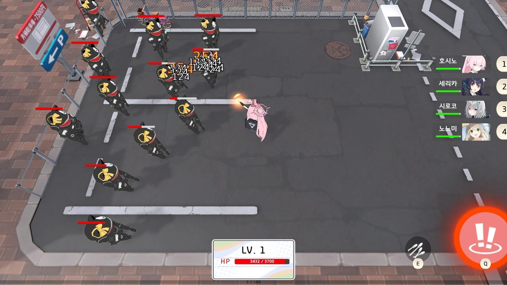 | 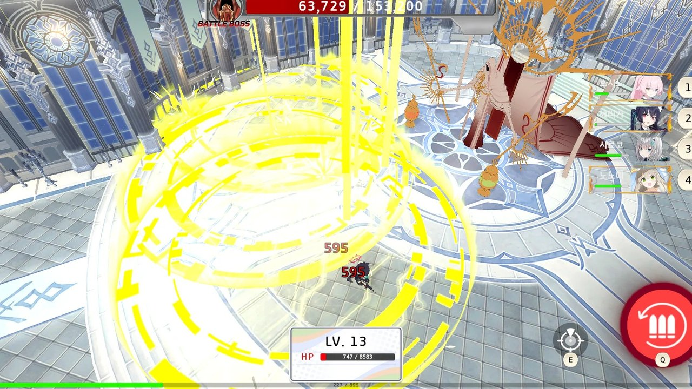 |
| **보스 기믹 · HP 50% 탄막** | **소환된 탱크 · 포격 경고** |
| 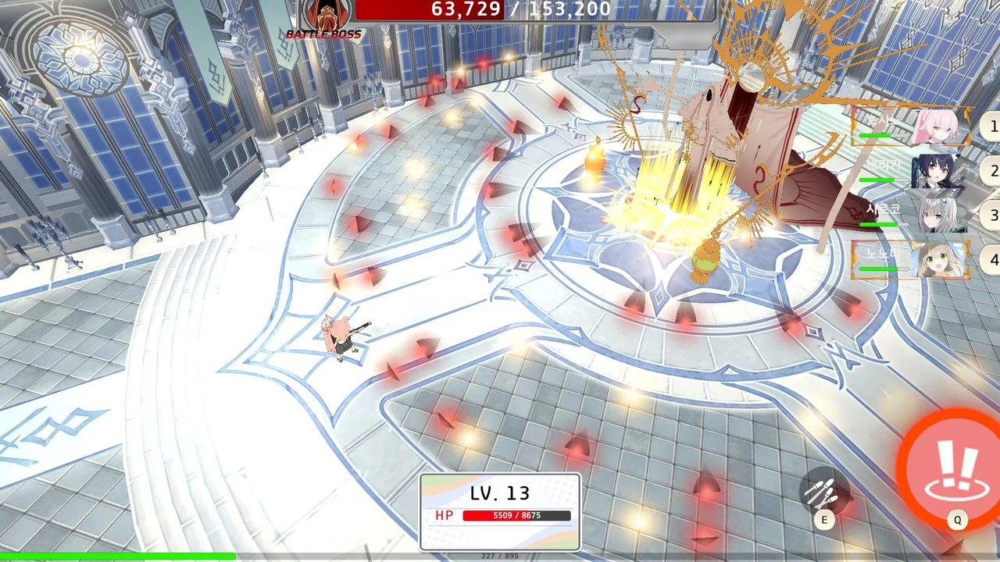 | 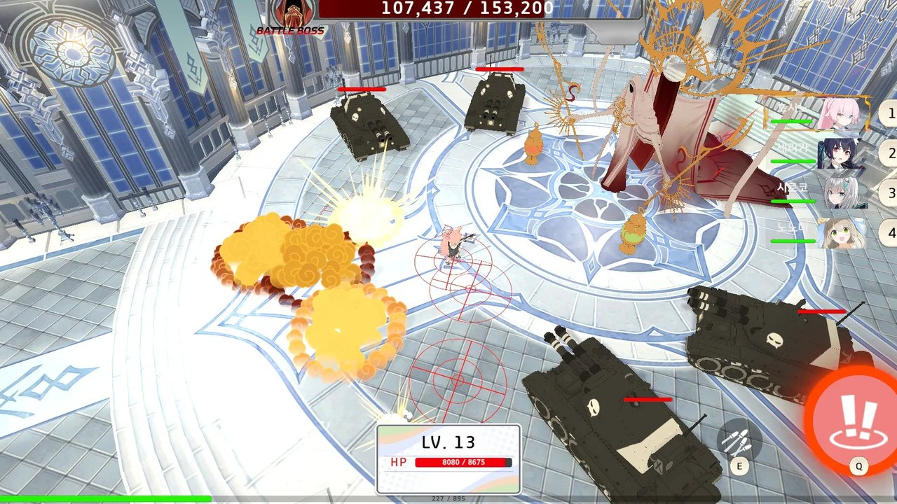 |
| **인벤토리 팝업** | **던전 클리어 · 보상** |
| 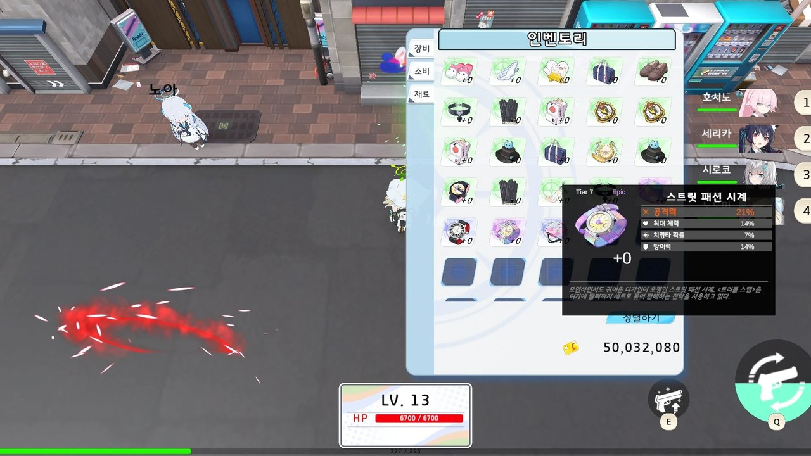 | 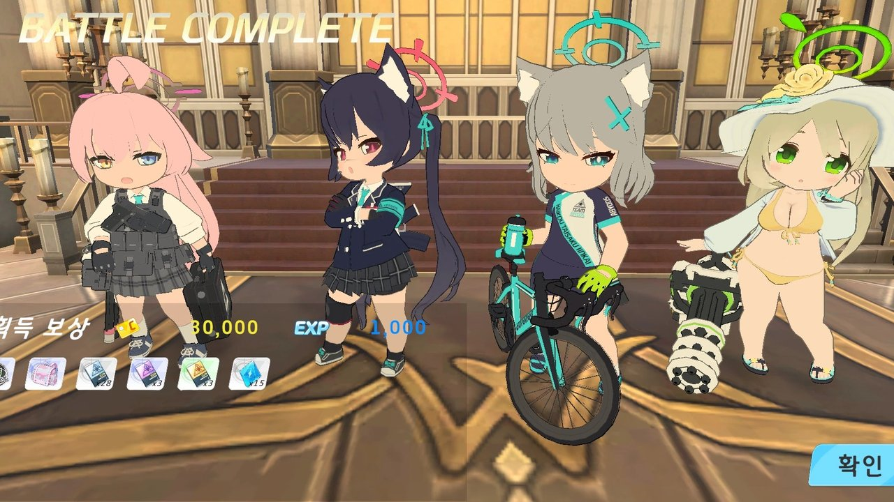 |

  <a href="#toc-bluearchive">⬆️ 프로젝트 목차로 돌아가기</a>

 

 

## 📌 중점 목표 및 달성

<table>
  <tr>
    <th width="33%">1. 필드 몬스터 관리</th>
    <th width="33%">2. 몬스터 · 보스 행동 설계</th>
    <th width="33%">3. 리소스 수명 관리</th>
  </tr>
  <tr>
    <td valign="top">

- 거리 기반 활성화
- 화면 밖 갱신 LOD

</td>
    <td valign="top">

- 흐름(타임라인) / 행동(Event) 분리
- 일반몹 · 보스 같은 SkillSystem

</td>
    <td valign="top">

- Addressables Release 일원화
- 수명 스코프 → 자동 해제

</td>
  </tr>
  <tr>
    <td align="center">

느린 프레임 $`\color{#E8352E}\textbf{▼47\%}`$

</td>
    <td align="center">

일반몹 · 보스 = $`\color{#E8352E}\textbf{같은 구조}`$

</td>
    <td align="center">

Global 상주 메모리 $`\color{#E8352E}\textbf{▼60\%}`$

</td>
  </tr>
</table>

**🧩 그 외 구현**

<table>
  <tr>
    <th width="50%">SYSTEM & DATA</th>
    <th width="50%">GAMEPLAY & AI</th>
  </tr>
  <tr>
    <td valign="top">

- **비동기 파이프라인** — Addressables 캐싱 · UniTask
- **데이터 주도 설계** — NPOI 엑셀 → ScriptableObject
- **UI 이벤트** — Action / Delegate 구독으로 데이터 · UI 분리

</td>
    <td valign="top">

- **행동 트리 AI** — 다형성 계층형 BT · Timeline 보스 스킬
- **전투 시스템** — 파티 4인 태그 · 무작위 옵션 장비

</td>
  </tr>
</table>

  <a href="#toc-bluearchive">⬆️ 프로젝트 목차로 돌아가기</a>

 
 

---

 

## 🔨 주요 개발

<h3>🗺️ 필드 몬스터 관리 : 거리 기반 활성화와 갱신 LOD</h3>

 

**누구를 켤 것인가 — 거리 기반 활성화**
- **판정 기준** : 스포너 중심 ↔ 플레이어 바닥(x · z) 거리
- **히스테리시스** : 켜기 20m / 끄기 25m → 경계 깜빡임 제거
- **방식 추상화** : `ActivationPolicy` → 7가지 방식을 같은 조건에서 교체 · 실측 후 채택
- **공통 규칙** : 교전 중이면 범위 밖에서도 유지 · 너무 멀면 스폰 지점 귀환(리쉬)

**얼마나 돌릴 것인가 — 갱신 LOD**
- **대상** : 화면 밖 · 교전 아님 (살아 있는 몬스터의 87%가 화면 밖)
- **줄이는 것** : HP바 끔 · Behavior Tree 8프레임에 1번 · Animator 끔

| **결과 — Sector → 거리 (최종 빌드 · 같은 경로 3회)** |
| :---: |
| 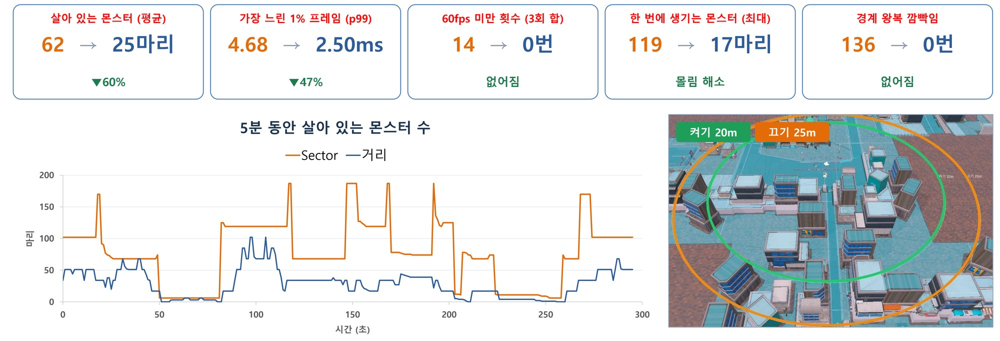 |

**관련 코드**
- [[📄DistanceActivation.cs (거리 판정)]](https://github.com/vfly1189/OperationKivotos-Code/blob/main/Assets/Scripts/Managers/Activation/DistanceActivation.cs)
- [[📄ActivationPolicy.cs (판정 방식 추상화)]](https://github.com/vfly1189/OperationKivotos-Code/blob/main/Assets/Scripts/Managers/Activation/ActivationPolicy.cs)
- [[📄SpawnerManager.cs (활성화 · 갱신 LOD 적용)]](https://github.com/vfly1189/OperationKivotos-Code/blob/main/Assets/Scripts/Managers/Core/Field/SpawnerManager.cs)

> **🚀 성능 개선 사례**: 7가지 방식 비교 후 거리 기반으로 바꿔 **가장 느린 1% 프레임 ▼47%** 를 달성한 과정은 하단 **[🛠️ 문제 해결](#optimization-trouble)** 에서 다룹니다.

  <a href="#toc-bluearchive">⬆️ 프로젝트 목차로 돌아가기</a>

 

 

<h3>⚔️ 전투 행동 설계 : SkillSystem + 다형성 계층형 몬스터 AI</h3>

 

**흐름과 행동의 분리**
- **흐름** : 애니메이션 · Timeline + 태그 신호 (`TimelineAction`, `AnimationAction`)
- **행동** : `PatternEvent` 하나 — 신호를 받은 순간에만 실행
- **`PatternMemo`** : 패턴 동안만 쓰는 값(고른 색 · 경고 위치) 보관 · 패턴마다 비움 (할당 0)
- **행동의 조합** : Event(무엇을) + `PointEmitter`(횟수 · 간격) + `Placement`(어디에)

| **보스 패턴 한 개의 흐름 — Runner · Action · Task · Event** |
| :---: |
| 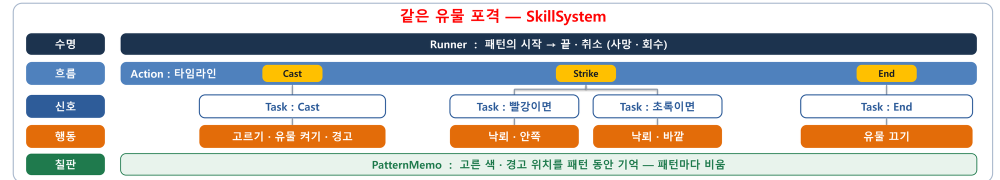 |

**다형성 계층형 몬스터 AI — 언제 / 무엇을 / 실행 분리**
- **언제 (컨트롤러 BT)** : `Base`(공통 생명주기) → `Normal`(감지 · 추적 · 리쉬) → `Skill`(전투 노드만 구현) · `Boss`
- **무엇을 (선택기)** : 일반몹 = 탄 수 / 보스 = HP선 기믹 · 가중치 추첨
- **실행 (`SkillSystem`)** : 써도 되나(쿨다운 · 태그) · 실행 — 호출자를 모름 → 일반몹 · 보스 같은 코드
- **BT 우선순위** : 리쉬 귀환 → 행동 중 → 전투 → 추적 → 대기 (리쉬가 진행 중 패턴을 끊을 수 있음)

| **몬스터 컨트롤러 계층 구조** |
| :---: |
| 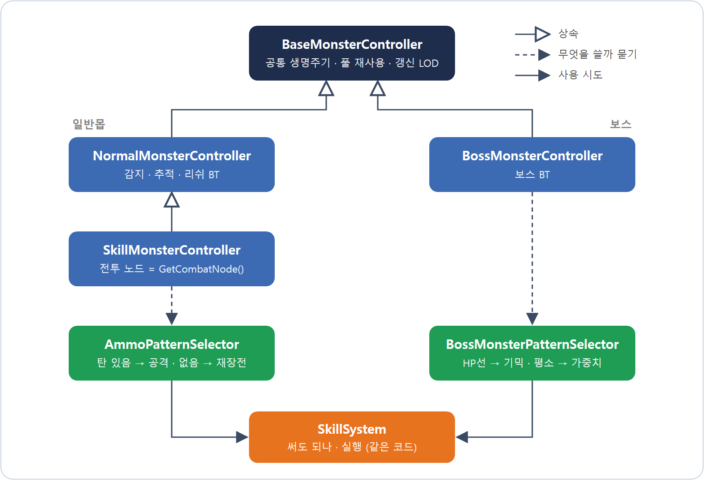 |

**관련 코드**
- [[📄SkillSystem.cs (사용 가능 판정 · 실행 창구)]](https://github.com/vfly1189/OperationKivotos-Code/blob/main/Assets/Scripts/SkillSystem/SkillSystem.cs)
- [[📄PatternRunner.cs (패턴 시작 → 끝 · 취소)]](https://github.com/vfly1189/OperationKivotos-Code/blob/main/Assets/Scripts/SkillSystem/PatternRunner.cs)
- [[📄BossMonsterPatternSelector.cs (보스 선택기)]](https://github.com/vfly1189/OperationKivotos-Code/blob/main/Assets/Scripts/SkillSystem/BossMonsterPatternSelector.cs) · [[📄AmmoPatternSelector.cs (일반몹 선택기)]](https://github.com/vfly1189/OperationKivotos-Code/blob/main/Assets/Scripts/SkillSystem/AmmoPatternSelector.cs)
- [[📄BaseMonsterController.cs]](https://github.com/vfly1189/OperationKivotos-Code/blob/main/Assets/Scripts/Controllers/Monster/BaseMonsterController.cs) · [[📄NormalMonster 행동 트리 구성 함수]](https://github.com/vfly1189/OperationKivotos-Code/blob/b64235f6042137cc6488aed291025114858b973c/Assets/Scripts/Controllers/Monster/NormalMonsterController.cs#L170-L197)
- [[📄SkillMonsterController.cs (일반몹 전투 노드)]](https://github.com/vfly1189/OperationKivotos-Code/blob/main/Assets/Scripts/Controllers/Monster/SkillMonsterController.cs) · [[📄BossMonsterController.cs]](https://github.com/vfly1189/OperationKivotos-Code/blob/main/Assets/Scripts/Controllers/Monster/Boss/BossMonsterController.cs)

> **🚀 구조 개선 사례**: 흐름까지 부품으로 만든 AbilitySystem의 한계와 SkillSystem으로 재설계한 과정은 하단 **[🛠️ 문제 해결](#ability-trouble)** 에서 다룹니다.

  <a href="#toc-bluearchive">⬆️ 프로젝트 목차로 돌아가기</a>

 

 

<h3>🗂️ 리소스 수명 관리 : 수명 스코프와 레지스트리</h3>

 

**책임 3층 분리**
- `ResourceManager`(라우팅) → `ResourceScope`(수명 · 키 집합) → `ResourceRegistry`(핸들 · refCount) → `Addressables`(실제 I/O)
- **캐시** : 실제 로드는 첫 요청 1번 · 재요청은 Registry에서 반환

**수명 스코프 4종**
- `Global`(앱 종료) · `Scene`(씬 전환) · `Party`(씬 전환 넘어 생존) · `Popup`(팝업 스택 0 → 1 생성, 1 → 0 Dispose)
- **자동 해제** : 스코프 소멸 → 자기 키만 −1 → 0이 된 키만 Release (호출부 Release 0줄)

**풀 · 아틀라스 캐시 수명 통합**
- **풀** : 원본 프리팹 ref 티켓 직접 획득 → 씬 전환 시 풀 인스턴스 깨짐 차단
- **아틀라스** : 클론 Sprite를 Registry `OnReleased`에 맞춰 함께 파기

| **리소스 로드 흐름 — 첫 요청만 실제 로드, 재요청은 캐시** |
| :---: |
|  |
| **refCount 정산 — 스코프 소멸 시 주인 없는 키만 Release** |
|  |

**관련 코드**
- [[📄ResourceScope.cs (수명 티켓)]](https://github.com/vfly1189/OperationKivotos-Code/blob/main/Assets/Scripts/Managers/Core/Resource/ResourceScope.cs)
- [[📄ResourceRegistry.cs (핸들 · refCount)]](https://github.com/vfly1189/OperationKivotos-Code/blob/main/Assets/Scripts/Managers/Core/Resource/ResourceRegistry.cs)
- [[📄ResourceManager.cs (스코프 라우팅)]](https://github.com/vfly1189/OperationKivotos-Code/blob/main/Assets/Scripts/Managers/Core/Resource/ResourceManager.cs)

> **🚀 메모리 개선 사례**: 2버킷 구조의 한계와 수명 스코프 도입으로 **Global 상주 메모리 ▼60%** 를 달성한 과정은 하단 **[🛠️ 문제 해결](#resource-lifetime-trouble)** 에서 다룹니다.

  <a href="#toc-bluearchive">⬆️ 프로젝트 목차로 돌아가기</a>

 

 

<h3>📊 데이터 주도 설계(Data-Driven) 및 에셋 베이킹 자동화</h3>

 

**Excel → ScriptableObject 베이킹**
- **대상** : 캐릭터 스탯 · 성장치 등 수식 연산이 필요한 데이터 (기획 친화 Excel)
- **베이킹** : 빌드 전 NPOI로 SO 에셋 자동 변환 → 런타임 엑셀 파싱 · GC 할당 제거
- 

**JSON 계층 데이터**
- **대상** : 구역별 스포너 위치 등 깊이(Depth)가 있는 데이터 → 2차원 표 대신 JSON

**DataManager 통합 조회**
- SO · JSON 일괄 로드 · 캐싱 → 원본 형식과 무관하게 ID 기반 $O(1)$ 조회

**관련 코드**
- [[📄아이템 정보 엑셀파일 추출 코드]](https://github.com/vfly1189/OperationKivotos-Code/blob/main/Assets/Editor/ItemExcelImporter.cs)

  <a href="#toc-bluearchive">⬆️ 프로젝트 목차로 돌아가기</a>

 

 

<h3>🖥️ UI 렌더링 최적화 및 이벤트 분리</h3>

 

**Observer 패턴 데이터 · UI 분리**
- `Action` / `Delegate` → 데이터 변동 순간에만 브로드캐스트
- UI는 이벤트 수신 시에만 갱신 → 불필요한 `Update()` 제거

**목적별 Canvas 분할**
- 갱신 빈도별 4개 Canvas (`Scene` · `System` · `World` · `Popup`)
- `World`(체력바 · 데미지)가 매 프레임 갱신돼도 정적 `Scene` UI는 Rebuild 제외
- 

**관련 코드**
- [[📄UIManager.cs]](https://github.com/vfly1189/OperationKivotos-Code/blob/main/Assets/Scripts/Managers/Core/UIManager.cs)

  <a href="#toc-bluearchive">⬆️ 프로젝트 목차로 돌아가기</a>

 
 

---

 

## 🛠️ 문제 해결

### 1️⃣ 필드 몬스터 관리 : 거리 기반 활성화와 갱신 LOD 도입

> **🚨 문제 상황: 구역(Sector) 단위로 켜고 끄자 경계에서 문제 발생**
>
> - **처음 설계** : 플레이어가 들어간 구역의 스포너만 활성화 (구역 Collider로 진입 · 탈출 판정)
> - **따라오던 몬스터 소실** : 구역 밖으로 나가면 교전 중 몬스터도 즉시 회수
> - **화면 밖 활성화** : 멀어도 같은 구역이면 켜짐 → 대부분 화면 밖
> - **경계 몰림** : 구역이 바뀌는 순간 **최대 119마리 동시 생성**
> - **수작업 반복** : 맵마다 구역 분할 · 스포너 배정

| **Sector 단위 활성화 — 플레이어가 있는 구역만 켜짐** |
| :---: |
| 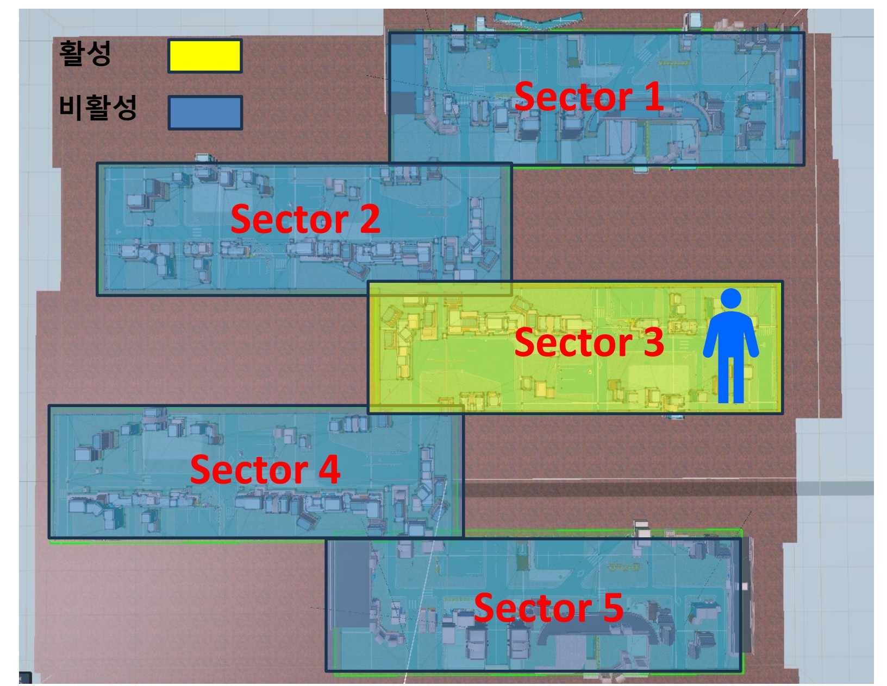 |

**🔍 원인 분석**
- **원인 1 · 회수 규칙** : 구역 off → 교전 몬스터도 회수 → 방식과 무관한 규칙 문제
  - **공통 규칙 적용** : 교전 중이면 유지 + 리쉬 반경 밖이면 스폰 지점 귀환
- **원인 2 · 판정 단위** : 나머지 문제 전부 **'구역 크기' 하나에 묶임**
  - 구역 키우면 → 활성 몬스터 증가 / 줄이면 → 깜빡임 증가
  - **크기 조절이 아니라 판정 단위 자체를 교체**

**💡 해결 과정**

1. **활성화 방식 7가지를 같은 조건에서 실측**
   - `ActivationPolicy` 추상화 → 같은 빌드 · 같은 자동 주행 경로 **5분 × 3회**
   - **탈락 조건** : 화면 안 등장 · 화면 안 소멸 · 끌고 온 몹 소실 · 경계 깜빡임 · 풀 확장

   | 방식 | 살아 있는 몬스터 | 가장 느린 1% 프레임 (p99) | 문제 | 판정 |
   |:---|:---:|:---:|:---|:---:|
   | ① Sector | 62마리 | 4.36ms | 깜빡임 136 · 화면 안 등장 9 | 탈락 |
   | ② Sector + 인접 | 187마리 | 4.86ms | 깜빡임 114 · 풀 부족 | 탈락 |
   | ③ 격자 3×3 | 46마리 | 2.72ms | 깜빡임 77 | 탈락 |
   | ④ 격자 5×5 | 34마리 | 2.60ms | 깜빡임 19 | 탈락 |
   | **⑤ 거리** | $`\color{#E8352E}\textbf{25마리}`$ | $`\color{#E8352E}\textbf{2.54ms}`$ | **문제 없음** | **채택** |
   | ⑥ 격자 + 거리 | 25마리 | 2.54ms | 문제 없음 | 통과 |
   | ⑦ CullingGroup | 25마리 | 2.55ms | 문제 없음 | 통과 |

2. **⑤ 거리 채택 — 결과가 같으면 가장 단순한 것**
   - ⑤ ⑥ ⑦ 켜는 스포너 **100% 동일** (결과 · 비용 같음)
   - ⑥ = 격자 후보 추리기 단계 추가 / ⑦ = 결과 1프레임 지연 · 카메라 미렌더 시 갱신 정지
   - → 가장 단순하고 **카메라에 의존하지 않는 ⑤ 거리**
   - **히스테리시스** : 켜기 20m / 끄기 25m → 사이 구간은 이전 상태 유지 → 깜빡임 $`\color{#E8352E}\textbf{136 → 0}`$

3. **갱신 LOD : 화면 밖에서 가만히 있는 몬스터는 덜 돌린다**
   - **대상** : 화면 밖 · 교전 아님 (살아 있는 몬스터의 $`\color{#E8352E}\textbf{87\%}`$ 가 화면 밖)
   - **HP바 끔 · Behavior Tree 8프레임에 1번 · Animator 끔**
   - **실행 프레임 분산** : `(frameCount + phase) % 8 == 0` → 한 프레임 몰림 방지
   - **교전 중 제외** : 화면 밖 공격 타이밍 유지

   | 몬스터 밀도 | ×1 (27마리) | ×2 (54마리) | ×4 (107마리) | ×8 (216마리) |
   |:---:|:---:|:---:|:---:|:---:|
   | LOD 끔 | 1.46ms | 1.75ms | 2.44ms | 4.12ms |
   | LOD 켬 | 1.45ms | 1.70ms | 2.20ms (−10%) | $`\color{#E8352E}\textbf{3.43ms (−17\%)}`$ |

| **거리 기반 활성화** | **갱신 LOD** |
| :---: | :---: |
| 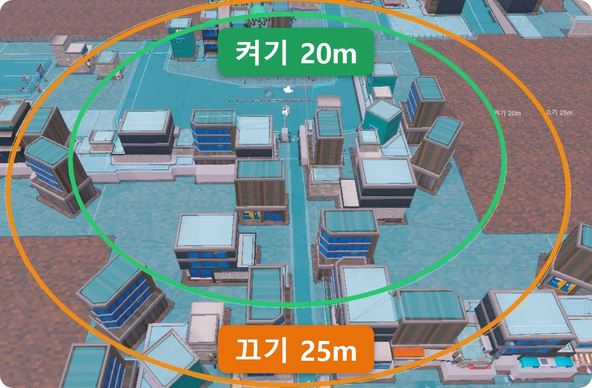 | 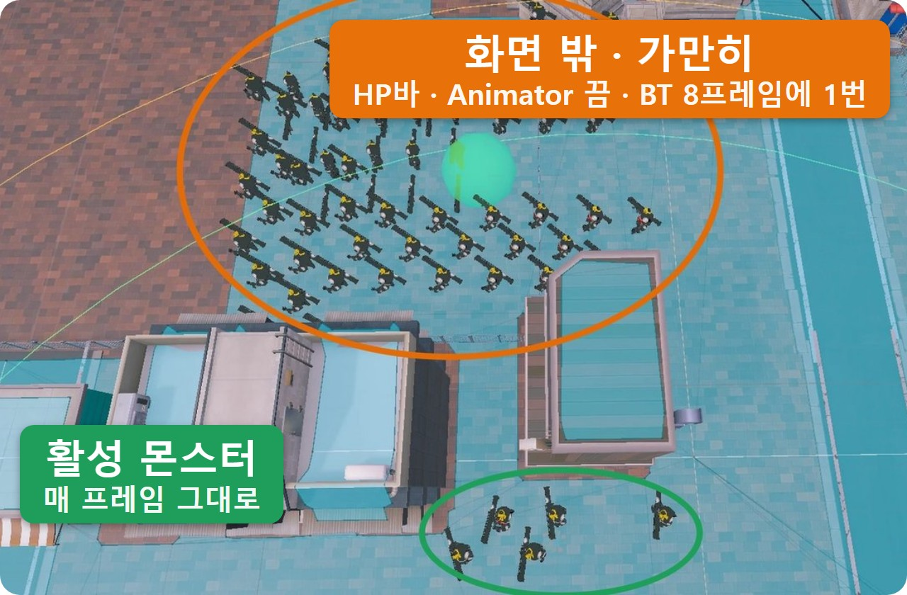 |
| 초록 = 켜기 20m · 주황 = 끄기 25m | 주황 = 화면 밖 · 가만히 (LOD 대상) · 초록 = 활성 몬스터 |

**✅ 결과 (최종 빌드 · 같은 경로 3회씩 재측정)**

| 항목 | Sector | 거리 | 변화 |
|---|:---:|:---:|:---:|
| 살아 있는 몬스터 (평균) | 62마리 | $`\color{#E8352E}\textbf{25마리}`$ | **▼60%** |
| 가장 느린 1% 프레임 (p99) | 4.68ms | $`\color{#E8352E}\textbf{2.50ms}`$ | **▼47%** |
| 60fps 미만 횟수 (3회 합) | 14번 | $`\color{#E8352E}\textbf{0번}`$ | **없어짐** |
| 한 번에 생기는 몬스터 (최대) | 119마리 | $`\color{#E8352E}\textbf{17마리}`$ | **몰림 해소** |
| 경계 왕복 깜빡임 | 136번 | $`\color{#E8352E}\textbf{0번}`$ | **없어짐** |
| 보통 프레임 (밀도 ×8, 갱신 LOD) | 4.12ms | $`\color{#E8352E}\textbf{3.43ms}`$ | **▼17%** |
| 144fps 예산 안 몬스터 수 (×8) | 430마리 | $`\color{#E8352E}\textbf{514마리}`$ | **약 1.2배** |

**관련 코드**
- [[📄DistanceActivation.cs (⑤ 거리 판정 · 히스테리시스)]](https://github.com/vfly1189/OperationKivotos-Code/blob/main/Assets/Scripts/Managers/Activation/DistanceActivation.cs)
- [[📄ActivationPolicies.cs (7가지 방식 생성)]](https://github.com/vfly1189/OperationKivotos-Code/blob/main/Assets/Scripts/Managers/Activation/ActivationPolicies.cs)
- [[📄ActivationManager.cs (판정 실행 · 방식 간 결과 비교)]](https://github.com/vfly1189/OperationKivotos-Code/blob/main/Assets/Scripts/Managers/Activation/ActivationManager.cs)
- [[📄SpawnerManager.cs (활성화 · 갱신 LOD 적용)]](https://github.com/vfly1189/OperationKivotos-Code/blob/main/Assets/Scripts/Managers/Core/Field/SpawnerManager.cs)
- [[📄측정 문서 (정책 비교 · 갱신 LOD 결과)]](https://github.com/vfly1189/OperationKivotos-Code/tree/main/docs/FieldEntity)

  <a href="#toc-bluearchive">⬆️ 프로젝트 목차로 돌아가기</a>

 

 

### 2️⃣ 전투 행동 설계 : 흐름과 행동 분리를 통한 확장

> **🚨 문제 상황: 흐름까지 부품으로 만들어 분기마다 새 클래스 필요**
>
> - **기존 AbilitySystem** : 공격을 부품(SO)으로 조립 — 흐름(`Delay` · `Repeat`)도 행동도 같은 부품
> - **플레이어 스킬엔 적합** : 몹 5연사 · 히나 8연사 = `RepeatEffect` 값만 다름 (코드 차이 0줄)
> - **보스 패턴에서 한계**
>   1. **블록 코딩** : 분기 종류마다 새 흐름 부품 클래스 (`SelectRandomChoice` · `BranchByChoice` …)
>   2. **분기 결과 저장 위치 없음** : 고른 색을 부품 밖 `BossRelicController`가 보관

| **기존 AbilitySystem — 흐름과 행동이 같은 부품** |
| :---: |
| 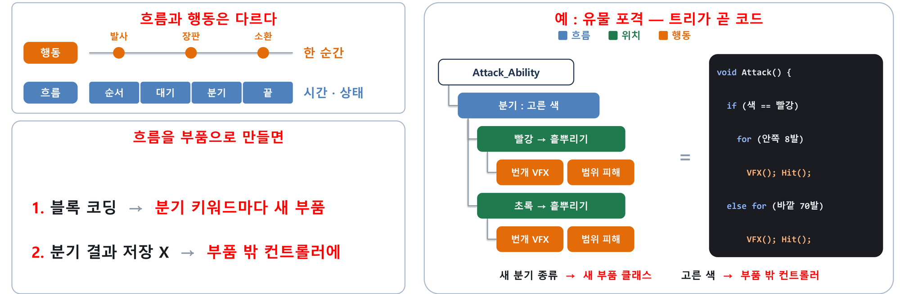 |

**💡 해결 과정**

1. **흐름은 Timeline 위에, 행동은 그 순간에만**
   - **흐름** : 순서 · 대기 · 분기 · 끝 → 시간 축이 있는 애니메이션 · Timeline + 태그 신호
   - **행동** : 발사 · 장판 · 소환 → 신호를 받은 순간 실행되는 `PatternEvent` 하나
   - **분기 = 부품 → 조건** : 같은 Strike 신호에 Task 2개 · `PatternMemo`의 색 조건이 맞는 쪽만 실행
   - **`PatternMemo`** : 고른 색 · 경고 위치를 패턴 동안 보관 · 패턴마다 비움 (할당 0)

| **빨강이면 → 낙뢰 · 안쪽** | **초록이면 → 낙뢰 · 바깥** |
| :---: | :---: |
| 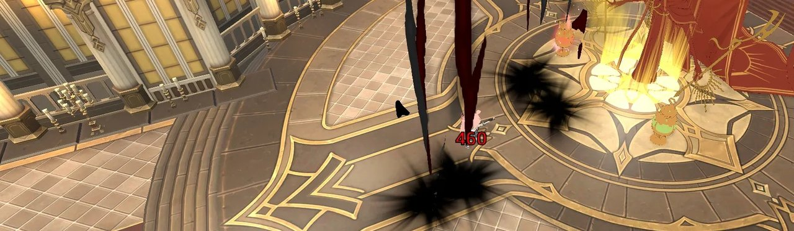 | 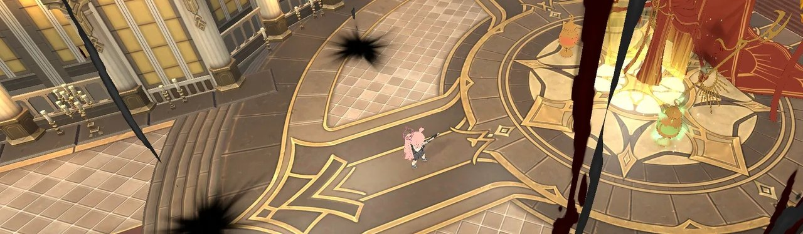 |

2. **고르는 곳과 실행하는 곳의 분리**
   - **선택기** = 무엇을 쓸까 / **SkillSystem** = 써도 되나 · 실행 / **PatternEnded** = 끝났다
   - **보스 선택기** : HP선 넘으면 기믹(1회) · 평소 가중치 추첨
   - **일반몹 선택기** : 탄 있으면 공격(탄 −1) · 없으면 재장전
   - **SkillSystem은 호출자를 모름** → 보스 · 일반몹 $`\color{#E8352E}\textbf{같은 코드}`$

| **SkillSystem 흐름 — 한 패턴의 한 바퀴** |
| :---: |
| 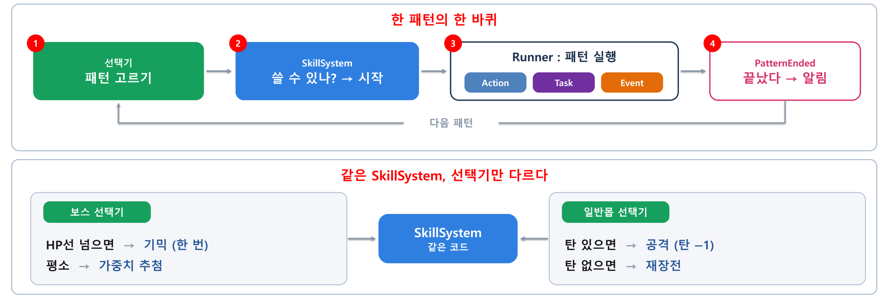 |

3. **행동 하나 = 무엇을 + 횟수 · 간격 + 어디에**
   - Event(무엇을) + `PointEmitter`(횟수 · 간격) + `Placement`(어디에) → 하나를 바꿔도 나머지는 그대로
   - Tank '경고 → 지연 → 타격' = 새 Event가 아닌 `StrikeEvent` 옵션 1개 → 보스도 같은 기능 획득

   | 예 | 무엇을 | 횟수 · 간격 | 어디에 |
   |:---:|:---:|:---:|:---:|
   | 조여오는 번개 | 내려치기 | 12개씩 · 0.15초 | 원 · 반경 8 → 0 |
   | 몬스터 소환 | 소환 | 1마리씩 · 0.3초 | 지정 위치 4곳 |

| **예 1 · 조여오는 번개** | **예 2 · 몬스터 소환** |
| :---: | :---: |
| 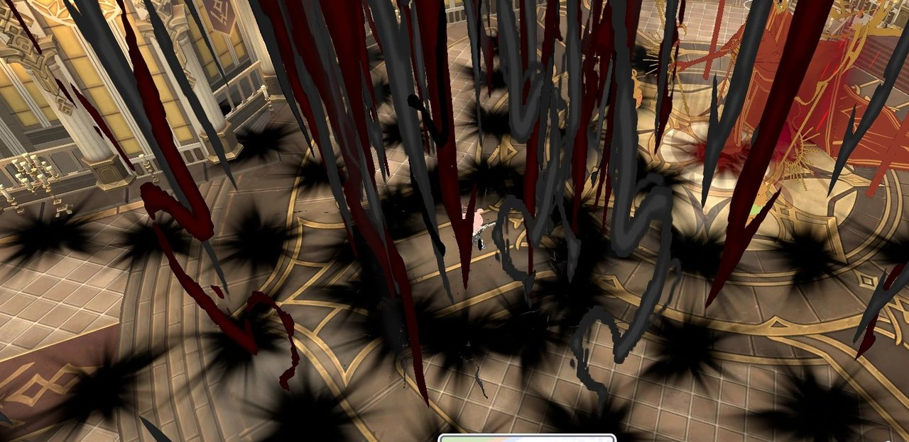 | 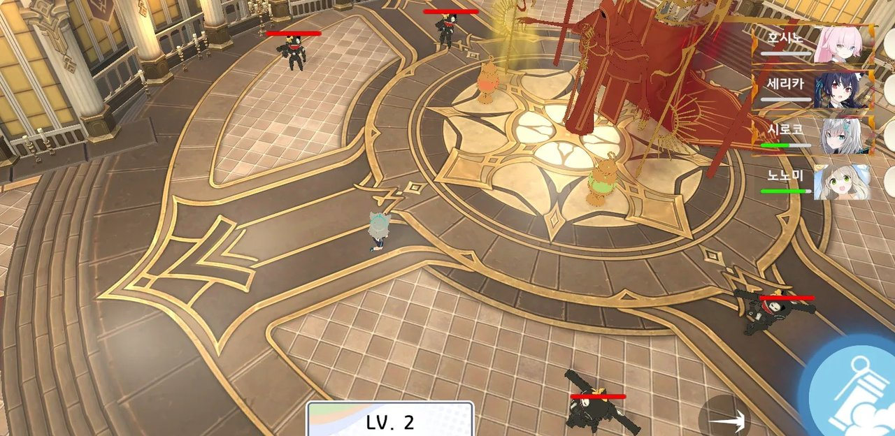 |

**✅ 결과 — 일반몹 · 보스가 같은 구조 위에서 동작**
- **같은 구조** : 일반몹(Tank) · 보스(Hieronymus) 모두 `SkillSystem → Pattern → Action → Task → Event` · 차이는 조립과 값
- **확장성** : 몬스터 이관 시 수정 `.cs` 수 — AR(공용화) 여러 개 → $`\color{#E8352E}\textbf{RL 0개}`$ → $`\color{#E8352E}\textbf{Tank 1개}`$
- **플레이어** : 기존 AbilitySystem 유지 · 데미지 이음새 공유 → 이관 가능

| **일반몹 (Tank) vs 보스 (Hieronymus) — 프리팹 계층이 같은 구조** |
| :---: |
| 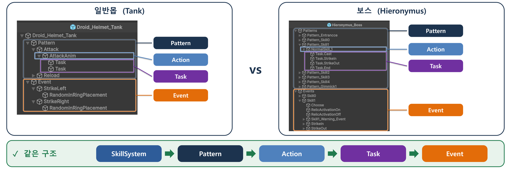 |

**관련 코드**
- [[📄SkillSystem.cs]](https://github.com/vfly1189/OperationKivotos-Code/blob/main/Assets/Scripts/SkillSystem/SkillSystem.cs)
- [[📄PatternRunner.cs (Action 진행 · 신호 → Task)]](https://github.com/vfly1189/OperationKivotos-Code/blob/main/Assets/Scripts/SkillSystem/PatternRunner.cs)
- [[📄TimelineAction.cs (흐름 = Timeline)]](https://github.com/vfly1189/OperationKivotos-Code/blob/main/Assets/Scripts/SkillSystem/TimelineAction.cs)
- [[📄PatternMemo.cs (칠판)]](https://github.com/vfly1189/OperationKivotos-Code/blob/main/Assets/Scripts/SkillSystem/PatternMemo.cs)
- [[📄StrikeEvent.cs (내려치기 · 경고 · 지연)]](https://github.com/vfly1189/OperationKivotos-Code/blob/main/Assets/Scripts/Pattern/Event/StrikeEvent.cs)

  <a href="#toc-bluearchive">⬆️ 프로젝트 목차로 돌아가기</a>

 

 

### 3️⃣ 리소스 수명 관리 : 2버킷 구조의 한계와 수명 스코프 도입

> **🚨 문제 상황: 버킷이 2개뿐이라 수명이 애매한 리소스는 전부 Global에 누적**
>
> - **구조** : 매니저 한 곳이 로드 · 핸들 · 수명 전부 소유 · 재로딩 방지용 핸들 캐싱
> - **버킷 부족** : `Global` · `Scene` 2개뿐 → 파티 · 팝업 · 던전 리소스가 `Global`로 도피
> - **해제 경로 없음** : `Global`은 세션 내내 상주 (진입 직후 **513MB**)
> - **수명 결정 분산** : 호출부 **46개 파일 · 130곳**이 각자 `isGlobal`로 수명 결정 → 애매하면 `Global`

| **2버킷 구조 — Global 버킷은 해제 경로 없이 계속 쌓인다** |
| :---: |
| 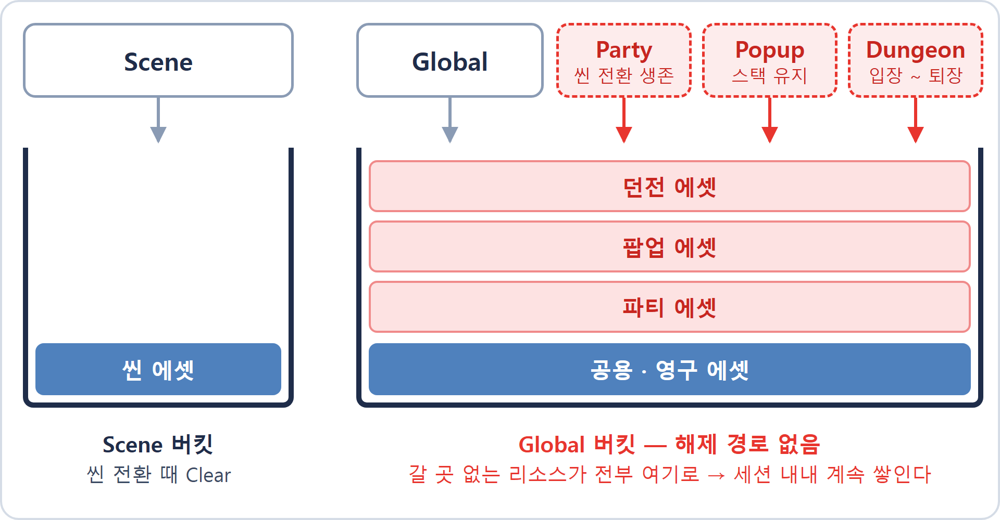 |

**💡 해결 과정**

1. **책임 3층 분리 (Manager / Scope / Registry)**
   - `ResourceManager`(라우팅) → `ResourceScope`(수명 · 키 집합) → `ResourceRegistry`(핸들 · refCount) → `Addressables`
   - **실제 로드 = 첫 요청 1번** · 재요청 = Registry 캐시
   - **refCount = 키를 쥔 스코프 수** (같은 스코프 재요청 +0)

| **로드 흐름 — 재요청은 Registry 캐시에서 반환** |
| :---: |
| 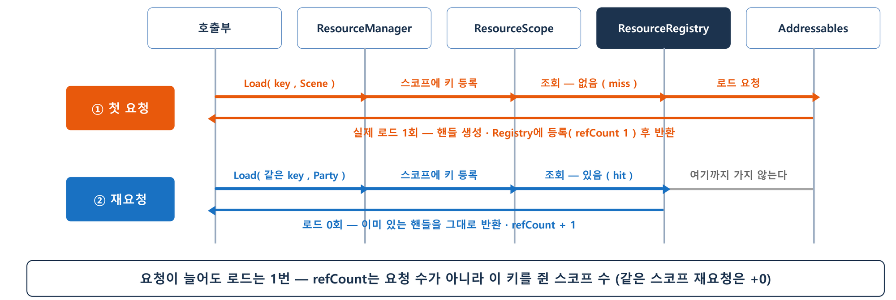 |

2. **수명 스코프 2종 → 4종 — 수명 경계 = 해제 시점**

   | 스코프 | 수명 | 담는 리소스 |
   |:---:|:---|:---|
   | `Global` | 앱 종료까지 | 공용 · 영구 에셋 |
   | `Scene` | 씬 전환까지 | 씬 에셋 · 팝업 프리팹 / 슬롯 |
   | `Party` | 씬 전환 넘어 생존 | 파티 에셋 |
   | `Popup` | 팝업 스택 0 → 1 생성 · 1 → 0 Dispose | 스탠딩 이미지 등 대형 콘텐츠 |

   - **자동 정산** : 스코프 소멸 → 자기 키만 −1 → 0이 된 키만 `Addressables.Release` (호출부 Release $`\color{#E8352E}\textbf{0줄}`$)

| **refCount 정산 — 팝업을 모두 닫으면 Popup 소유만 빠진다** |
| :---: |
| 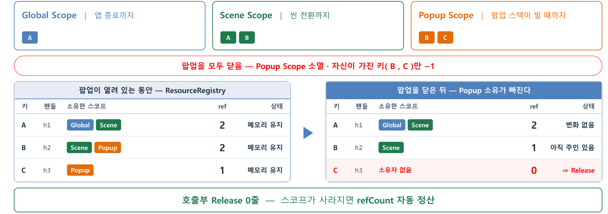 |

3. **Addressables가 이미 세는데 왜 카운트를 하나 더?**
   - **Addressables** = 몇 번 로드했나 / **수명 스코프** = 언제 줄일지
   - 도메인 신호(씬 전환 · 팝업 스택 0 · 파티 해체) → refCount 감소로 번역
   - 수명 결정 지점 : 호출부 $`\color{#E8352E}\textbf{130곳 → 수명 경계 수}`$

4. **오브젝트 풀 · 아틀라스 캐시 통합**
   - **풀** : 원본 프리팹 ref 티켓 직접 획득(`AcquirePoolRef`) → 씬 전환 시 풀 인스턴스 깨짐 차단
   - **아틀라스** : 클론 Sprite를 Registry `OnReleased`에 맞춰 파기 → 캐시가 핸들을 붙잡는 문제 방지

**✅ 결과 (같은 경로 · 같은 체크포인트 Before / After)**

| 항목 | Before | After | 변화 |
|---|:---:|:---:|:---:|
| Global 상주 메모리 (진입 직후) | 513MB | $`\color{#E8352E}\textbf{205MB}`$ | **▼60%** |
| 전체 리소스 메모리 (진입 직후) | 617MB | $`\color{#E8352E}\textbf{363MB}`$ | **▼41%** |
| 던전 왕복 후 남는 메모리 | +18.7MB | $`\color{#E8352E}\textbf{≈0MB}`$ | **쌓이지 않음** |
| 대가 : 팝업 첫 오픈 | — | +14 ~ 20ms | 재오픈은 추가 지연 없음 |

> Global · 전체 = 에디터 계측(Use Existing Build · 실제 번들)의 버킷별 핸들 메모리 / 아래 그래프 = 개발 빌드 텍스처 메모리 — 서로 다른 지표

- **팝업 5종 첫 오픈** : $`\color{#E8352E}\textbf{+28.1MB}`$ → 던전 왕복 후 $`\color{#E8352E}\textbf{−26.7MB}`$ 반납 → 재오픈 · 재왕복 시 증가 $`\color{#E8352E}\textbf{0MB}`$
- **풀 티켓 정산** : Global 프리팹 `ref 1 → 3 → 1` (Global + Scene 스코프 + 풀 티켓)

| **개발 빌드 실측 — 텍스처 메모리 (MB)** |
| :---: |
| 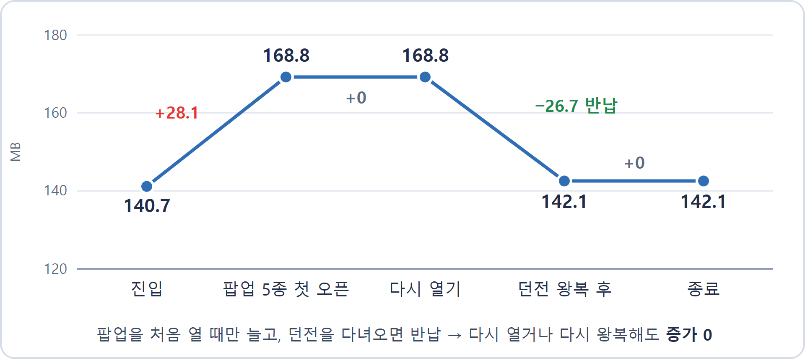 |

**관련 코드**
- [[📄ResourceScope.cs (수명 티켓)]](https://github.com/vfly1189/OperationKivotos-Code/blob/main/Assets/Scripts/Managers/Core/Resource/ResourceScope.cs)
- [[📄ResourceRegistry.cs (핸들 · refCount)]](https://github.com/vfly1189/OperationKivotos-Code/blob/main/Assets/Scripts/Managers/Core/Resource/ResourceRegistry.cs)
- [[📄ResourceManager.cs (스코프 라우팅)]](https://github.com/vfly1189/OperationKivotos-Code/blob/main/Assets/Scripts/Managers/Core/Resource/ResourceManager.cs)
- [[📄UIManager.cs (Popup 스코프 생성 · Dispose 지점)]](https://github.com/vfly1189/OperationKivotos-Code/blob/main/Assets/Scripts/Managers/Core/UIManager.cs)

  <a href="#toc-bluearchive">⬆️ 프로젝트 목차로 돌아가기</a>

 
 

---

 

# 🎮 이터널 리턴 모작

### 📌 프로젝트 정보

| 항목 | 내용 |
|:---:|:---:|
| 🎯 **장르** | 쿼터뷰, 배틀로얄, MOBA |
| ⏱️ **개발 기간** | 2025.07 ~ 2025.09 (2개월) |
| 👥 **개발 인원** | 2인 (프로그래머로 참여) |
| 🛠️ **개발 환경** | C++, DirectX11, HLSL |
| 🎬 **시연 영상** | [YouTube 바로가기](https://youtu.be/b6XVkd0xc-E?si=XHB1nkE6C2-JarC8) |
| 📝 **개발 블로그** | [상세 개발 과정](https://tobrother.tistory.com/category/DirectX11/Eternal%20Return%20%EB%AA%A8%EC%9E%91) |
| 💾 **GitHub** | [소스코드](https://github.com/HyangRim/DirectX11-Engine-Client) |

## 📑 프로젝트 목차

**1. 📖 [게임 개요](#overview-eternal)**

**2. 📌 [학습 목표 및 달성](#goals-eternal)**

**3. 🔨 [주요 개발 기능](#features-eternal)**  
&nbsp;&nbsp; └ [Deferred Rendering (Hybrid)](#deferred-rendering) 
&nbsp;&nbsp; └ [GPU Instancing](#gpu-instancing) 
&nbsp;&nbsp; └ [Quad Tree 공간 분할](#quad-tree) 
&nbsp;&nbsp; └ [NavMesh 길찾기 · 검색 최적화 (Spatial Grid)](#navmesh) 
&nbsp;&nbsp; └ [몬스터 AI 시스템 (FSM → Behavior Tree)](#fsm-to-bt-feature)

**4. 🛠️ [문제 해결 (Troubleshooting)](#troubleshooting-eternal-return)**  
&nbsp;&nbsp; └ **[Hybrid 렌더링 : Deferred와 Forward의 장점 결합](#deferred-rendering-trouble)** 
&nbsp;&nbsp;&nbsp;&nbsp;&nbsp;&nbsp;  Forward + Deferred **혼합 파이프라인 구축**

&nbsp;&nbsp; └ **[NavMesh 경로 스무딩](#navmesh-smoothing)** 
&nbsp;&nbsp;&nbsp;&nbsp;&nbsp;&nbsp;  Funnel + Bezier로 **코너 끼임 93쌍 → 0**

&nbsp;&nbsp; └ **[마우스 Picking + 충돌 처리 최적화 (Quad Tree)](#quadtree-optimization)** 
&nbsp;&nbsp;&nbsp;&nbsp;&nbsp;&nbsp;  검사할 후보만 남겨 충돌 처리 **135.8배 단축 (53,922μs → 397μs)**

  <a href="#table-of-contents">⬆️ 전체 목차로 돌아가기</a>

 

 

## 📖 게임 개요

**장르** : 쿼터뷰 배틀로얄 / MOBA

**🔄 핵심 루프 (Core Loop)**
1. **파밍 및 제작** : 맵 곳곳의 재료 수집 · 장비 제작
2. **장비 강화** : 상위 등급 장비로 전투력 상승
3. **금지 구역 회피** : 좁아지는 안전 구역 · 다른 생존자와 전투
4. **최후의 1인** : 마지막까지 생존

**🎯 개발 초점**
- DirectX 11 기반 **3D 렌더링 파이프라인 구축**
- **엔진 레벨의 성능 최적화** 및 아키텍처 설계

  <a href="#toc-eternal">⬆️ 프로젝트 목차로 돌아가기</a>

 

 

## 📌 학습 목표 및 달성

<table>
  <tr>
    <th width="33%">1. 고급 렌더링 파이프라인</th>
    <th width="33%">2. 대규모 오브젝트 처리</th>
    <th width="33%">3. 3D 게임 엔진 기술</th>
  </tr>
  <tr>
    <td valign="top">

- Deferred Rendering · 다중 광원
- G-Buffer / MRT

</td>
    <td valign="top">

- GPU Instancing · DrawCall
- Quad Tree 공간 분할

</td>
    <td valign="top">

- NavMesh A\* 길 찾기
- Funnel + Bezier 경로 스무딩

</td>
  </tr>
  <tr>
    <td align="center">

조명 비용 = $`\color{#E8352E}\textbf{픽셀 × 조명}`$

</td>
    <td align="center">

충돌 검사 $`\color{#E8352E}\textbf{135.8배}`$ 단축

</td>
    <td align="center">

코너 끼임 $`\color{#E8352E}\textbf{93쌍 → 0}`$

</td>
  </tr>
</table>

**🧩 그 외 구현**

<table>
  <tr>
    <th width="50%">GRAPHICS & RENDERING</th>
    <th width="50%">GAME LOGIC & ARCHITECTURE</th>
  </tr>
  <tr>
    <td valign="top">

- **Hybrid 렌더링** — Forward / Deferred 혼합 파이프라인
- **Skeletal Animation** — GPU Skinning

</td>
    <td valign="top">

- **몬스터 AI** — FSM → Behavior Tree 리팩토링
- **NavMesh 검색** — Spatial Grid 기반 최적화
- **스킬 시스템** — FSM 기반 스킬 · 쿨타임 매니저

</td>
  </tr>
</table>

  <a href="#toc-eternal">⬆️ 프로젝트 목차로 돌아가기</a>

 
 

---

 

## 🔨 주요 개발

<h3>🎨 Deferred Rendering 파이프라인 (Hybrid)</h3>

 

**렌더링 파이프라인 구조**
- **Geometry Pass (Deferred)** : 불투명 객체 → G-Buffer 기록 [[📄G-Buffer 셰이더]](https://github.com/HyangRim/DirectX11-Engine-Client/blob/master/Shaders/00.%20GBuffer.fx)
- **Lighting Pass (Deferred)** : G-Buffer 샘플링 → 화면 전체 조명 계산 [[📄Lighting 셰이더]](https://github.com/HyangRim/DirectX11-Engine-Client/blob/d0b9114a5d95640c568cfa5f0bffa8fb9e8c036b/Shaders/00.%20DeferredLighting.fx#L121-L169)
- **Forward Pass (반투명 / UI)** : 알파 블렌딩 객체 덧그림 → 최종 합성 [[📄UI 객체 셰이더]](https://github.com/HyangRim/DirectX11-Engine-Client/blob/master/Shaders/ImageShader.fx)

**G-Buffer 구성 (MRT)**
- 4개 Render Target(Albedo · Normal · Position · Material) 동시 출력
- 풀스크린 쿼드 기반 라이팅 패스

| **Albedo** | **Normal** |
| :---: | :---: |
|  |  |
| **Position (World Space)** | **Material** |
|  |  |

> **🚀 기술 도입 배경**: 동적 광원 증가에 따른 Forward의 한계와 Hybrid 전환 과정은 하단 **[🛠️ 문제 해결](#deferred-rendering-trouble)** 에서 다룹니다.

  <a href="#toc-eternal">⬆️ 프로젝트 목차로 돌아가기</a>

 

 

<h3>🧬 인스턴싱 기반 렌더링 (GPU Instancing)</h3>

 

**구현 목적**
- 수천 개의 나무 · 풀 · 환경 오브젝트로 인한 **DrawCall 병목(CPU 오버헤드)** 해소

**기술적 구현**
- **인스턴스 버퍼** : `World Matrix` · 색상 정보를 별도 버퍼로 VS에 전달
- **배칭** : 같은 키(Mesh + Material) 객체 자동 묶음 → 1회 호출
- **렌더러 지원** : 정적 메시 · 애니메이션 객체 모두 인스턴싱
  - [[📄MeshRenderer (정적 객체)]](https://github.com/HyangRim/DirectX11-Engine-Client/blob/d0b9114a5d95640c568cfa5f0bffa8fb9e8c036b/Engine/RenderManager.cpp#L311-L348)
  - [[📄AnimRenderer (애니메이션 객체)]](https://github.com/HyangRim/DirectX11-Engine-Client/blob/d0b9114a5d95640c568cfa5f0bffa8fb9e8c036b/Engine/RenderManager.cpp#L388-L435)

| 구분 | 기존 방식 (Individual) | 개선 방식 (Instancing) |
| :---: | :---: | :---: |
| **API 호출** | 객체 수(N)만큼 | **Batch당 1회** |
| **데이터 전달** | 매번 상수 버퍼 갱신 | **인스턴스 버퍼 일괄 전달** |
| **확장성** | 객체 증가 시 성능 급락 | **객체가 늘어도 호출 수 일정** |

  <a href="#toc-eternal">⬆️ 프로젝트 목차로 돌아가기</a>

 

 

<h3>🧱 쿼드 트리 (공간 분할 자료구조)</h3>

 

**자료구조 설계**
- **재귀적 노드** : `QuadTreeNode` = 자식 4개 + 영역(BoundingBox)
- **동적 객체 관리** : 위치 변경 시 노드 갱신 · 재삽입

**핵심 기능**
- **공간 쿼리** : 절두체 · 마우스 Ray와 겹치는 노드만 선별
- **충돌 그룹** : 노드 단위 객체 리스트 → 인접 객체끼리만 검사

| **마우스 Picking 최적화** | **충돌 처리 최적화 (Collision)** |
| :---: | :---: |
|  |  |
| Ray와 교차하는 Leaf 노드만 정밀 검사 | 빨간 영역 객체는 초록 영역만 검사 |

**관련 코드**
- [[📄QuadTree.h (헤더 설계)]](https://github.com/HyangRim/DirectX11-Engine-Client/blob/master/Engine/QuadTree.h)
- [[📄Node Insert (객체 삽입 로직)]](https://github.com/HyangRim/DirectX11-Engine-Client/blob/d0b9114a5d95640c568cfa5f0bffa8fb9e8c036b/Engine/QuadTree.cpp#L218-L257)

> **🚀 성능 최적화 사례**: Picking 4.6배 · 충돌 처리 135.8배 단축 과정은 하단 **[🛠️ 문제 해결](#quadtree-optimization)** 에서 다룹니다.

  <a href="#toc-eternal">⬆️ 프로젝트 목차로 돌아가기</a>

 

 

<h3>🧭 NavMesh 길찾기 시스템</h3>

 

**시스템 구조**
- **NavMesh 데이터** : 맵 → 삼각형 그래프 (이동 가능 영역)
- **경로 탐색** : 시작 · 도착 삼각형 → A\* 최단 삼각형 경로
- **경로 스무딩** : Funnel(코너 꼭짓점 탐색) + Bezier(코너를 둥글게) → 코너 끼임 93쌍 → 0
- **Agent** : 이동 상태(Idle · Move) 관리 · NavMesh 위로 위치 투영

| **A\* 원본 경로** | **Funnel + Bezier 스무딩** |
| :---: | :---: |
|  | <!-- TODO: Funnel + Bezier 이동 GIF로 교체 -->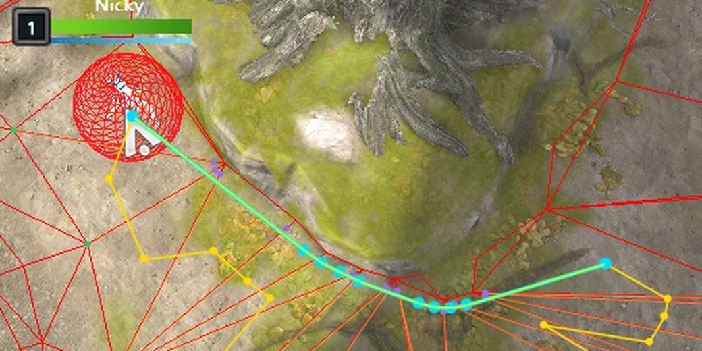 |

**검색 최적화 (Spatial Grid)**
- **문제** : 위치 보정(`GetNearestPointOnNavMesh`)마다 삼각형 20,000개+ 선형 탐색 $O(N)$ [[📄GetNearestPointOnNavMesh()]](https://github.com/HyangRim/DirectX11-Engine-Client/blob/d0b9114a5d95640c568cfa5f0bffa8fb9e8c036b/Engine/NavMesh.cpp#L93-L129)
- **해결** : 맵을 그리드로 분할 · 셀별 삼각형을 `unordered_map`에 저장 → 좌표로 셀 즉시 접근 · 셀 안 k개만 검사 $O(k)$ [[📄SpatialGrid]](https://github.com/HyangRim/DirectX11-Engine-Client/blob/d0b9114a5d95640c568cfa5f0bffa8fb9e8c036b/Engine/NavMesh.h#L31-L81) [[📄FindTriangleContaining]](https://github.com/HyangRim/DirectX11-Engine-Client/blob/d0b9114a5d95640c568cfa5f0bffa8fb9e8c036b/Engine/NavMesh.cpp#L463-L500)
- **결과** : 탐색 $`\color{#E8352E}\textbf{301μs → 14μs}`$ (약 **21.5배**) · 맵이 커져도 탐색 비용 일정

| **Spatial Grid 분할 — 셀 안의 삼각형만 검사** |
| :---: |
|  |

| **Linear Search (Before)** | **Spatial Grid (After)** |
| :---: | :---: |
|  |  |

> **🚀 경로 스무딩 개선**: LOS 스무딩이 만든 코너 끼임과 Funnel + Bezier로 바꾼 과정은 하단 **[🛠️ 문제 해결](#navmesh-smoothing)** 에서 다룹니다.

  <a href="#toc-eternal">⬆️ 프로젝트 목차로 돌아가기</a>

 

 

<h3>🤖 몬스터 AI 시스템 (FSM → Behavior Tree)</h3>

 

**FSM의 한계**
- **파일 폭증** : Wolf 1종 상태 8개 → 파일 16개 (.cpp + .h)
- **전이 로직 분산** : 다음 상태 조건이 각 상태 클래스에 흩어짐 → 흐름 파악 어려움
- **확장 비용** : 새 행동 추가 시 기존 상태 여러 개 수정

**Behavior Tree 구조** [[📄BehaviorTree.h]](https://github.com/HyangRim/DirectX11-Engine-Client/blob/master/Engine/BehaviorTree.h)
- **Selector 우선순위** : 생존(사망) > 전투(공격) > 추적(이동) > 대기
- **Sequence** : "조건 체크 → 행동" 묶음 (예 : `[HP <= 0] → [Die()]`)
- **결합도 제거** : 노드는 조건만 체크 · 전환은 부모(Selector)가 처리

| 비교 항목 | FSM | Behavior Tree |
| :---: | :---: | :---: |
| **흐름 제어** | 각 상태가 다음 상태 결정 | 부모 노드가 자식 실행 결정 |
| **결합도** | 상태끼리 참조 | 노드끼리 서로 모름 |
| **확장성** | 기존 상태 수정 필요 | 노드 추가만 |
| **우선순위** | 코드 속 `if`에 숨음 | 트리 구조(왼쪽 → 오른쪽)로 명시 |

| **FSM 구조** | **Behavior Tree 구조** | **인게임 AI (추적 → 공격 → 사망)** |
| :---: | :---: | :---: |
|  |  |  |

**관련 코드**
- [[📄WolfAI.cpp (몬스터 트리 구성)]](https://github.com/HyangRim/DirectX11-Engine-Client/blob/5d9aa0d9b421b32bf8004703d286ba5dbfd8bac5/Client/Wolf.cpp#L281-L319)

  <a href="#toc-eternal">⬆️ 프로젝트 목차로 돌아가기</a>

 
 

---

 

## 🛠️ 문제 해결

### 1️⃣ Hybrid Rendering : Deferred와 Forward의 장점 결합

> **🚨 문제 상황: 동적 광원이 늘수록 프레임 저하**
>
> - **Forward Rendering** : 객체마다 모든 조명 계산 → 비용 = 객체 수 × 조명 수
> - **픽셀 오버드로우** : 가려져 안 보일 픽셀까지 조명 계산
> - **곱으로 늘어나는 비용** : $O(M \times N)$ — 조명 하나 추가 → 모든 객체 재계산
> - → **조명 비용을 객체 수에서 분리해야 함**

**💡 해결 과정**

**"조명은 화면 픽셀에만 계산 (Deferred) · 반투명 UI만 Forward"** → 비용 $O(\text{객체} \times \text{조명}) \rightarrow O(\text{픽셀} \times \text{조명})$

1. **Geometry Pass → G-Buffer** : MRT로 4장(Albedo · Normal · Position · Material) 한 번에 기록 · 객체는 여기서 한 번만 그림
2. **Lighting Pass** : G-Buffer를 읽어 픽셀마다 한 번 조명 계산 → 객체가 늘어도 조명 비용 일정
3. **반투명 UI → Forward** : Deferred는 픽셀당 표면 하나만 저장 → 반투명은 Lighting 이후 Forward로 덧그림

| **G-Buffer 실시간 구성 (MRT Debug View)** |
| :---: |
|  |

**✅ 결과**
- **다중 광원** : 조명 비용 = 픽셀 수 × 조명 수 (객체 수와 무관)
- **반투명 처리** : Hybrid로 Deferred(다중 광원) + Forward(알파 블렌딩) 동시 확보

| **Deferred Only (반투명 / UI 미적용)** | **Hybrid (Deferred + Forward)** |
| :---: | :---: |
|  |  |

  <a href="#toc-eternal">⬆️ 프로젝트 목차로 돌아가기</a>

 

 

### 2️⃣ NavMesh 경로 스무딩 : 지그재그 A* 경로를 어떻게 펼 것인가

> **🚨 문제 상황: 코너에서 캐릭터가 멈춤 (1,000쌍 중 93쌍)**
>
> - **구조** : A\* 경로 = 삼각형 중심점 지그재그 → LOS(시야 판정)로 통과하는 가장 먼 점까지 건너뜀
> - **원인** : 코너를 끼고 돌도록 **판정을 후하게(허용 오차 띠)** → 띠 안이라 통과 → **경로가 벽 안을 지나감**
> - **결과** : NavMesh 밖으로 밀린 캐릭터가 코너에서 멈춤 · 스무딩 1회 16.4ms

| **인게임 : 코너에서 멈춘 캐릭터** |
| :---: |
| 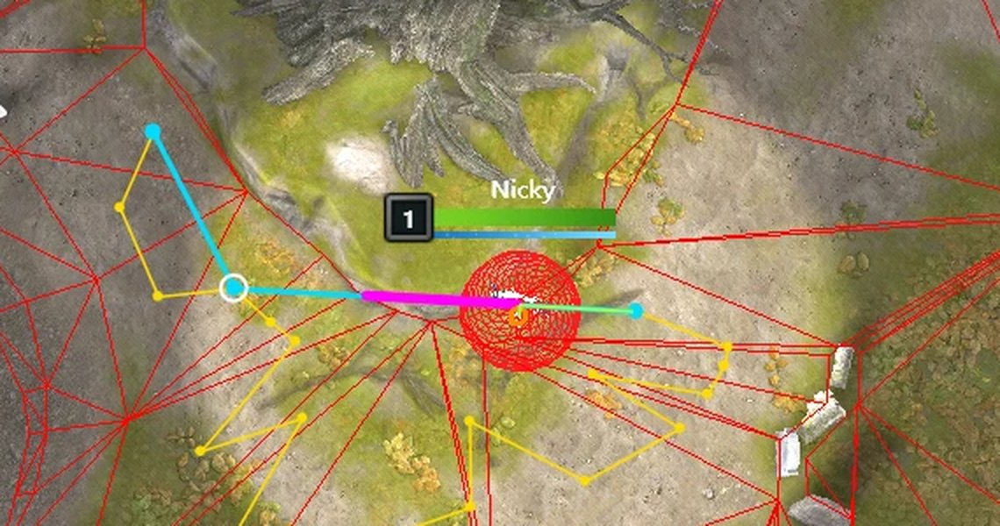 |

**💡 해결 과정**

1. **시도 : 같은 규칙, 판정만 엄격하게**
   - 직선이 **A\* 통로 삼각형 안에만** 있어야 통과 → 끼임 $`\color{#E8352E}\textbf{93쌍 → 0}`$
   - 하지만 후보가 여전히 **삼각형 중심점** → 코너에서 먼 중심점에서 급히 꺾임 (최대 회전 중앙값 $`\color{#E8352E}\textbf{78.6° → 86.1°}`$ 오히려 증가)

| **엄격한 판정의 LOS 경로** |
| :---: |
| 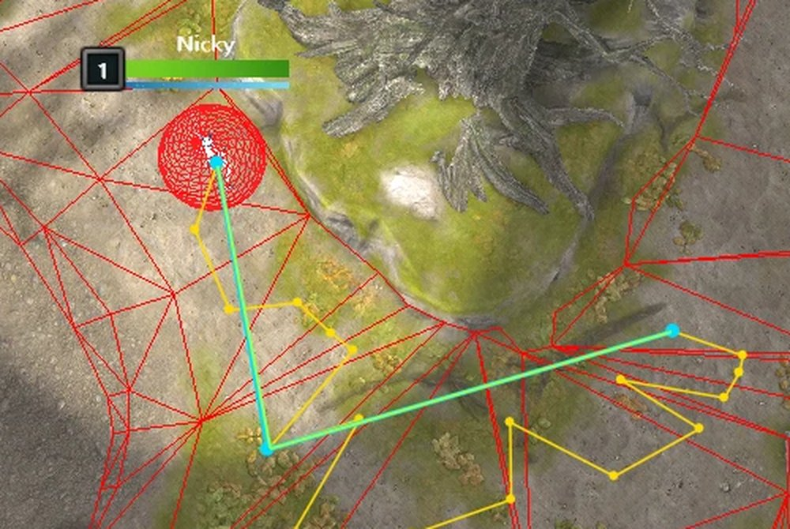 |

2. **왜 Funnel + Bezier인가**
   - **목표** : 최단 경로가 아니라 **자연스러운 이동** → 코너를 가깝게 돌아야 함
   - **한계** : 중심점에는 코너 정보 없음 → 코너를 직접 찾아야 함
   - **Funnel** : A\* 통로에서 꺾이는 벽 꼭짓점 V 탐색 / **Bezier** : V 기준으로 가깝고 둥글게

3. **코너 꼭짓점 V 기준 Bezier 곡선**
   - **① 통로를 R만큼 줄여 Funnel** : 벽 쪽 끝을 R = 1.5r (r = 몸 반경) 축소 → V에서 R 떨어져 꺾임
   - **② 새 점 A** : Funnel 꺾인 점은 버리고 진입 · 진출 방향으로 A 결정
   - **③ A 앞뒤로 곡선** : A 앞뒤 직선 위 d 지점 = 곡선 시작 · 끝 · 곡선 한가운데가 V에서 r이 되도록 d 결정 (A는 당기기만, 지나지 않음)

**✅ 결과 — 끼임 0 · 꺾임 최소 · 벽 여유 최대 (몬스터 이동에도 그대로 적용)**

> 같은 1,000쌍(시작 · 도착) 자동 측정 · 끼임은 합계, 나머지는 **1,000쌍 중앙값** (최대 회전 = 경로 하나에서 가장 크게 꺾인 각도 · 벽 여유 = 경로가 벽에 가장 가까워진 거리, 몸 반경 r = 0.3)

- **코너 끼임** : $`\color{#E8352E}\textbf{93쌍 → 0}`$
- **최대 회전 (중앙값)** : $`\color{#E8352E}\textbf{78.6° → 15.8°}`$
- **벽 여유 (중앙값)** : $`\color{#E8352E}\textbf{0.000 → 0.296}`$ (몸 반경만큼 띄워서 이동)
- **스무딩 1회 (중앙값)** : $`\color{#E8352E}\textbf{16.4ms → 45μs}`$ (약 **360배** 빠름)

| 방식 | 끼임 | 최대 회전 | 벽 여유 ↑ | 스무딩 1회 |
|:---|:---:|:---:|:---:|:---:|
| LOS (후한 판정) | 93쌍 | 78.6° | 0.000 | 16.4ms |
| LOS (엄격한 판정) | 0 | 86.1° | 0.194 | 11μs |
| Funnel | 0 | 37.7° | 0.136 | 13μs |
| **Funnel + Bezier** | $`\color{#E8352E}\textbf{0}`$ | $`\color{#E8352E}\textbf{15.8°}`$ | $`\color{#E8352E}\textbf{0.296}`$ | $`\color{#E8352E}\textbf{45μs}`$ |

| **인게임 : 최종 경로 (Funnel + Bezier)** |
| :---: |
|  |
| 코너를 가깝게 · 둥글게 · 벽에서 몸 반경만큼 띄워서 |

  <a href="#toc-eternal">⬆️ 프로젝트 목차로 돌아가기</a>

 

 

### 3️⃣ Quad Tree 기반 공간 분할 : 마우스 Picking + 충돌 처리 최적화

> **🚨 문제 상황: 객체 1,000개 이상을 매 프레임 전부 검사**
>
> - **비용 구조** : 마우스 Picking $O(N)$ (클릭마다) · 충돌 검사 $O(N^2)$ (매 프레임)
> - **N = 1,000** : 충돌 검사만 프레임마다 약 50만 쌍 — 대부분 화면 밖 · 멀리 떨어진 객체
> - **N이 10배** : Picking ×10 · 충돌 ×100
> - → **한 구조로 둘 다** : 검사할 후보를 줄이는 공간 분할

**💡 해결 과정**

1. **Quad Tree 선택 이유**
   - **화면 좌표(2D)면 충분** : 쿼터뷰 고정 카메라 → 높이 축 불필요 (Octree 대신 Quad Tree)
   - **근접 전투 위주** : 원거리 투사체 · 맵 전체 스킬 없음
   - **개발 자원** : 난이도 · 일정 대비 충분한 효과

2. **후보만 남기는 검사**
   - **Picking** : 마우스 Ray가 지나는 Leaf 노드만 검사 [[📄QuadTree 쿼리]](https://github.com/HyangRim/DirectX11-Engine-Client/blob/d0b9114a5d95640c568cfa5f0bffa8fb9e8c036b/Engine/QuadTree.cpp#L259-L278)
   - **충돌** : 같은 노드끼리 + 경계에 걸친 객체(부모 노드 소속)만 하위 노드와 교차 검사 [[📄QuadTree 충돌 로직]](https://github.com/HyangRim/DirectX11-Engine-Client/blob/d0b9114a5d95640c568cfa5f0bffa8fb9e8c036b/Engine/QuadTree.cpp#L945-L1113)

**✅ 결과**

| 항목 | 전체 검사 | Quad Tree | 변화 |
|---|:---:|:---:|:---:|
| 마우스 Picking | 656μs | $`\color{#E8352E}\textbf{142μs}`$ | **4.6배 단축** |
| 충돌 처리 (객체 1,118개) | 53,922μs | $`\color{#E8352E}\textbf{397μs}`$ | **135.8배 단축** |

| **Picking 최적화 (Ray-Node 검사)** | **결과** |
| :---: | :---: |
|  |  |
| **충돌 처리 최적화 (Node 내부 검사)** | **결과** |
|  |  |

**🤔 남은 한계 → 개선 방향**
- **빌드 비용 역전** : 객체가 많을수록 빌드 > 탐색 · 잦은 할당 / 해제 → 정적 / 동적 트리 분리 · 메모리 풀링
- **화면 밖 충돌 누락** : 화면 밖 로직 정지 → 충돌 무시 → Frustum 영역만 렌더링 검색 · 활성 청크 기반 시뮬레이션

  <a href="#toc-eternal">⬆️ 프로젝트 목차로 돌아가기</a>

 
 

---

 

# 🎮 Brotato 모작

  

### 📌 프로젝트 정보

| 항목 | 내용 |
|:---:|:---:|
| 🎯 **장르** | 탑다운 슈팅, 로그라이크 서바이벌 |
| ⏱️ **개발 기간** | 2025.02 ~ 2025.03 (3주) |
| 👥 **개발 인원** | 2인 (프로그래머로 참여) |
| 🛠️ **개발 환경** | C++, Direct2D, GDI+, Win32 API |
| 🎬 **시연 영상** | [YouTube 바로가기](https://youtu.be/d-VZS1AdvtA?si=zvILKb3qGncavOqS) |
| 💾 **GitHub** | [소스코드](https://github.com/HyangRim/BrotatoClone) |

## 📑 프로젝트 목차

**1. 📖 [게임 개요](#overview-brotato)**

**2. 📌 [학습 목표 및 달성](#goals-brotato)**

**3. 🔨 [주요 개발 기능](#features-brotato)**  
&nbsp;&nbsp; └ [렌더링 시스템](#rendering-system-brotato) 
&nbsp;&nbsp; └ [엔진 아키텍처 (Manager-Scene-Object)](#engine-brotato) 
&nbsp;&nbsp; └ [컴포넌트 기반 객체 설계](#component-brotato) 

**4. 🛠️ [문제 해결 (Troubleshooting)](#troubleshooting-brotato)**  
&nbsp;&nbsp; └ **[Direct2D 하드웨어 가속 전환](#direct2d-optimization)**  
&nbsp;&nbsp;&nbsp;&nbsp;&nbsp;&nbsp;  GPU 하드웨어 가속으로 **대규모 웨이브에서도 평균 150 ~ 250 FPS** (GDI+는 소수 객체에서도 20 ~ 40 FPS)

&nbsp;&nbsp; └ **[타일맵 렌더링 최적화](#tilemap-optimization)**  
&nbsp;&nbsp;&nbsp;&nbsp;&nbsp;&nbsp;  비트맵 베이킹(Baking) 기법으로 **DrawCall 99.9% 감소 (1,296회 → 1회)**

&nbsp;&nbsp; └ **[이벤트 처리 안정성](#event-queue-system)**  
&nbsp;&nbsp;&nbsp;&nbsp;&nbsp;&nbsp;  `unordered_set` 도입으로 **삭제 중복 요청(Double Free)으로 인한 크래시 해결**

  <a href="#table-of-contents">⬆️ 전체 목차로 돌아가기</a>

 

## 📖 게임 개요

**장르** : 탑다운 슈팅 / 로그라이크 서바이벌

Brotato는 감자가 되어 외계 행성에서 밀려오는 수많은 외계인을 물리치는 탑다운 아레나 슈팅 게임입니다. 최대 6개의 무기를 동시에 사용하며, 다양한 아이템과 특성을 조합하여 자신만의 빌드를 구축하고 생존해야 합니다.

**🔄 핵심 루프 (Core Loop)**
1. **웨이브 생존** : 제한 시간 동안 몰려오는 적들로부터 생존
2. **재화 획득** : 적 처치 시 떨어지는 재료 수집
3. **상점/빌드 강화** : 웨이브 종료 후 상점에서 무기 및 아이템 구매
4. **다음 웨이브** : 더 강력해진 적들과 전투

**🎯 개발 초점**
- **수백 개의 몬스터와 투사체**가 난무하는 대규모 난전 상황 구현
- **프레임 방어 및 최적화**를 위한 렌더링 파이프라인 설계

  <a href="#toc-brotato">⬆️ 프로젝트 목차로 돌아가기</a>

 

 

## 📌 학습 목표 및 달성

<table>
  <tr>
    <th width="33%">1. 계층적 엔진 아키텍처</th>
    <th width="33%">2. 렌더링 시스템 이해</th>
    <th width="33%">3. 성능 중심 개발</th>
  </tr>
  <tr>
    <td valign="top">

- Manager – Scene – Object 3계층
- 싱글톤 매니저 · 이벤트 버스

</td>
    <td valign="top">

- GDI+ → Direct2D 하드웨어 가속
- 게임 루프 · 렌더링 동기화

</td>
    <td valign="top">

- 병목 지점 식별
- 타일맵 오프스크린 베이킹

</td>
  </tr>
  <tr>
    <td align="center">

Double Free 크래시 $`\color{#E8352E}\textbf{→ 0}`$

</td>
    <td align="center">

대규모 웨이브 $`\color{#E8352E}\textbf{150} \sim \textbf{250 FPS}`$

</td>
    <td align="center">

DrawCall $`\color{#E8352E}\textbf{1,296 → 1}`$

</td>
  </tr>
</table>

**🧩 그 외 구현**

<table>
  <tr>
    <th width="50%">SYSTEM ARCHITECTURE</th>
    <th width="50%">GAMEPLAY & GRAPHICS</th>
  </tr>
  <tr>
    <td valign="top">

- **컴포넌트 기반 객체** — 레이어 기반 충돌 처리 (AABB)
- **UI** — 컴포넌트 & 콜백 이벤트 시스템

</td>
    <td valign="top">

- **애니메이션** — Scale-Based Procedural
- **게임 시스템** — 상점 & 캐릭터 선택

</td>
  </tr>
</table>

  <a href="#toc-brotato">⬆️ 프로젝트 목차로 돌아가기</a>

 
 

---

 

## 🔨 주요 개발

<h3>🎨 렌더링 시스템</h3>

 

**Direct2D 기반 렌더링 파이프라인**
- **하드웨어 가속** : GDI+의 CPU 렌더링 방식이 가진 성능 한계를 극복하기 위해, GPU 가속을 지원하는 Direct2D로 렌더링 파이프라인 교체
- **더블 버퍼링 (Double Buffering)** : `ID2D1HwndRenderTarget`이 `BeginDraw` ~ `EndDraw` 사이의 그리기를 백 버퍼에 모은 뒤 `EndDraw`에서 한 번에 화면에 표시
- [[📄Direct2D.h]](https://github.com/HyangRim/BrotatoClone/blob/master/Client/Direct2DMgr.h)

**대규모 리소스 관리 및 최적화**
- **리소스 매니저** : `unordered_map`을 활용한 텍스처(비트맵) 캐싱 시스템을 구축하여 중복 로딩 방지 및 빠른 리소스 접근 지원
- **타일맵 렌더링 최적화 (오프스크린 베이킹)** : 
    - 32x32 타일 1,296개(36x36)를 매 프레임 개별 렌더링하던 방식을 개선
    - 로딩 시 1,296장을 비트맵 한 장으로 미리 합성(Baking) → **DrawCall을 1,296회 → 1회로 감소**
      - [[📄오프스크린 비트맵]](https://github.com/HyangRim/BrotatoClone/blob/7c887b61fc9d09e10d9a9f0866541d067a76d7e2/Client/CScene.cpp#L431-L547)

> **🚀 성능 개선 사례**:
> 1. 대규모 웨이브에서도 평균 150 ~ 250 FPS를 확보한 **[Direct2D 전환기]** 는 하단 **[🛠️ 문제 해결](#direct2d-optimization)**에서 다룹니다.
> 2. 타일맵 드로우 콜을 99.9% 줄인 **[타일맵 베이킹 기법]** 은 하단 **[🛠️ 문제 해결](#tilemap-optimization)**에서 상세히 설명합니다.

  <a href="#toc-brotato">⬆️ 프로젝트 목차로 돌아가기</a>

 

 

<h3>🏗️ 엔진 아키텍처 및 코어 시스템</h3>

 

**Manager-Scene-Object 3계층 구조**
- **싱글톤 매니저** : `CCore`를 중심으로 Time, Key, Camera, Scene 등 10여 개의 핵심 기능을 담당하는 Manager 클래스들을 싱글톤 패턴으로 초기화 및 관리
  - [[📄매니저 초기화]](https://github.com/HyangRim/BrotatoClone/blob/7c887b61fc9d09e10d9a9f0866541d067a76d7e2/Client/CCore.cpp#L88-L100)
- **프레임워크 흐름 제어** : 메인 루프에서 매 프레임 `Progress()`를 호출하여 `Update` → `Render` 순서로 게임 로직과 렌더링을 일괄 처리

**지연 처리(Delayed Processing) 이벤트 시스템**
- **이벤트 큐(Event Queue)** : 객체 생성/삭제, 씬 전환 등의 요청을 즉시 실행하지 않고 큐에 저장하여 프레임 동기화 유지
- **안전한 생명주기 관리** : 모든 로직 업데이트가 끝난 후 이벤트를 일괄 처리하여, 반복문 순회 중 객체 삭제로 인한 `Iterator Invalidated` 에러 방지
  - [[📄이벤트 처리 로직]](https://github.com/HyangRim/BrotatoClone/blob/7c887b61fc9d09e10d9a9f0866541d067a76d7e2/Client/CEventMgr.cpp#L44-L92)

> **🚀 구조적 문제 해결**: 같은 프레임의 중복 삭제 요청으로 생긴 **Double Free 크래시**를 `unordered_set`으로 해결한 과정은 하단 **[🛠️ 문제 해결](#event-queue-system)**에서 자세히 다룹니다.

  <a href="#toc-brotato">⬆️ 프로젝트 목차로 돌아가기</a>

 

 

<h3>🧩 컴포넌트 기반 객체 시스템</h3>

 

**확장성 있는 오브젝트 설계**
- **CObject 추상 클래스** : 모든 게임 객체의 기본이 되는 클래스로, 컴포넌트 컨테이너 역할 수행
- **컴포넌트 패턴** : `Collider`(충돌), `Animator`(애니메이션), `Rigidbody`(물리) 등 기능 단위로 컴포넌트를 분리하여 조합형 객체 설계
  - [[📄Collider.h]](https://github.com/HyangRim/BrotatoClone/blob/master/Client/CCollider.h)
  - [[📄Animator.h]](https://github.com/HyangRim/BrotatoClone/blob/master/Client/CAnimator.h)

**계층적 UI 시스템**
- **UI 컴포넌트화** : `Panel`, `Button`, `Text` 등 UI 요소를 객체화하고, 부모-자식 관계(Parent-Child)를 통해 위치와 렌더링 순서를 계층적으로 관리
- **콜백(Callback) 이벤트** : 버튼 클릭 등의 상호작용을 함수 포인터 기반의 콜백으로 처리하여 로직 결합도 감소

  <a href="#toc-brotato">⬆️ 프로젝트 목차로 돌아가기</a>

 
 

---

 

## 🛠️ 문제 해결

### 1️⃣ Direct2D 하드웨어 가속 전환 : GDI+ → Direct2D

> **🚨 문제 상황: CPU 기반 렌더링의 한계**
> 
> *   **GDI+의 구조적 문제** : 픽셀 연산을 CPU가 전담하는 소프트웨어 렌더링이라 하드웨어 가속을 쓰지 못해, **소수 객체에서도 FPS 20~40**

**💡 해결 과정** [[📄Direct2D 초기화]](https://github.com/HyangRim/BrotatoClone/blob/7c887b61fc9d09e10d9a9f0866541d067a76d7e2/Client/Direct2DMgr.cpp#L15-L59)
- **하드웨어 가속 파이프라인** : CPU 의존적인 GDI+를 버리고, GPU 가속을 활용하는 Direct2D(`ID2D1HwndRenderTarget`)로 엔진 코어 교체
- **프레임 단위 그리기** : 한 프레임을 `BeginDraw` ~ `EndDraw`로 묶어 백 버퍼에 그린 뒤 `EndDraw`에서 한 번에 표시 (`ID2D1HwndRenderTarget` 내장 더블 버퍼링)

**✅ 결과**
- **성능 향상** : 소수 객체에서도 20~40 FPS였던 GDI+와 달리, 수백 개 객체가 등장하는 **대규모 웨이브에서도 평균 150~250 FPS** 유지
- **안정적인 플레이** : 수백 개의 투사체와 몬스터가 난무하는 상황에서도 끊김 없는 부드러운 조작감 확보.

| **대규모 웨이브** | **FPS 변화** |
| :---: | :---: |
|  |  |

  <a href="#toc-brotato">⬆️ 프로젝트 목차로 돌아가기</a>

 

 

### 2️⃣ 타일맵 렌더링 최적화 : DrawCall 병목 해결

> **🚨 문제 상황**
>
> **"매 프레임 1,296회의 그리기 명령으로 인한 CPU 오버헤드 발생"**
>
> - **상황** : 36x36 크기의 타일맵을 구현하기 위해 매 프레임 **1,296번의 `DrawBitmap`** 함수 호출.
> - **위험** : 초기에는 650 FPS로 문제가 없어 보였으나, 몬스터(100마리 이상)와 투사체가 급증하는 후반부 웨이브에서 프레임 드랍이 발생할 잠재적 위험 확인.
> - **기술적 원인 분석** :
>   - **드로우콜 제출 오버헤드 누적** : 1,296번의 렌더링 명령을 개별적으로 처리하면서 CPU가 GPU에 명령을 제출(Submit)하는 과정에 병목 발생.
>   - **GPU 유휴 상태(Idle)** : CPU가 명령을 보내느라 바빠서, 정작 GPU는 명령을 기다리는 대기 시간이 길어짐 (CPU 바운드 현상).

**💡 해결 과정** [[📄타일맵 생성 함수]](https://github.com/HyangRim/BrotatoClone/blob/7c887b61fc9d09e10d9a9f0866541d067a76d7e2/Client/CScene.cpp#L431-L547)

**"오프스크린 렌더링을 통한 베이킹 처리"**
- **오프스크린 타겟 생성** : `ID2D1BitmapRenderTarget`을 사용하여 메모리 상에 거대한 캔버스(1,152x1,152 픽셀)를 생성.
- **프리 렌더링 (Pre-rendering)** : 게임 로딩 시점에 36x36개의 타일(32px)을 순회하며 오프스크린 타겟에 **단 1장의 거대 비트맵** 으로 미리 합성.
  - *테두리 타일은 규칙적으로, 내부 타일은 랜덤하게 배치하여 자연스러운 맵 생성.*
- **런타임 최적화** : 매 프레임 1,296번의 루프를 도는 대신, 합성된 **단일 비트맵만 1회 렌더링** 하도록 변경.

**✅ 결과**
- **CPU 명령 제출 비용 절감** → 후반부 대규모 교전 로직(충돌 처리 등)을 위한 연산 여유 확보

- | 성능 지표 | 최적화 전 (Before) | 최적화 후 (After) | 개선율 |
  | :--- | :---: | :---: | :---: |
  |  **DrawCall** | 1,296 회 | **1 회** | **99.9% 감소** |
  | **FPS (Avg)** | ~650 | **~1,400** | **약 2.15배 증가** |
  | **Frame Time** | 1.54 ms | **0.71 ms** | **약 0.8ms 단축** |
- | **Before (최적화 전)** | **After (최적화 후)** |
  | :---: | :---: |
  |  |  |
  | **DrawCall: 1,296회 / FPS: ~650** | **DrawCall: 1회 / FPS: ~1,400** |

  <a href="#toc-brotato">⬆️ 프로젝트 목차로 돌아가기</a>

 

 

### 3️⃣ 이벤트 처리 안정성 : 중복 삭제로 인한 댕글링 포인터 방지

> **🚨 문제 상황**
>
> **"동일 프레임 내 중복된 삭제 요청으로 인한 Double Free 크래시 발생"**
>
> - **상황** : 안전한 객체 관리를 위해 `DELETE_OBJECT` 이벤트를 즉시 처리하지 않고 `vector` 컨테이너에 담아 지연 처리(Deferred Deletion) 수행.
> - **문제** : 다수의 투사체가 같은 프레임에 같은 대상(플레이어)을 동시에 타격하는 상황에서, **동일한 객체 주소에 대한 삭제 요청**이 큐에 여러 번 중복 등록됨.
> - **결과** : 메모리 해제 시, 이미 해제된 주소를 다시 해제하려는 **Double Free 오류** 및 댕글링 포인터 접근으로 인한 프로그램 강제 종료(Crash) 발생.

**💡 해결 과정** [[📄객체 삭제 이벤트 처리]](https://github.com/HyangRim/BrotatoClone/blob/7c887b61fc9d09e10d9a9f0866541d067a76d7e2/Client/CEventMgr.cpp#L61-L69)

**"이벤트 큐와 실제 삭제 컨테이너의 분리 및 `unordered_set` 도입"**

- **이벤트 처리 파이프라인 분리:**
  - 이벤트 큐(`vector`)는 순차 처리용으로 유지 · **삭제할 객체만 모으는 전용 저장소** 분리

- **중복 제거 로직 적용 (`unordered_set`):**
  - `Execute`에서 삭제 이벤트를 즉시 `delete`하지 않고 **삭제 스케줄러(`unordered_set`)** 에 주소만 삽입
  - **자료구조 선택 이유:**
      - **유일성 보장** : `set`의 특성을 활용해 동일 주소가 여러 번 들어와도 자동으로 1개만 유지.
      - **성능 ( $O(1)$ )** : `std::set` 대신 해시 기반의 `std::unordered_set`을 사용하여 삽입/검색 성능을 $O(1)$ 로 최적화, 정렬 오버헤드 제거.
        
- **지연 삭제 (Lazy Deletion) 수행:** [[📄최종 삭제 로직]](https://github.com/HyangRim/BrotatoClone/blob/7c887b61fc9d09e10d9a9f0866541d067a76d7e2/Client/CEventMgr.cpp#L24-L30)
  - 프레임 로직이 모두 끝난 뒤 `unordered_set`의 고유 주소만 순회하며 1회씩 `delete`

 
**✅ 결과**
| 개선 항목 | 설명 |
| :---: | :---: |
| **안정성 확보** | 동일 프레임 내 수십 개의 삭제 요청이 들어와도 **메모리 해제는 단 1회만 수행됨**을 보장하여 크래시 차단. |
| **성능 유지** | 해시 기반 컨테이너(`unordered_set`) 사용으로 다수의 오브젝트가 상호작용하는 난전 상황에서도 오버헤드 없는 이벤트 처리 구현. |
| **구조 개선** | 삭제 요청(Logic)과 실제 메모리 해제 시점을 명확히 분리하여 코드의 유지보수성 향상. |

  <a href="#toc-brotato">⬆️ 프로젝트 목차로 돌아가기</a>

 
 

---
